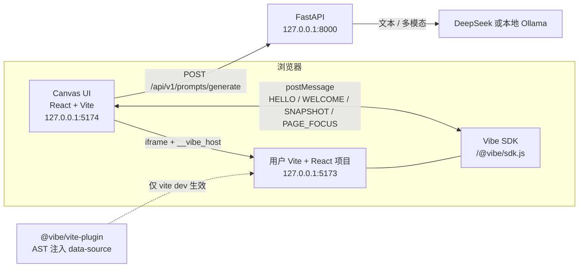

# Vibe Canvas

> 基于视觉与源码 AST 标注的 Vibe Coding 可视化交互辅助外挂。

在真实运行的 Vite + React 页面或截图上直接圈画、旁注、拖拽，把空间操作整理成带 JSX 源码上下文或截图的 Markdown Prompt，交给 Cursor、Claude Code 等编码工具继续执行。

画布不修改用户代码、不生成 Diff、不控制 dev server，也不强制刷新页面。

## 架构



- **Canvas UI**：无限画布、iframe 预览、标注、截图合成、Prompt 工作台。
- **Vite 插件 / SDK**：编译期为 JSX 注入 `data-source`，dev server 提供快照、命中、圈选与 JSX 片段接口。
- **FastAPI**：校验请求、脱敏、拼接上下文，路由到 DeepSeek 或 Ollama，返回 Markdown Prompt。
- 跨域 iframe 的 DOM 不直接读取；所有目标信息都通过精确 Origin 的 `postMessage` 获取。

## 核心功能

| 能力 | 说明 |
|---|---|
| 源码模式 | 3 秒内完成 SDK 握手后，旁注 / 圈画 / 拖拽会定位到带 `data-source` 的 JSX 节点，并附带精简源码片段 |
| 视觉模式 | 未接入 SDK、握手超时或直接选择截图时启用；上传 / 粘贴截图后圈画，不依赖页面 DOM |
| 红圈合图 | 只把红圈包围盒并集外扩 20% 的局部图提交给视觉模型；无红圈时提交全图 |
| 脱敏 | 发送模型前默认替换邮箱、手机号、AK/SK、Authorization、JWT、URL 凭据等为 `[REDACTED]` |
| 本地 Ollama | 支持本地 / 局域网 OpenAI 兼容接口，无需外网；视觉模式需单独配置视觉模型 |
| 焦点隔离 | 点击 iframe 内部进入「浏览中」，点击父页面任意区域立即收回画布焦点与快捷键 |

> 截图内的像素文字无法被正则脱敏；视觉模式会明确提示。不要上传包含明文密码、Token 或生产数据的截图。

## 快速开始

环境要求：

- Python 3.11+（已在 3.14 验证）
- Node.js 20.19+（已在 22 验证）
- npm
- MySQL / Redis / MinIO 可选：当前 MVP 的 Prompt API 不依赖数据库；需要历史或对象存储时复用 `~/Workspace/infra` 下的 Docker 实例，不需要重复部署

### 一键启动

首次安装依赖后，可在项目根目录运行：

```bash
./scripts/dev.sh
```

脚本会在后台同时启动 FastAPI（`127.0.0.1:8000`）和 Canvas（`127.0.0.1:5174`）；
按 `Ctrl+C` 会关闭两个服务。

打开 <http://127.0.0.1:5174>，在入口页选择「加载本地项目」或「使用截图」。

### 1. 启动后端

```bash
cd /path/to/vibe-app
python3 -m venv .venv
source .venv/bin/activate
pip install -r requirements.txt

cp .env.example .env
# 默认 LLM_PROVIDER=mock，无需模型密钥即可跑通接口
.venv/bin/uvicorn app.main:app --host 127.0.0.1 --port 8000 --reload
```

验证：

```bash
curl http://127.0.0.1:8000/api/v1/health
open http://127.0.0.1:8000/docs
```

启用真实模型时修改 `.env`：

```env
# DeepSeek
LLM_PROVIDER=deepseek
DEEPSEEK_API_KEY=sk-...

# 或本地 Ollama（无需 API Key）
LLM_PROVIDER=ollama
OLLAMA_BASE_URL=http://127.0.0.1:11434
OLLAMA_MODEL=qwen2.5:7b
OLLAMA_VISION_MODEL=qwen2.5vl:7b
```

### 2. 启动画布

```bash
cd canvas-ui
npm install
npm run dev
```

打开 <http://127.0.0.1:5174>。

### 3. 接入一个 Vite + React 项目

先在本地构建插件：

```bash
cd vite-plugin-vibe
npm install
npm run build
```

选择一种方式安装到用户项目：

```bash
# 打包后安装
npm pack
npm install -D /absolute/path/to/vibe-vite-plugin-0.1.0.tgz

# 或 npm link
npm link
cd /path/to/your-app
npm link @vibe/vite-plugin
```

```js
// vite.config.js
import react from '@vitejs/plugin-react'
import { defineConfig } from 'vite'
import vibe from '@vibe/vite-plugin'

export default defineConfig({
  // vibe 必须在 react 之前执行；插件自身也声明了 enforce: 'pre'。
  plugins: [vibe(), react()],
})
```

启动用户项目：

```bash
npm run dev -- --host 127.0.0.1 --port 5173
```

在画布入口输入 `http://127.0.0.1:5173`。插件会自动注入 `data-source` 与 `/@vibe/sdk.js`，
无需手写 script 标签，也不影响生产构建。

仓库内的验证项目：

```bash
cd examples/vite-demo
npm install
npm run dev
# http://127.0.0.1:5173
```

## 模型与隐私

```env
# 发送前脱敏，默认开启
REDACT_SENSITIVE=true

# 是否允许加载局域网 / 远程项目，默认关闭
ALLOW_REMOTE_PROJECTS=false
```

- 默认只允许 `localhost`、`127.0.0.1`、`::1` 预览地址，并拦截数据库、Redis、MinIO 等基础设施端口。
- 远程项目开关由后端 `/api/v1/capabilities` 下发，前端不单独配置。
- DeepSeek 会收到脱敏后的文本、JSX 片段与可选截图；Ollama 可将数据保留在本地网络。
- `.env` 不提交到 Git；`.env.example` 只保留占位符。

Ollama 使用前先拉取模型：

```bash
ollama pull qwen2.5:7b
ollama pull qwen2.5vl:7b   # 视觉模式
```

## 目录结构

```text
vibe-app/
├── app/                    # FastAPI：校验、脱敏、模型路由、Prompt 生成
├── canvas-ui/              # React + Vite 画布前端
├── vite-plugin-vibe/       # @vibe/vite-plugin：AST 注入 + 浏览器 SDK
├── examples/vite-demo/     # 可运行的 Vite + React 验证项目
├── scripts/dev.sh          # 一键启动后端与画布
├── tests/                  # pytest 回归测试
├── docs/
│   ├── design/             # 架构 / 模块 / API 设计
│   ├── memory/             # 分阶段实现记录
│   └── prototypes/         # 交互原型
├── .env.example
├── requirements.txt
└── README.md
```

## 开发与验证

```bash
# 后端
.venv/bin/pytest

# 前端
cd canvas-ui
npm run build
npm run lint

# 插件打包
cd ../vite-plugin-vibe
npm run build
npm pack --dry-run
```

更详细的前端操作、远程项目与降级策略见 [`canvas-ui/README.md`](canvas-ui/README.md)；
插件实现与端点见 [`vite-plugin-vibe/README.md`](vite-plugin-vibe/README.md)。

## 已知边界

- 仅支持 Vite + React；Vue / Svelte 尚未适配。
- 跨域 iframe 不能直接截屏，视觉模式必须由用户上传或粘贴截图。
- 组件吞掉未知 props、动态 DOM、第三方组件内部节点可能没有 `data-source`，此时无法生成源码定位标注。
- HMR 后源码行号可能变化；Prompt 指向的是生成时的片段。
- 系统只生成 Markdown Prompt，不自动修改代码，也不声称修改已应用。
