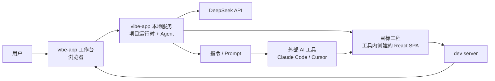
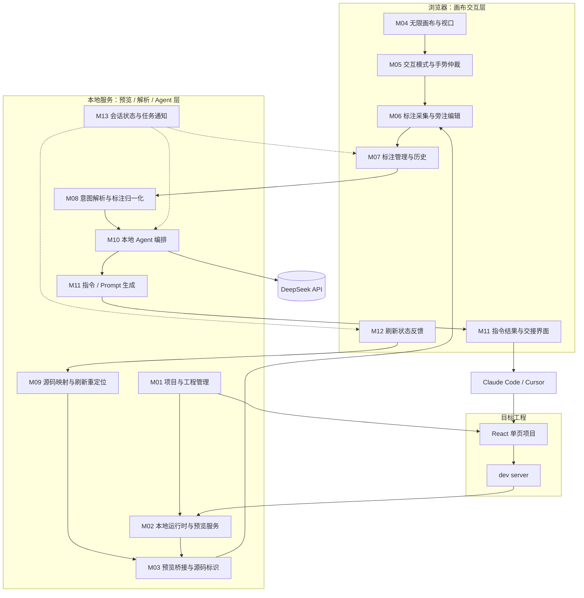
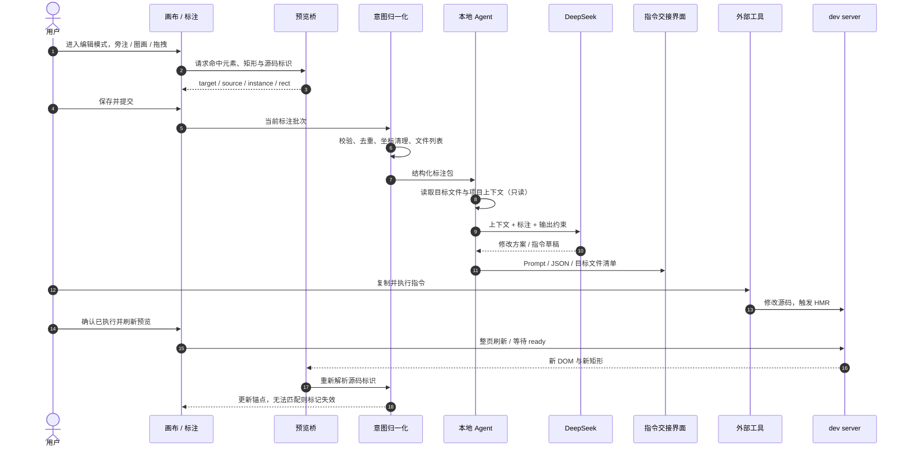
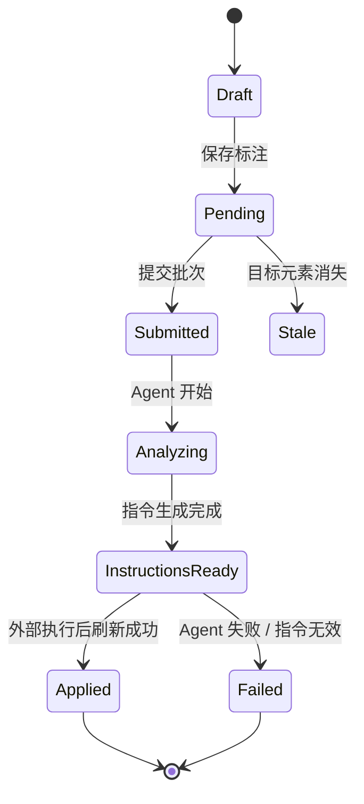

# 01. 功能模块梳理

> 状态：草案，等待负责人审核
> 日期：2026-11-02
> 依据：`docs/memory/00_project_brief.md`、`docs/prototypes/stage-2-canvas.html`、`docs/prototypes/README.md`
> 范围：只梳理功能模块、职责边界与交互关系；不包含数据库设计、API 设计、进程部署方案和业务代码。

## 1. 文档目的

这份文档回答三个问题：

1. 系统由哪些功能模块组成。
2. 每个模块负责什么、不负责什么、依赖谁、产出什么。
3. 原型中的哪些能力已经验证，哪些只是演示，哪些必须在正式设计前先做决策。

本文件不是需求清单的重复，也不是架构图。它位于“交互原型”与“架构/数据库/API 设计”之间，用来锁定功能边界，防止后续把画布、Agent、代码执行混成一个模块。

## 2. 已确认前提与本文工作假设

### 2.1 已确认前提

| 编号 | 决策 |
|---|---|
| U | 首要用户是独立开发者 / AI 编程用户 |
| P1 | 独立 Web 应用 + 本地 Agent，面向用户本地代码 |
| P2 | 系统启动 dev server，同源 iframe + 注入控制脚本 |
| P3 | 独立编辑模式；用户主动保存提交后才触发 Agent；拖拽只采集意图 |
| P4 | 系统生成修改指令 / Prompt，交给 Claude Code、Cursor 等外部工具执行 |
| P5 | MVP 只支持工具内新建的 React 单页项目 |
| P6 | 只支持自有创建的项目，可自由注入源码标记 |
| P7 | AI 完成后整体刷新，3–10 秒可接受 |

### 2.2 本文采用的工作假设

以下内容是为了让模块划分可以落地而采用的临时假设，**不是已确认决策**：

- **A1**：按 P4-B 理解，vibe-app 对目标项目以“读取 + 生成指令”为主，不直接写入业务代码；真正改代码的是外部工具。
- **A2**：MVP 只有一个当前打开的项目、一个预览视口、一个标注批次；不做多项目并行、多人协作。
- **A3**：标注在提交前保存在当前会话中；是否落库、是否跨刷新保留，待确认。
- **A4**：DeepSeek 的输入是项目相关文件内容 + 结构化标注，输出是修改方案或指令文本；具体输出契约待确认。
- **A5**：所有画布标注使用“画布世界坐标 + 源码目标引用”表达，不用屏幕像素直接持久化。

> 其中 A1 与项目简报中的 P1“本地 Agent 读写用户本地代码”、P3“后台 Agent 分析再修改”存在文字冲突。该冲突已列为 Q1，属于阶段三的阻塞问题。

## 3. 系统边界与角色



### 3.1 角色职责

| 角色 | 职责 |
|---|---|
| 用户 | 选择项目、进入编辑模式、标注、提交、把指令交给外部工具、确认刷新 |
| vibe-app 工作台 | 画布、预览、标注采集、清单管理、结果展示 |
| vibe-app 本地服务 | 项目与 dev server 管理、同源预览桥接、归一化、Agent 编排、指令生成、刷新与重定位 |
| DeepSeek | 理解标注与项目上下文，生成修改方案 / 指令 |
| 外部 AI 工具 | 真正修改目标工程代码；MVP 不由 vibe-app 代劳 |
| 目标工程 / dev server | 提供真实可交互预览，并在代码变化后刷新 |

### 3.2 系统“做”与“不做”

| 做 | 不做（按 P4-B 工作假设） |
|---|---|
| 维护项目与预览运行时 | 直接编辑业务源码 |
| 读取目标文件作为 Agent 上下文 | 代替 Claude Code / Cursor 执行修改 |
| 把空间操作归一化为结构化标注 | 承诺 1 秒级实时同步 |
| 调用 DeepSeek 生成方案 / 指令 | 在 MVP 中做多用户、协作、计费 |
| 展示、复制、导出 Prompt | 自动提交 Git、自动部署 |
| 刷新预览并重定位标注 | 理解任意第三方页面或用户已有仓库 |

## 4. 模块总览



### 4.1 模块清单

| 编号 | 模块 | 所属层 | 一句话职责 | MVP 优先级 |
|---|---|---|---|---|
| M01 | 项目与工程管理 | 项目运行时层 | 创建、打开、校验和关闭工具内项目 | 必需，创建方式待定 |
| M02 | 本地运行时与预览服务 | 项目运行时层 | 启动 dev server、保证同源预览、处理生命周期 | 必需 |
| M03 | 预览桥接与源码标识 | 预览桥接层 | 让父页面能安全读取预览 DOM、命中元素、读取源码标识 | 必需 |
| M04 | 无限画布与视口 | 画布交互层 | 平移、缩放、适应画布、屏幕与世界坐标换算 | 必需 |
| M05 | 交互模式与手势仲裁 | 画布交互层 | 管理交互 / 抓手 / 旁注 / 圈画 / 拖拽五种模式 | 必需 |
| M06 | 标注采集与旁注编辑 | 画布交互层 | 把点击、圈画、拖拽变成待保存标注 | 必需 |
| M07 | 标注管理与历史 | 画布交互层 | 列表、选中、删除、撤销、清空、状态展示 | 必需 |
| M08 | 意图解析与标注归一化 | 意图解析层 | 校验并打包标注，形成稳定的提交批次 | 必需 |
| M09 | 源码映射与刷新重定位 | 预览桥接层 | 把标注绑定到源码位置，刷新后重新锚定或标记失效 | 必需 |
| M10 | 本地 Agent 编排 | 本地 Agent 层 | 读取项目上下文、调用 DeepSeek、生成修改方案 | 必需 |
| M11 | 指令 / Prompt 生成与外部交接 | 指令输出层 | 把方案变成可交给外部工具的指令、Prompt 或 JSON | 必需 |
| M12 | 刷新确认与版本反馈 | 闭环层 | 在外部修改后刷新预览、更新版本和标注状态 | 必需 |
| M13 | 会话状态与任务通知 | 支撑层 | 维护当前项目、提交任务、进度、错误、取消与重试 | 必需（基础版） |
| M14 | 配置、安全与可观测性 | 支撑层 | 密钥、路径白名单、日志、错误边界、数据外发提示 | 必需（基础版） |
| M15 | 截图 / 手绘资产存储 | 支撑层 | 保存画布截图或手绘图片，供多模态输入或追溯 | 待确认，非默认 MVP |

### 4.2 关于“指令解析层”和“本地执行 Agent 层”的拆分

这两个词在不同语境下容易被混用，本文做如下拆分：

- **意图解析层**由 M08 承担：只回答“用户标注了什么”，负责校验、坐标清理、去重和结构化打包，不做 UI 语义推断。
- **本地 Agent 层**由 M10 承担：回答“这些标注意味着什么修改”，负责读取项目上下文、调用 DeepSeek、生成修改方案。
- **指令输出层**由 M11 承担：回答“如何把方案交给外部工具”，负责 Prompt / JSON / 文件清单的生成与展示。

之所以拆开，是因为三者的失败方式不同：标注可能无效，模型可能理解错误，指令可能格式不对。如果合成一个“AI 模块”，后续很难定位问题，也无法单独测试。M10 在本文中按 P4-B 定义为“分析 / 指令生成 Agent”，不是“代码执行 Agent”；这一点以 Q1 的最终答案为转移。

## 5. 端到端主流程



### 5.1 模块间的概念数据流

以下只是概念数据，不是 API 契约或数据库模型：

| 从 | 到 | 传递内容 |
|---|---|---|
| M03 | M06 | `TargetRef`：source、component、instance、世界坐标矩形 |
| M06 | M07 | `AnnotationDraft`：类型、目标、笔迹 / 位移、用户意图 |
| M07 | M08 | `AnnotationBatch`：本次提交的全部标注 + 项目 / 视口元信息 |
| M08 | M10 | `AnnotationPackage`：校验后的标注、目标文件集合、约束 |
| M10 | M11 | `ChangePlan` 或 `InstructionDraft`：修改方案、涉及文件、风险点 |
| M11 | 用户 / 外部工具 | `HandoffPayload`：Prompt、JSON、目标文件清单 |
| M12 | M09 | `RefreshEvent`：刷新完成、版本号、预览状态 |
| M09 | M07 | `ReanchorResult`：更新后的目标矩形、失效标记 |

## 6. 核心概念：标注与目标

### 6.1 标注类型

| 类型 | 用户操作 | 必须记录 | 原型是否实现 |
|---|---|---|---|
| 旁注 `note` | 点击元素，输入修改意图 | 目标元素、源码引用、意图文本 | 是 |
| 圈画 `draw` | 按住拖动画圈，松手后补充意图 | 笔迹点、包围盒、覆盖元素集合、意图 | 是 |
| 拖拽 `drag` | 拖动元素到目标位置，松手后补充意图 | 目标元素、起点矩形、终点矩形、位移、意图 | 是；只记录意图，不改真实 DOM |

### 6.2 坐标空间

原型中同时存在三种坐标，正式实现必须保持边界清晰：

| 坐标 | 含义 | 用途 |
|---|---|---|
| 屏幕坐标 | 浏览器视口像素 | 指针事件、浮层定位 |
| 画布世界坐标 | 以画板左上角为原点的逻辑坐标 | 标注持久化、跨缩放渲染 |
| iframe 本地坐标 | 预览文档内部坐标 | `elementFromPoint`、DOM 矩形读取 |

规则：

- 标注落库或提交时只使用画布世界坐标，不保存屏幕坐标。
- iframe 本地坐标换算时必须除以当前缩放比例，并加上 iframe 在画布中的偏移。
- 预览视口尺寸、画板尺寸和缩放比例要随标注批次一起传递，避免刷新后失真。

### 6.3 源码目标引用

原型使用的形式是：

```text
data-source="src/components/StatCard.tsx:15"
data-component="StatCard"
```

同一 `data-source` 可能出现多次，原型用“出现顺序”作为实例序号。正式方案必须解决：

- 行号变化后 `:15` 是否还可靠；
- 同一组件的多个实例如何稳定区分；
- 嵌套元素、列表虚拟化、React Portal 是否需要支持；
- 源码标记由构建插件、运行时包装还是脚手架模板注入。

该问题属于 Q4，直接决定 M03 与 M09 的实现难度。

### 6.4 标注状态（建议，待确认）

原型只实现了 `pending`、`applied`、`stale`。为了覆盖正式流程，建议在设计中明确以下状态，但**本文件不据此设计数据库**：



需要确认的点：

- 一次提交是“当前所有待提交标注”，还是“用户勾选的标注”；
- 已应用标注是否继续保留、能否再次提交；
- 部分成功是否允许；
- 撤销是单条标注、单次提交，还是整个会话。

## 7. 模块详述

### M01 项目与工程管理

**职责**

- 创建工具内 React 单页项目：项目名、目录、模板、依赖、初始页面。
- 打开 / 关闭当前项目，维护项目元信息：框架、路径、视口尺寸、当前版本。
- 校验项目是否由本工具创建，确保满足 P6 的源码标记前提。
- 为 M02 提供启动 dev server 所需的项目信息。

**输入 / 输出**

- 输入：用户创建或打开项目的操作、模板参数。
- 输出：项目上下文（项目 ID、根路径、框架、视口、版本、标记方案）。

**原型覆盖**

- 只有顶部静态项目标识 `vibe-demo / React` 和 `v1/v2` 版本号。
- 没有真实创建、打开、目录选择和项目校验。

**边界与待确认**

- MVP 是“从零创建”还是“打开工具内已有项目”？
- 项目模板是否固定为 React + Tailwind？是否允许用户改配置？
- 项目目录、依赖安装、端口选择由谁决定？
- 是否需要项目列表 / 最近项目？当前按 A2 假设不做多项目并行。

### M02 本地运行时与预览服务

**职责**

- 管理目标项目的 dev server 生命周期：启动、健康检查、端口分配、日志、重启、停止。
- 提供同源预览入口，使父页面能够访问 iframe DOM。
- 在外部工具修改代码后，配合 M12 完成整页刷新或等待 HMR 完成。
- 处理运行时异常：端口占用、启动失败、依赖缺失、构建错误、预览空白。

**输入 / 输出**

- 输入：M01 的项目上下文、刷新指令。
- 输出：可加载的预览地址、运行状态、错误信息、刷新完成信号。

**原型覆盖**

- 使用 `srcdoc` 加载纯 HTML mock，没有真实 dev server、端口、进程或 HMR。

**边界与待确认**

- “同源”如何实现：反向代理到应用同源、dev server 中间件、还是由同一个服务同时提供工作台和预览？
- 是否由 vibe-app 负责 `npm install` / 依赖管理？
- dev server 崩溃后是否自动重启？日志展示到哪里？
- 预览尺寸固定 1200×772，还是支持响应式 / 多设备画板？

### M03 预览桥接与源码标识

**职责**

- 管理预览 iframe 的加载、就绪、销毁与重新加载。
- 在编辑模式下拦截预览交互，在交互模式下放行预览交互。
- 提供元素命中、DOM 矩形读取、源码标识读取。
- 将预览内的滚轮、键盘快捷键等事件安全转发给工作台。
- 约束父页面访问范围，避免把任意页面都当成可控预览。

**输入 / 输出**

- 输入：预览地址、当前模式、指针事件。
- 输出：`TargetRef`（源码、组件、实例、矩形）、预览就绪状态、预览错误。

**原型覆盖**

- 同源 `srcdoc`；直接使用 `contentDocument`。
- `elementFromPoint` 命中元素，`closest("[data-source]")` 读取目标。
- 注入 `data-source` / `data-component`，用出现顺序计算实例序号。
- 转发滚轮、Escape、Delete、模式快捷键。

**边界与待确认**

- 正式环境是否允许直接访问 `contentDocument`，还是需要注入 bridge 脚本通过消息通信？
- 源码标记的稳定标识方案（Q4）。
- 预览内输入框、链接、按钮在编辑模式下是否统一拦截？
- 跨域预览是否明确不支持？按 P2 应要求同源。

### M04 无限画布与视口

**职责**

- 维护画布平移、缩放、适应画布、100% 复位。
- 维护世界坐标与屏幕坐标转换，保证标注在缩放后仍然贴合元素。
- 提供画板、点阵背景、缩放范围限制和缩放锚点。
- 为标注渲染、浮层定位、元素命中提供统一坐标基准。

**输入 / 输出**

- 输入：指针 / 滚轮事件、画板尺寸、目标缩放。
- 输出：当前 pan / zoom、世界坐标、屏幕坐标、画板可见区域。

**原型覆盖**

- 平移、滚轮平移、Ctrl/⌘ + 滚轮缩放、适应画布、复位、缩放范围 25%–250%。
- 标注浮针反向缩放，保持屏幕尺寸稳定。
- 原生触摸双指缩放未实现。

**边界与待确认**

- MVP 是否只支持单个画板？
- 是否需要多设备画板（桌面 / 平板 / 手机）并排？
- 触摸板、触屏、双指手势是否在 MVP 范围？

### M05 交互模式与手势仲裁

**职责**

- 管理五种模式：交互、抓手、旁注、圈画、拖拽。
- 决定一次指针事件属于预览交互、画布平移、旁注、圈画还是拖拽。
- 管理快捷键、空格临时平移、指针捕获、模式切换时的草稿处理。
- 保证编辑模式下不会误触预览中的按钮或链接。

**输入 / 输出**

- 输入：模式切换、键盘、指针事件、当前是否有草稿。
- 输出：模式状态、手势状态、被拦截或放行的预览事件。

**原型覆盖**

- 已实现五种模式、快捷键 `V/H/N/P/D`、空格平移、指针捕获。
- 编辑模式下由透明捕获层拦截预览交互；交互模式下放行。
- Agent 运行期间禁止修改标注。

**边界与待确认**

- 模式切换时已有草稿是自动保存、取消还是弹窗确认？
- 是否需要“选择 / 移动已有标注”模式？
- 触屏长按、双指、手写笔支持是否在 MVP 范围？

### M06 标注采集与旁注编辑

**职责**

- 把旁注、圈画、拖拽操作转换为待保存的标注草稿。
- 显示旁注编辑框，收集用户意图，校验必填项。
- 旁注：绑定具体元素；圈画：记录笔迹、包围盒、覆盖元素；拖拽：记录起点、终点、位移。
- 保证拖拽只表达意图，不直接修改真实 DOM。

**输入 / 输出**

- 输入：指针事件、命中目标、用户文本。
- 输出：`AnnotationDraft` 或取消状态。

**原型覆盖**

- 完整实现三种采集方式。
- 旁注意图必填；圈画 / 拖拽意图可选，未填写时生成默认意图。
- 圈画目标使用包围盒相交；拖拽使用 ghost + 箭头。
- 草稿保存前提交会被阻止。

**边界与待确认**

- 圈画和拖拽的意图是否也应该必填？默认意图是否足够让 DeepSeek 准确修改？
- 圈画应使用“笔迹穿过元素”还是“包围盒相交”作为命中规则？嵌套父容器是否要排除？
- 一个圈画覆盖多个元素时，是一组整体修改，还是拆成多条独立指令？
- 保存后是否允许再次编辑标注文本或位置？

### M07 标注管理与历史

**职责**

- 维护当前会话的标注集合、编号、选中状态和状态标签。
- 提供清单展示、点选定位、单条删除、撤销上一步、二次确认清空。
- 在刷新后展示“已应用 / 元素失效”等状态。
- 为提交提供当前批次快照。

**输入 / 输出**

- 输入：M06 的草稿、用户管理操作、M09 的重定位结果。
- 输出：标注列表、当前选中项、提交批次、状态变更。

**原型覆盖**

- 列表、编号、选中居中、删除、撤销最后一条、二次确认清空。
- 全部在内存中，刷新页面即丢失。
- 没有编辑、重做、历史版本、批量选择。

**边界与待确认**

- 标注是否需要在提交前持久化？是否需要跨页面刷新保留？
- 撤销粒度是单条、单次提交还是整个会话（对应简报 R9）？
- 已应用标注是否保留？下一轮修改是新建批次还是继续累加？
- 是否需要“重新绑定到其他元素”的手动修复能力？

### M08 意图解析与标注归一化

**职责**

- 对提交批次做结构校验：目标是否存在、坐标是否有效、意图是否为空、重复标注是否合并。
- 清理坐标精度，统一世界坐标、视口尺寸、项目与框架信息。
- 去重目标文件，生成 Agent 可消费的标注包。
- 识别明显的冲突或信息不足，返回用户可理解的提示。

**输入 / 输出**

- 输入：M07 的标注批次、项目上下文。
- 输出：`AnnotationPackage`、校验错误、目标文件集合、需澄清的问题。

**原型覆盖**

- `buildPayload()` 完成坐标取整、目标清理、文件去重、默认意图补全。
- 生成的 JSON 包含项目、框架、视口和三类标注。
- 没有正式校验、冲突检测、用户澄清流程。

**边界与待确认**

- “意图解析”只做结构归一化，还是也要在本地做语义解析（例如把“往左一点”换算成具体 CSS）？
- 语义理解由 DeepSeek 承担，还是需要本地规则先做一层？
- 视口尺寸变化后，旧标注的世界坐标是否仍然有效？是否需要按比例归一化？
- 多元素圈画、同一目标多条冲突标注如何处理？

### M09 源码映射与刷新重定位

**职责**

- 把 `TargetRef` 解析到源码位置，维护文件、组件、实例、行号等映射。
- 在预览刷新后重新查找目标元素，更新矩形；找不到时标记失效。
- 处理外部工具修改代码后行号漂移、组件重命名、元素被删除等情况。
- 为 M03 的命中结果和 M07 的状态展示提供一致的目标身份。

**输入 / 输出**

- 输入：`TargetRef`、刷新后的预览 DOM、源码标记。
- 输出：更新后的 `TargetRef`、失效标记、无法重定位的原因。

**原型覆盖**

- 通过 `data-source` + 实例序号重新查找目标，并更新其世界坐标矩形。
- 目标消失后标记“元素失效”，但不会自动迁移。
- `data-source` 中的行号是手写常量，刷新后不会自动更新。

**边界与待确认**

- 源码标记如何注入（构建插件 / 运行时包装 / 模板）？
- 目标身份用什么作为稳定主键：文件 + 组件 + 稳定的实例 key，还是行号？
- 元素被外部工具重命名或移动后，是否要尝试模糊匹配？
- 列表虚拟化、Portal、条件渲染导致元素暂时不存在时，如何处理？

### M10 本地 Agent 编排

**职责**

- 接收归一化后的标注包，创建一次分析任务。
- 读取目标项目上下文：目标文件、相关组件、样式 / 配置、必要的依赖信息。
- 组装 DeepSeek 输入，调用模型，校验模型输出，必要时重试或要求澄清。
- 向工作台推送任务进度、错误和最终方案。
- 按 P4-B，不直接写入目标工程代码；只产出修改方案 / 指令草稿。

**输入 / 输出**

- 输入：`AnnotationPackage`、项目上下文、模型配置。
- 输出：`ChangePlan` / `InstructionDraft`、目标文件、风险点、错误或澄清问题。

**原型覆盖**

- 4 步流程完全是定时模拟：上传标注、解析目标、DeepSeek 生成方案、生成外部工具指令。
- 没有真实读取文件、没有调用 DeepSeek、没有输出校验。

**边界与待确认**

- **Q1 阻塞**：本地 Agent 是只读分析，还是也会直接改代码？
- DeepSeek 的输出是“修改方案 + 指令”，还是直接输出 unified diff，还是只输出 Prompt？
- Agent 读取上下文的范围：只读被标注文件，还是整个组件目录 / 项目配置？
- 是否需要流式输出、取消、超时、重试、并发限制？
- 模型输出不合法时，是本地修复、重试，还是要求用户补充标注？

### M11 指令 / Prompt 生成与外部工具交接

**职责**

- 把 `ChangePlan` 渲染成外部工具可执行的 Prompt / 指令 / JSON。
- 明确目标文件、修改约束、输出格式、禁止事项和需要澄清的问题。
- 展示结果，支持复制、导出，必要时提供跳转到外部工具的入口。
- 记录“已生成 / 已复制”等交接状态；不假装知道外部工具是否执行成功。

**输入 / 输出**

- 输入：`ChangePlan`、标注包、项目约束。
- 输出：`HandoffPayload`（Prompt、JSON、文件清单）、交接状态。

**原型覆盖**

- `buildPrompt()` 生成中文指令，包含项目约束、目标文件、用户标注和结构化 JSON。
- 结果弹窗支持 Prompt / JSON 切换与复制。
- “模拟执行并刷新”只是演示按钮，不执行 Prompt。

**边界与待确认**

- 外部工具需要的到底是 Prompt、unified diff，还是结构化的修改计划？
- 是复制粘贴，还是调用外部工具 CLI / IDE 插件？MVP 是否只做复制？
- Prompt 中是否包含完整文件内容？如何控制 token 和敏感信息？
- 是否需要生成多文件 diff，还是只允许单文件修改？

### M12 刷新确认与版本反馈

**职责**

- 在外部工具修改代码后，触发或等待预览刷新。
- 等待 dev server / 预览就绪，更新版本号，重新锚定标注。
- 展示刷新成功、构建失败、预览空白、超时等状态。
- 把“已应用”限定为“刷新成功 + 重定位成功”，不把“已复制 Prompt”当成已应用。

**输入 / 输出**

- 输入：外部执行完成信号、dev server 状态、刷新事件。
- 输出：新版本、预览状态、标注状态、错误信息。

**原型覆盖**

- “模拟执行并刷新”做固定 DOM 变更，1.3 秒遮罩，版本 `v1 → v2`，标注全部标记已应用。
- 没有真实文件监听、构建等待、失败处理。

**边界与待确认**

- 刷新由用户手动确认，还是监听文件变化自动触发？
- 如何判断外部工具已经执行完，而不是只保存了文件？
- 构建失败时，保留旧预览还是显示错误页？标注状态如何回退？
- 是否需要截图对比 / 像素差异来验证修改效果（对应 R4）？

### M13 会话状态与任务通知

**职责**

- 维护当前项目、当前批次、提交任务、Agent 进度、结果、错误和取消状态。
- 防止重复提交、分析期间修改标注、并发任务互相覆盖。
- 提供全局 toast、进度弹窗、错误提示和“查看上次结果”。
- 为多标签页 / 页面刷新后的状态恢复预留边界（是否实现待定）。

**输入 / 输出**

- 输入：各模块状态变更、用户操作。
- 输出：统一的任务状态、UI 通知、可恢复的会话快照。

**原型覆盖**

- 有 `submitting` / `processing` 状态、进度弹窗、toast、上次结果。
- 没有取消、重试、任务队列、多标签页处理。

**边界与待确认**

- Agent 任务能否取消？
- 同一项目是否允许同时存在多个提交任务？
- 页面刷新或关闭后，未提交标注和进行中的任务如何处理？

### M14 配置、安全与可观测性

**职责**

- 管理 DeepSeek API Key、项目根路径、模型参数、超时和日志级别。
- 限制 Agent 只能读取允许的项目目录，阻止路径穿越和任意文件读取。
- 明确哪些代码和标注会发送给 DeepSeek，避免密钥、`.env`、凭据外泄。
- 记录任务 ID、目标文件、模型调用、耗时和错误，便于复现。
- 本地服务默认只绑定 `127.0.0.1`，避免局域网暴露。

**输入 / 输出**

- 输入：`.env`、项目配置、任务日志。
- 输出：安全的运行配置、审计日志、错误信息。

**原型覆盖**

- 没有真实配置、密钥、文件访问或日志。

**边界与待确认**

- DeepSeek Key 存在本地 `.env` 还是由工作台输入？
- Agent 读取项目时是否排除 `.env`、`node_modules`、构建产物？
- 用户标注文本可能包含提示注入，是否需要隔离 / 转义 / 约束？
- 日志保留多久？是否记录完整代码内容？

### M15 截图 / 手绘资产存储（待确认）

**职责（若确认需要）**

- 保存画布截图、手绘笔迹图片或用户上传的参考图。
- 为多模态模型提供图片输入；为结果追溯提供证据。
- 使用 MinIO 等对象存储保存资产，并在标注中引用。

**原型覆盖**

- 没有截图上传、图片存储或图片输入。

**边界与待确认**

- 对应简报 R2 / R7：提交给 Agent 的内容是否只包含标注 JSON？
- 如果包含截图，是整张画布、选区还是纯笔迹图层？
- DeepSeek 是否需要图片输入？如果需要，是否切换多模态模型？
- MinIO 在本项目中的实际用途是否确定？

## 8. 模块交互中的关键规则

1. **预览只读原则**：编辑模式下，工作台不直接修改预览 DOM；预览的真实变化只能来自目标工程代码变化。
2. **意图与执行分离**：M06 只采集意图，M10 / M11 只生成方案与指令，外部工具负责执行。
3. **坐标单一来源**：标注提交时必须使用世界坐标；屏幕坐标和 iframe 本地坐标只用于交互与渲染。
4. **目标身份优先于位置**：刷新重定位先找源码目标，再用矩形辅助校验；不能只靠坐标匹配。
5. **批次可追溯**：每次提交应能追溯到当时的标注、目标文件、生成指令和预览版本。
6. **失败不伪装成功**：Agent 失败、指令未执行、构建失败、预览空白都必须明确展示，不能把“已生成 Prompt”标成“已应用”。
7. **状态互斥**：分析中禁止修改标注；草稿未保存时禁止提交；刷新中禁止重复提交。

## 9. MVP 范围建议

### 9.1 必需：闭环必需

- M01 项目创建 / 打开的最小版本（具体方式待 Q9）。
- M02 dev server 启停、同源预览、刷新。
- M03 同源 iframe 桥接、元素命中、源码标识读取。
- M04 平移 / 缩放 / 适应画布。
- M05 五种模式与快捷键。
- M06 旁注、圈画、拖拽采集。
- M07 标注列表、删除、撤销、清空。
- M08 标注校验与结构化打包。
- M09 刷新后重定位与失效标记。
- M10 真实 DeepSeek 调用与任务状态。
- M11 Prompt / JSON 展示与复制。
- M12 手动刷新、版本号、成功 / 失败反馈。
- M13 基础进度与错误提示。
- M14 本地密钥、路径白名单、基本日志。

### 9.2 增强：闭环增强

- 标注编辑、重做、历史版本。
- 任务取消、重试、超时。
- 构建 / 类型检查 / lint 结果展示。
- 更精细的圈画命中规则。
- 刷新后的截图对比或视觉差异提示。
- 标注持久化与跨刷新恢复。

### 9.3 暂不纳入 MVP

- 多项目并行、多用户、登录、协作、分享、计费。
- 导入用户已有仓库、Vue、多页面 / 多路由。
- 移动端预览、触屏双指缩放。
- 手绘生成 UI、草图理解、复杂多模态交互。
- 自动提交 Git、自动部署、自动回滚。

## 10. 待确认问题

### 10.1 阻塞阶段三的问题

| 编号 | 问题 | 影响 |
|---|---|---|
| Q1 | **本地 Agent 的边界**：只读分析并生成指令，还是也直接修改代码？对应简报 R1。P1 / P3 与 P4-B 存在文字冲突。 | 决定 M10 是否需要代码编辑、校验、回滚；决定系统边界 |
| Q2 | **DeepSeek 的输出契约**：输出修改方案、Prompt，还是 unified diff？Prompt 由本地模板生成还是由模型生成？ | 决定 M08 / M10 / M11 的分工与结果展示 |
| Q3 | **同源预览的实现方式**：反向代理、dev server 中间件，还是同一服务同时提供工作台和预览？ | 决定 M02 的进程拓扑与 M03 的桥接方式 |
| Q4 | **源码标记方案**：构建插件、运行时包装还是脚手架模板？目标身份用行号还是稳定 ID？对应 R5。 | 决定 M03 / M09 的可行性、重定位精度和工作量 |
| Q5 | **刷新触发方式**：用户手动确认、文件监听还是 HMR 自动触发？如何判断外部工具已经执行完成？ | 决定 M12 的状态机与用户体验 |

### 10.2 影响模块细化的问题

| 编号 | 问题 | 影响 |
|---|---|---|
| Q6 | 提交给 Agent 的“上传”是否只包含标注 JSON，还是也要画布截图 / 手绘图片？对应 R2 / R7。 | M15 是否进入 MVP；是否使用 MinIO；是否需要多模态模型 |
| Q7 | 标注是否需要持久化、跨刷新保留、支持再次编辑？撤销粒度是什么？对应 R9。 | M07 / M13 的状态模型与后续数据库设计 |
| Q8 | 圈画的命中规则：包围盒相交、笔迹穿过，还是两者结合？嵌套父容器如何排除？ | M06 / M08 的目标选择与指令粒度 |
| Q9 | MVP 项目从哪里来：从零创建、模板创建，还是打开工具内已有项目？ | M01 的范围与脚手架工作量 |
| Q10 | 修改范围是否只限样式 / 文案 / 布局，还是也包括交互逻辑、数据请求？对应 R3。 | M10 / M11 的 Prompt 约束与验收方式 |
| Q11 | 修改后是否要做构建、类型检查、lint、截图对比？失败如何处理？对应 R4。 | M12 / M14 的验证与回滚能力 |
| Q12 | Agent 能读取哪些项目文件？是否排除 `.env`、`node_modules`、构建产物？ | M10 / M14 的安全边界与 token 成本 |
| Q13 | 是否需要取消 Agent 任务、重试、并发限制、多标签页恢复？ | M13 的任务状态与交互 |
| Q14 | 是否支持触屏、手写笔、双指缩放？ | M04 / M05 的手势模型 |

### 10.3 需要负责人明确回答的最小集合

如果希望尽快进入下一份设计文档，至少需要先回答：

1. Q1：Agent 是否直接改代码。
2. Q2：DeepSeek 输出什么，Prompt 由谁生成。
3. Q3：同源预览如何实现。
4. Q4：源码标记与稳定身份方案。
5. Q5：外部执行完成后如何触发刷新。

其余问题可以带着假设继续设计，但必须在对应模块文档中标注为“待确认”。

## 11. 与已确认决策的追溯

| 决策 | 对应模块 |
|---|---|
| U 独立开发者 | M01 / M04 / M06 的整体交互取向 |
| P1 独立 Web 应用 + 本地 Agent | M01 / M02 / M10 |
| P2 同源 iframe + 注入脚本 | M02 / M03 |
| P3 独立编辑模式、主动提交、拖拽只采集意图 | M05 / M06 / M08 |
| P4-B 生成指令、外部工具执行 | M10 / M11 / M12；冲突见 Q1 |
| P5 工具内 React 单页项目 | M01 |
| P6 自有项目、可注入源码标记 | M03 / M09；注入方案见 Q4 |
| P7 完成后整体刷新 | M12 |

## 12. 审核检查点

请重点确认：

- 模块拆分是否符合你对系统的理解，是否有遗漏或过度拆分。
- 第 3.2 节的“做 / 不做”边界是否同意，尤其是 P4-B。
- 第 6 节的标注概念与状态是否覆盖了实际工作流。
- 第 9 节的 MVP 范围是否过大或过小。
- 第 10.1 节的五个阻塞问题是否有明确答案。

审核通过后，再进入下一份设计文档；在此之前不开始数据库、API 或代码实现。
