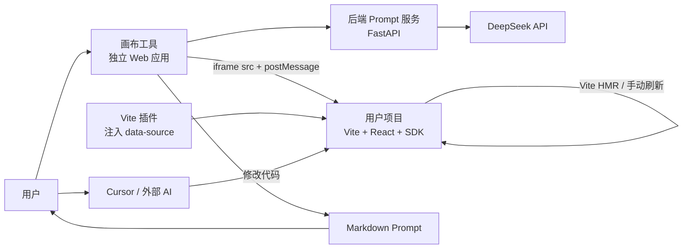
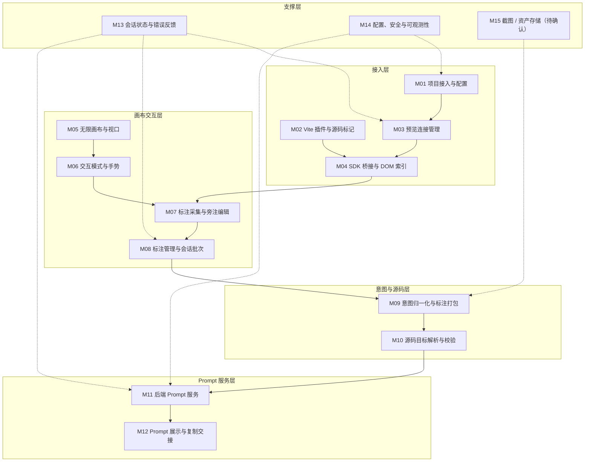
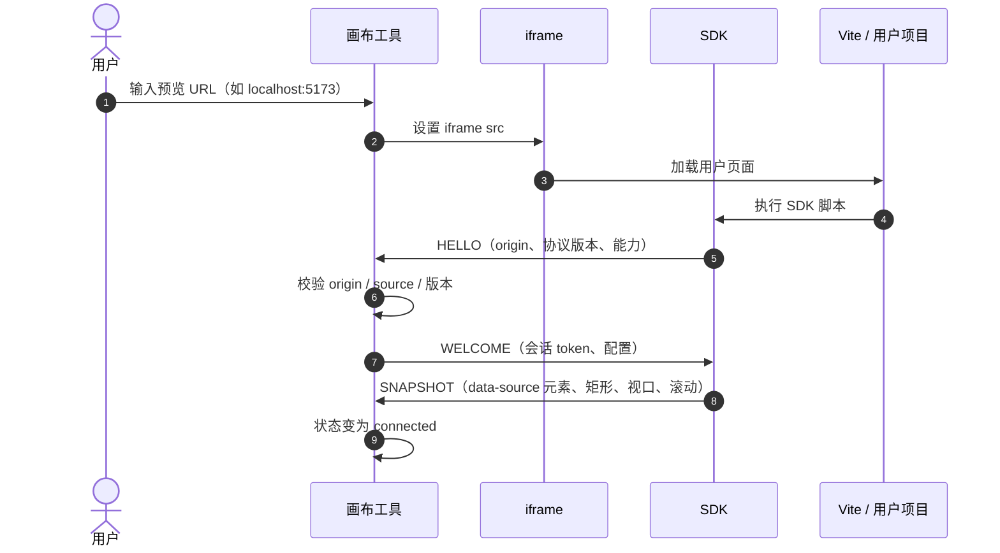
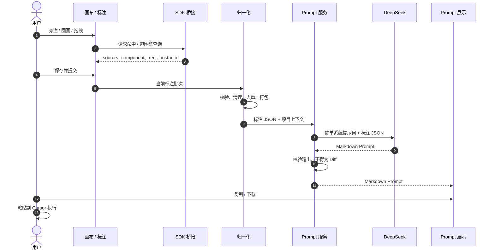
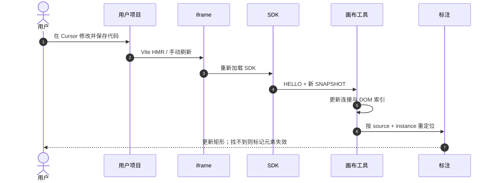

# 01. 功能模块梳理（v2）

> 状态：草案 v2，基于 2026-11-02 的 Q1–Q5 决策重写，等待负责人审核
> 日期：2026-11-02
> 依据：`docs/memory/00_project_brief.md`、`docs/prototypes/stage-2-canvas.html`、Q1–Q5 决策
> 范围：功能模块、职责边界与交互关系；不包含数据库设计、API 细节和业务代码

> **重要说明**：阶段二原型中的 `srcdoc` 同源预览、直接读取 `contentDocument`、模拟执行并刷新，仅用于验证交互模型，**不代表最终架构**。最终架构以本文和 `02.整体架构设计.md` 为准。

## 1. 文档目的

这份文档回答三个问题：

1. 系统由哪些功能模块组成；
2. 每个模块负责什么、不负责什么、依赖谁、产出什么；
3. 哪些能力来自阶段二原型，哪些必须在正式架构中替换。

它位于“交互原型”与“整体架构设计”之间，用来锁定功能边界，防止把画布、SDK 桥接、Prompt 服务和外部代码执行混成一个模块。

## 2. 最终定位与决策

### 2.1 产品定位

> 本系统是 **Vibe Coding 的可视化交互辅助层**：把用户在真实前端界面上的旁注、圈画、拖拽，转成一段极其精准、可直接交给 Cursor 等外部 AI 使用的 Markdown Prompt。

系统不修改代码，不生成 Diff，不编译，不回滚，不控制用户的 dev server，也不介入刷新。

### 2.2 Q1–Q5 最终决策

| 编号 | 决策项 | 最终结论 | 对模块的影响 |
|---|---|---|---|
| Q1 | Agent 边界 | 只读分析并生成指令；本地/后端服务绝对不修改用户代码；不涉及代码修改、回滚和编译 | 取消代码编辑、Diff、构建、回滚模块 |
| Q2 | DeepSeek 输出契约 | 模型最终输出 Markdown 自然语言 Prompt；后端只把标注 JSON 作为 Context，加上简单系统提示词发给模型；不做复杂 Prompt 模板 | 后端是轻量 Prompt 服务，不读取源码 |
| Q3 | 同源预览 | 用户自己启动 Vite 项目；画布工具作为独立 Web 应用，通过跨域 iframe 加载用户 URL；用户项目引入极简 SDK，通过 `postMessage` 传递 DOM 树和坐标 | 新增 SDK 桥接；取消 dev server 管理和直接 DOM 访问 |
| Q4 | 源码标记 | Vite 构建插件在开发环境给 React 组件注入 `data-source="src/components/Button.tsx:12"` | 新增 Vite 插件；Prompt 能直接引用文件与行号 |
| Q5 | 刷新触发 | 用户复制 Prompt 到 Cursor 执行，Cursor 改完代码后由用户保存；Vite HMR 或用户手动刷新 iframe；系统完全不介入刷新逻辑 | 取消“应用 / 刷新确认”模块；只被动接收刷新后的 SDK 快照 |

### 2.3 对原项目简报决策的覆盖关系

Q3 / Q4 将目标项目从“工具内创建”调整为“用户自有 Vite React 项目接入”。这是本轮决策带来的重要变化，需要在项目简报中同步。

| 原决策 | 原内容 | 当前状态 |
|---|---|---|
| P1 | 独立 Web 应用 + 本地 Agent，读写用户本地代码 | 覆盖为：独立 Web 应用 + 后端 Prompt 服务 + 用户项目 SDK；不读源码、不写代码 |
| P2 | 系统启动 dev server，同源 iframe | 覆盖为：用户自己启动 Vite；跨域 iframe + SDK |
| P3 | 独立编辑模式；主动提交；拖拽只采集意图 | 保留 |
| P4 | 生成指令 / Prompt，外部工具执行 | 保留，并进一步明确：只输出 Markdown Prompt，不输出 Diff |
| P5 | 工具内新建的 React 单页项目 | 覆盖为：用户自有 Vite React 项目 |
| P6 | 只支持自有创建的项目，可自由注入源码标记 | 覆盖为：接入 Vite 插件 + SDK 的 React 项目；不再要求工具内创建 |
| P7 | AI 完成后整体刷新，3–10 秒 | 覆盖为：系统不控制刷新；HMR / 用户手动刷新由用户环境完成 |

### 2.4 由决策直接推导的硬约束

- 后端不接收、不读取、不写入用户源码。
- 后端不接收完整 DOM；只接收结构化标注。
- 系统不生成 unified diff，不输出代码补丁。
- 系统不启动、不停止、不重启用户的 dev server。
- 系统不触发 iframe 刷新；只在 iframe 重新加载后被动更新快照。
- 系统不能宣称“修改已应用”，因为无法知道 Cursor 是否执行成功。
- 跨域 iframe 的 DOM 信息只能通过 SDK + `postMessage` 获取。
- 源码路径和行号来自 Vite 插件注入的 `data-source`，不是后端扫描文件得到。

## 3. 系统边界与角色



### 3.1 角色职责

| 角色 | 职责 |
|---|---|
| 用户 | 启动自己的 Vite 项目；在画布上标注；提交；复制 Prompt 到 Cursor；保存代码；让 HMR 或手动刷新生效 |
| 画布工具 | 加载用户 URL、展示 iframe、采集标注、展示与复制 Prompt |
| SDK | 运行在用户页面内；握手、发送 DOM 索引、响应命中查询；不修改页面业务逻辑 |
| Vite 插件 | 开发环境给 React 元素注入源码路径与行号 |
| 后端 Prompt 服务 | 接收标注 JSON，调用 DeepSeek，返回 Markdown Prompt；无状态、无文件访问 |
| DeepSeek | 把标注 JSON 转成对 Cursor 友好的自然语言指令 |
| Cursor | 用户手动执行 Prompt，修改代码；不属于本系统 |
| Vite / HMR | 用户环境自己的刷新机制；本系统不控制 |

### 3.2 系统“做”与“不做”

| 做 | 不做 |
|---|---|
| 加载用户 Vite 页面并建立 SDK 连接 | 启动 / 停止 / 重启用户 dev server |
| 采集旁注、圈画、拖拽 | 直接修改用户 DOM 或源码 |
| 通过 SDK 获取 DOM 结构、坐标、`data-source` | 直接访问跨域 iframe 的 `contentDocument` |
| 把标注归一化为 JSON | 生成 Diff、补丁或直接可执行代码 |
| 调 DeepSeek 生成 Markdown Prompt | 读取用户源码、构建项目、运行测试 |
| 展示、复制、下载 Prompt | 触发 iframe 刷新或判断 Cursor 是否执行成功 |
| 在 iframe 重新加载后更新快照和标注锚点 | 自动提交 Git、部署、回滚 |

## 4. 核心概念

### 4.1 标注类型

| 类型 | 用户操作 | 必须记录 | 备注 |
|---|---|---|---|
| 旁注 `note` | 点击元素，输入修改意图 | 目标元素、`data-source`、意图文本 | 意图必填 |
| 圈画 `draw` | 按住拖动画圈，松手后补充意图 | 笔迹点、包围盒、覆盖元素集合、意图 | 圈画目标由 SDK 快照或查询得到 |
| 拖拽 `drag` | 拖动元素到目标位置 | 目标元素、起点矩形、终点矩形、位移、意图 | 只表达意图，不修改真实 DOM |

### 4.2 坐标空间

| 坐标 | 含义 | 用途 |
|---|---|---|
| 屏幕坐标 | 浏览器视口像素 | 指针事件、浮层定位 |
| 画布世界坐标 | 以画板左上角为原点的逻辑坐标 | 标注存储、跨缩放渲染、提交 |
| iframe 本地坐标 | 用户页面内部的 CSS 像素 | SDK 命中查询、DOM 矩形 |

规则：

- 提交给后端的标注只使用画布世界坐标；屏幕坐标不进入标注 JSON。
- iframe 本地坐标换算时除以当前缩放比例，并加上 iframe 在画布中的偏移。
- SDK 必须同时上报 iframe 视口尺寸、滚动位置和快照版本；否则滚动后矩形会失真。
- 跨域 iframe 不能由父页面直接读取布局，坐标只能由 SDK 提供。

### 4.3 源码目标

Vite 插件注入的形式：

```text
data-source="src/components/Button.tsx:12"
data-component="Button"
```

目标引用的概念字段：

- `source`：相对项目根目录的文件路径 + 行号；
- `component`：组件或元素名，用于 Prompt 可读性；
- `instance`：同一 `source` 在页面中的出现序号；
- `rect`：最近一次快照下的世界坐标矩形。

限制：

- 行号会随代码修改漂移，Prompt 里应说明“以文件内容为准，行号是定位提示”。
- 自定义组件不一定会把 `data-*` 透传到 DOM；插件注入范围和组件转发策略需要在架构中明确。
- 系统不读取文件，因此无法验证 `source` 指向的文件是否真的存在；只能校验格式和当前快照。

### 4.4 Prompt

- 后端输出的是一个 Markdown 文档，不是 Diff。
- Prompt 应包含：目标文件 / 行号、每条标注的意图、空间关系、约束、验收标准。
- Prompt 由 DeepSeek 生成，后端不做复杂模板拼接。
- 系统只负责展示和复制，不解析 Prompt 去执行。
- Prompt 生成后，如果用户又改代码或 HMR 刷新，Prompt 可能过期；系统只能提示，不能自动重写。

### 4.5 连接状态

建议的预览连接状态：

| 状态 | 含义 |
|---|---|
| `idle` | 尚未配置预览 URL |
| `loading` | iframe 正在加载 |
| `handshaking` | 已加载，等待 SDK 握手 |
| `connected` | SDK 已连接，快照可用 |
| `incompatible` | SDK / 协议版本不匹配 |
| `disconnected` | 页面刷新、SDK 断开或心跳超时 |
| `error` | 加载失败、origin 不匹配、iframe 被阻止 |

连接状态属于会话状态，不进入 Prompt 数据。

## 5. 模块总览



### 5.1 模块清单

| 编号 | 模块 | 所属层 | 一句话职责 | MVP |
|---|---|---|---|---|
| M01 | 项目接入与配置 | 接入层 | 配置用户项目名、预览 URL、期望 origin，展示接入状态 | 必需 |
| M02 | Vite 插件与源码标记 | 接入层 | 开发环境给 JSX 元素注入 `data-source` 路径与行号 | 必需 |
| M03 | 预览连接管理 | 接入层 | 管理 iframe 加载、握手、重连、连接状态 | 必需 |
| M04 | SDK 桥接与 DOM 索引 | 接入层 | 跨域通信、DOM 快照、命中查询、滚动/尺寸更新 | 必需 |
| M05 | 无限画布与视口 | 画布交互层 | 平移、缩放、适应画布、世界坐标换算 | 必需 |
| M06 | 交互模式与手势 | 画布交互层 | 交互 / 抓手 / 旁注 / 圈画 / 拖拽五种模式 | 必需 |
| M07 | 标注采集与旁注编辑 | 画布交互层 | 把点击、圈画、拖拽变成待保存标注 | 必需 |
| M08 | 标注管理与会话批次 | 画布交互层 | 列表、选中、删除、撤销、清空、提交批次 | 必需 |
| M09 | 意图归一化与标注打包 | 意图层 | 校验、坐标清理、目标引用、生成标注 JSON | 必需 |
| M10 | 源码目标解析与校验 | 意图层 | 解析 `data-source`，匹配快照，维护失效状态 | 必需 |
| M11 | 后端 Prompt 服务 | Prompt 服务层 | 接收标注 JSON，调 DeepSeek，返回 Markdown Prompt | 必需 |
| M12 | Prompt 展示与复制交接 | Prompt 服务层 | 展示、复制、下载 Prompt；不执行 | 必需 |
| M13 | 会话状态与错误反馈 | 支撑层 | 连接、提交、生成、错误、重试状态 | 必需（基础版） |
| M14 | 配置、安全与可观测性 | 支撑层 | Key、CORS、origin 白名单、日志、数据最小化 | 必需（基础版） |
| M15 | 截图 / 资产存储 | 支撑层 | 保存截图 / 手绘图，供多模态或追溯 | 待确认 |

## 6. 模块详述

### 6.1 接入层

#### M01 项目接入与配置

**职责**

- 接收用户输入：项目名、预览 URL（如 `http://localhost:5173`）、期望 origin。
- 校验 URL 与 origin 格式，保存当前会话的项目配置。
- 展示 SDK 是否加载、协议版本是否兼容、Vite 插件是否已注入标记。
- 为 M03 提供预览地址与 origin 白名单。

**边界**

- 不创建项目、不安装依赖、不启动 dev server、不访问文件系统。
- 不做登录、多用户、项目列表；MVP 只维护当前项目。

**原型对应**

- 顶部静态项目标识和版本号；没有真实 URL / SDK / 插件状态。

#### M02 Vite 插件与源码标记

**职责**

- 作为 Vite 开发插件，在 `serve` 阶段转换 JSX / TSX。
- 给 React 元素注入 `data-source="相对路径:行号"`，必要时注入 `data-component`。
- 保证同一元素只注入一次；开发环境生效，生产构建不注入。
- 在 HMR 后继续提供最新标记。

**边界**

- 不修改业务逻辑、不改变组件 API、不引入运行时依赖。
- 不保证所有自定义组件都会把 `data-*` 透传到 DOM；这是接入风险，不是插件可以完全解决的问题。
- 不读取项目源码发送到后端；插件只在本地构建期工作。

**关键风险**

- 只注入宿主元素（`div`、`button` 等）更稳，但源码定位粒度较粗；注入所有 JSX 元素覆盖更广，但自定义组件可能丢失属性。
- 行号会随格式化 / 编辑漂移，Prompt 需要把行号当“定位提示”，不能当唯一身份。

#### M03 预览连接管理

**职责**

- 维护 iframe 的 `src`、加载状态、错误状态。
- 管理 `idle → loading → handshaking → connected` 生命周期。
- 处理页面刷新 / HMR 导致的重新加载：重新握手、替换快照、通知 M10 重定位。
- 校验消息来源：`event.origin`、`event.source`、会话 token、协议版本。

**边界**

- 不启动 dev server、不控制刷新、不注入业务代码。
- 不直接访问跨域 iframe 的 DOM；所有 DOM 信息来自 M04。

**原型对应**

- 原型使用同源 `srcdoc`，直接访问 `contentDocument`；正式实现必须替换为跨域 iframe + SDK。

#### M04 SDK 桥接与 DOM 索引

**职责**

- 在用户页面内运行 SDK：握手、心跳、版本协商。
- 生成轻量 DOM 索引：所有带 `data-source` 的元素及其 `source`、`component`、实例序号、矩形、深度、可见性。
- 上报视口尺寸、滚动位置、快照版本。
- 响应父页面的命中查询：点命中、包围盒相交。
- 在 DOM 变化、滚动、resize 时更新索引。

**边界**

- 不上报输入框内容、cookie、localStorage、完整文本或完整 HTML。
- 不修改业务 DOM 的结构和样式；只读取和响应查询。
- 不负责画布渲染、标注存储或 Prompt 生成。

**数据最小化原则**

- 默认只发送带 `data-source` 的元素元数据。
- 元素文本、表单值、网络信息不进入快照。
- 如果后续需要更多上下文，必须单独评审隐私影响。

### 6.2 画布交互层

#### M05 无限画布与视口

**职责**

- 平移、缩放、适应画布、100% 复位。
- 维护世界坐标 / 屏幕坐标换算与 iframe 偏移。
- 提供点阵背景、缩放范围、画板边界。
- 为标注渲染和浮层定位提供统一坐标基准。

**边界**

- 不负责模式判断和标注语义。
- 不直接操作 iframe 内部布局。

#### M06 交互模式与手势

**职责**

- 管理交互、抓手、旁注、圈画、拖拽五种模式。
- 决定指针事件是放行给 iframe、平移画布，还是进入标注流程。
- 管理快捷键、空格临时平移、指针捕获、模式切换时的草稿处理。
- 编辑模式下用父页面覆盖层拦截指针；交互模式下放行 iframe。

**边界**

- 不负责标注数据结构和提交。
- 不负责跨域通信，只调用 M04 的命中查询。

#### M07 标注采集与旁注编辑

**职责**

- 把旁注、圈画、拖拽操作转换为草稿。
- 显示旁注编辑框，收集意图文本，校验必填项。
- 旁注绑定目标；圈画记录笔迹 / 包围盒 / 覆盖元素；拖拽记录起点、终点、位移。
- 保证拖拽只表达意图，不修改真实 DOM。

**边界**

- 不持久化、不提交、不调用模型。
- 圈画和拖拽的意图是否必填，仍需产品确认；当前建议至少给出明确默认意图。

#### M08 标注管理与会话批次

**职责**

- 维护当前会话的标注集合、编号、选中状态、状态标签。
- 提供列表、点选定位、单条删除、撤销、清空。
- 维护“本次提交批次”的快照。
- 在 HMR 后接收 M10 的失效 / 重定位结果并更新展示。

**边界**

- MVP 不做数据库持久化，刷新页面丢失；是否落库待确认。
- 状态不包含“已应用”，因为系统无法知道 Cursor 是否执行成功。

### 6.3 意图与源码层

#### M09 意图归一化与标注打包

**职责**

- 校验标注：目标是否存在、意图是否为空、坐标是否有效。
- 清理坐标精度，统一画布世界坐标。
- 补充项目名、预览 origin、视口尺寸、标注类型等上下文。
- 去重目标文件，生成后端可消费的标注 JSON。
- 识别明显冲突或信息不足，返回用户可理解的提示。

**边界**

- 不做语义理解；把“往左一点”变成具体 CSS 的工作交给 DeepSeek。
- 不读取源码，不生成 Prompt 模板。
- 不把完整 DOM 快照发给后端。

#### M10 源码目标解析与校验

**职责**

- 解析 `data-source`：文件路径、行号、组件名。
- 用最近一次 SDK 快照匹配目标，维护实例序号和世界坐标矩形。
- iframe 刷新 / HMR 后，用 source + instance 重新匹配；找不到时标记失效。
- 为 M09 提供稳定的目标引用，为 M12 展示目标文件清单。

**边界**

- 不读文件、不验证文件真实存在、不解析源码 AST。
- 行号漂移时只能标记风险，不能自动修正。
- 元素被重命名或删除后，不做模糊匹配；MVP 只标记失效。

### 6.4 Prompt 服务层

#### M11 后端 Prompt 服务

**职责**

- 接收标注 JSON、项目名、预览 origin 等最小上下文。
- 使用简单系统提示词，把标注 JSON 作为用户消息 / Context 发给 DeepSeek。
- 让模型输出一段 Markdown Prompt，供用户复制给 Cursor。
- 校验模型输出：必须是非空 Markdown；不得是 unified diff / 代码补丁。
- 处理超时、限流、模型错误、输出不合规；返回可展示的错误。
- 记录请求 ID、耗时、token 用量、错误类型；不记录源码。

**边界**

- 不读取用户源码，不访问用户项目目录。
- 不拼接复杂 Prompt 模板，不做 Diff 生成，不执行代码。
- 不保存会话历史（MVP 无数据库）；是否持久化待确认。

**设计要点**

- 系统提示词只做三件事：定义角色、要求输出 Cursor 友好的 Markdown、明确禁止 Diff / 代码补丁。
- 标注 JSON 中包含 `source` 文件路径与行号，Prompt 才能直接告诉 Cursor 去哪里改。
- 由于模型看不到源码，Prompt 必须要求 Cursor 先阅读目标文件，再按意图修改；不能用猜测替代阅读。
- 如果标注信息不足，模型应在 Prompt 中写明假设或待确认点，而不是编造代码细节。

#### M12 Prompt 展示与复制交接

**职责**

- 展示 Markdown Prompt，支持复制、下载 `.md`。
- 展示目标文件清单、标注条数、生成时间、模型信息。
- 明确提示“请复制到 Cursor 执行；本系统不会修改代码”。
- 复制成功后只记录“已复制”，不声称“已应用”。

**边界**

- 不执行 Prompt，不调用 Cursor，不监听 Cursor 是否完成。
- 不触发 iframe 刷新。

### 6.5 支撑层

#### M13 会话状态与错误反馈

**职责**

- 维护当前项目、连接状态、标注批次、Prompt 请求状态。
- 防止重复提交、生成中修改标注、连接断开时提交。
- 展示加载、超时、限流、SDK 未连接、origin 不匹配、输出不合规等错误。
- 支持重试当前 Prompt 生成（不重试代码执行）。

**边界**

- MVP 不做跨标签页同步、历史会话、任务队列。
- 不管理 Cursor 的任务状态。

#### M14 配置、安全与可观测性

**职责**

- 管理 DeepSeek Key、模型、超时、CORS、origin 白名单。
- 限制请求体大小、频率；后端默认只接受已配置 origin。
- 保证 API Key 只在服务端，不进入浏览器。
- 记录脱敏日志：请求 ID、标注数量、目标文件列表、耗时、错误；不记录源码和完整 Prompt 内容。
- 明确告知用户：标注内容和目标文件路径会发送给 DeepSeek。

**边界**

- MVP 不做账号、权限、计费、审计后台。
- 不做 SDK 代码签名 / 供应链校验；版本兼容性靠协议版本号。

#### M15 截图 / 资产存储（待确认）

**职责（若启用）**

- 保存画布截图、手绘笔迹或用户上传的参考图。
- 为 Prompt 服务提供图片输入或为结果追溯提供证据。
- 使用对象存储保存资产，并在标注中引用。

**边界**

- 当前 Q2 只要求标注 JSON，不要求截图；默认不进入 MVP。
- 如果启用，需要单独确认：截图范围、隐私、存储位置、DeepSeek 是否支持图片输入。

## 7. 主流程

### 7.1 连接到用户页面



### 7.2 从标注到 Prompt



### 7.3 HMR 或手动刷新之后



系统在这里只做“被动观察和重定位”，不触发、不控制、不等待刷新。若用户没有刷新，标注保持旧快照；若 HMR 失败，系统只显示连接断开，不负责修复。

## 8. 关键规则

1. **Prompt-only 原则**：系统输出 Prompt，不输出 Diff，不写代码，不执行代码。
2. **跨域边界**：父页面不直接读 iframe DOM；所有 DOM 信息通过 SDK + `postMessage`。
3. **来源校验**：每条消息必须校验 `origin`、`source`、会话 token 和协议版本。
4. **数据最小化**：SDK 只发带 `data-source` 的结构元数据，不发输入值、cookie、完整文本。
5. **源码只读**：后端不接收源码，Prompt 依赖 `data-source` 的路径与行号。
6. **坐标单一来源**：提交只使用画布世界坐标；iframe 本地坐标仅用于 SDK 查询。
7. **刷新不归系统管**：HMR / 手动刷新由用户环境完成；系统只被动更新。
8. **不伪装成功**：只显示“已生成 / 已复制”，不显示“已应用 / 已验证”。
9. **失败可解释**：SDK 未连接、origin 不匹配、输出不合规、模型超时都要有明确提示。
10. **状态互斥**：连接未就绪不能提交；生成中不能修改批次；失效目标不能静默提交。

## 9. MVP 范围

### 9.1 必须

- M01 项目配置：项目名、预览 URL、origin。
- M02 Vite 插件：React / Vite 开发环境注入 `data-source`。
- M03 预览连接：iframe 加载、握手、重连、错误状态。
- M04 SDK：快照、点命中、包围盒查询、滚动 / resize 更新。
- M05 画布：平移、缩放、适应画布。
- M06 模式：交互 / 抓手 / 旁注 / 圈画 / 拖拽。
- M07 标注采集：三种标注 + 旁注编辑。
- M08 标注管理：列表、删除、撤销、清空、提交批次。
- M09 归一化：校验、坐标清理、标注 JSON。
- M10 源码目标：解析 `data-source`、重定位、失效标记。
- M11 后端 Prompt 服务：DeepSeek 调用、Markdown 输出、错误处理。
- M12 Prompt 展示与复制。
- M13 基础会话状态与错误提示。
- M14 基础安全：Key 服务端、origin 白名单、请求限制、脱敏日志。

### 9.2 增强

- Prompt 历史 / 最近结果（会话内）。
- Prompt 下载、目标文件清单复制。
- 标注编辑、重做、批量选择。
- SDK / 插件版本兼容提示与自动诊断。
- 多项目配置切换。
- 连接失败时的降级模式（是否允许无源码目标的标注，待确认）。

### 9.3 暂不纳入

- 数据库持久化、账号、协作、计费。
- 截图 / 手绘图片输入（M15 待确认）。
- 自动调用 Cursor、自动执行 Prompt、自动刷新。
- 代码修改、Diff、构建、lint、测试、回滚。
- Vue、其他构建工具、多页面 / 多路由。
- 移动端、触屏双指缩放。

## 10. 风险与待确认

### 10.1 架构级风险

| 编号 | 风险 | 影响 | 建议 |
|---|---|---|---|
| R1 | Vite 插件无法保证自定义组件透传 `data-*` | 某些组件没有源码目标，Prompt 精度下降 | MVP 先注入宿主元素；对自定义组件做接入文档和诊断 |
| R2 | 跨域 iframe + 本地 HTTP 的混合内容限制 | 如果画布工具部署在 HTTPS，嵌入 `http://localhost` 可能被浏览器阻止 | MVP 画布工具本地 HTTP 运行；部署方案单独确认 |
| R3 | SDK 快照与真实 DOM 不同步 | 标注矩形偏移、命中错误 | 快照版本 + scroll/resize/MutationObserver + 查询兜底 |
| R4 | 后端看不到源码，Prompt 可能泛泛而谈 | Cursor 仍需自己理解代码 | 系统提示词要求 Cursor 先读目标文件；Prompt 必须带文件 / 行号 |
| R5 | 用户标注文本包含提示注入 | 模型输出被污染 | 明确分隔“数据”和“指令”；输出仅展示，不执行 |
| R6 | 没有“已应用”反馈 | 用户不知道 Cursor 是否真的改了 | 产品文案只承诺“生成 / 复制”，不承诺“应用成功” |
| R7 | SDK / 插件 / 画布协议版本漂移 | 连接失败或数据字段不兼容 | 协议版本号 + 兼容性提示 + 最低版本检查 |
| R8 | HMR 后行号漂移 | Prompt 指向旧行 | Prompt 中说明以文件内容为准；重定位只按 source + instance |

### 10.2 仍需确认的问题

| 编号 | 问题 | 当前建议 |
|---|---|---|
| Q6 | 后端部署在本地还是云端？ | 架构保持无状态，两种都可；MVP 先本地 |
| Q7 | SDK 如何分发：手动 `<script>`、npm 包，还是 Vite 插件自动注入？ | 按 Q3 先手动脚本；后续可做 npm / 自动注入 |
| Q8 | Vite 插件注入所有 JSX 元素，还是只注入宿主元素？ | 先只注入宿主元素，降低自定义组件丢属性的风险 |
| Q9 | 是否允许“无源码目标”的标注？ | 建议不允许提交，只允许预览；否则 Prompt 不可定位 |
| Q10 | 标注 / Prompt 是否需要持久化和历史？ | MVP 会话内保留；数据库待后续 |
| Q11 | 是否需要截图 / 手绘图片输入？ | 默认不做；对应 M15 |
| Q12 | 是否需要支持 Vue / 其他构建工具？ | MVP 只做 Vite + React |
| Q13 | 后端是否需要鉴权、限流、配额？ | 如果公网部署必须做；本地可先最小化 |
| Q14 | Prompt 是否允许包含代码片段示例？ | 由系统提示词约束；建议只给修改指令，不给完整补丁 |
| Q15 | SDK 的“DOM 树”范围：完整 DOM，还是只发送带 `data-source` 的最小索引？ | 建议最小索引；完整 DOM 会带来文本 / 表单值泄露风险 |

## 11. 与决策的追溯

| 决策 | 对应模块 |
|---|---|
| Q1 只读、不修改代码 | M11 / M12；全系统边界 |
| Q2 Markdown Prompt、标注 JSON 作为 Context | M09 / M11 / M12 |
| Q3 跨域 iframe + SDK | M01 / M03 / M04 / M14 |
| Q4 Vite 插件 + `data-source` | M02 / M10 |
| Q5 用户手动复制、HMR 自行刷新 | M12 / M13；无刷新模块 |
| P3 编辑模式、拖拽只采集意图 | M06 / M07 |
| U 独立开发者 / AI 编程用户 | M01 / M05 / M07 的交互取向 |

## 12. 审核检查点

请重点确认：

- 第 2.3 节对 P1 / P2 / P5 / P6 / P7 的覆盖是否符合你的预期。
- 第 3.2 节的“做 / 不做”边界是否同意。
- M01–M15 的拆分是否有遗漏或过度拆分。
- SDK 数据最小化范围是否足够。
- 是否接受“系统只显示已生成 / 已复制，不显示已应用”。
- 是否接受 MVP 无数据库、无历史、无截图。
- 第 10.2 节的 Q6–Q15 是否需要现在回答。

审核通过后，进入 `02.整体架构设计.md` 的评审；在架构确认前不开始接口细化和编码。
