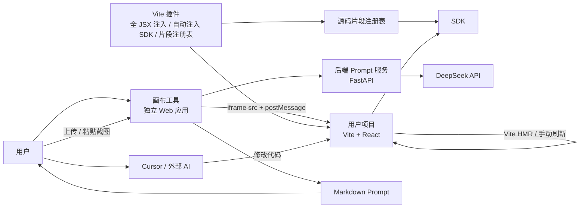
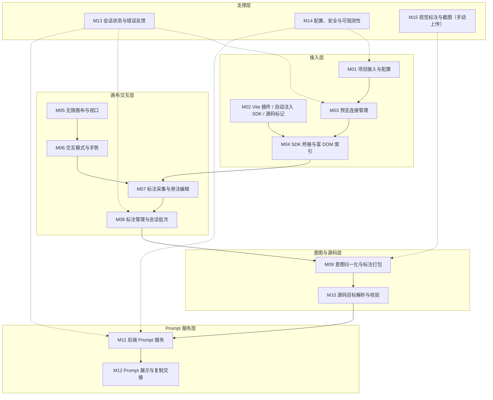
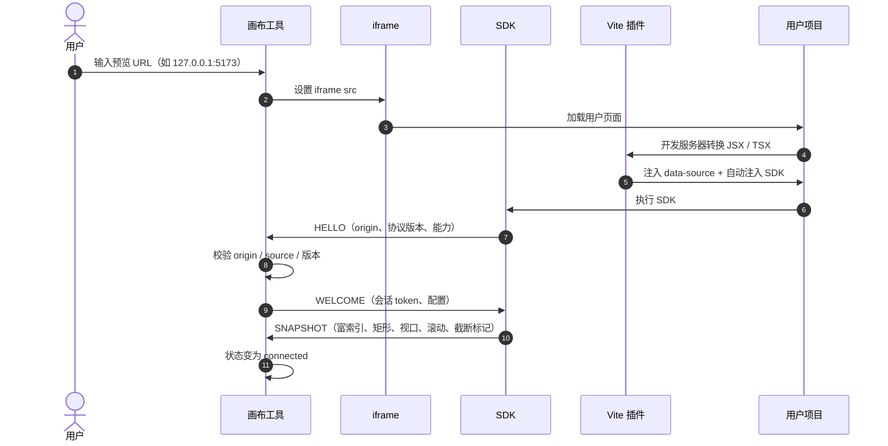
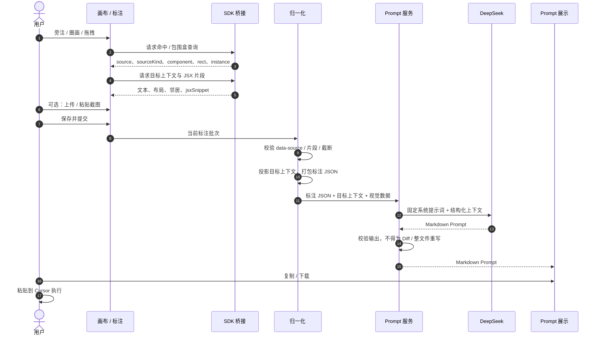
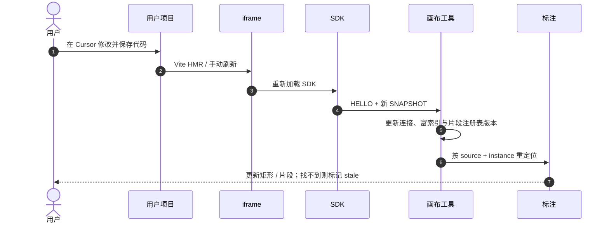

# 01. 功能模块梳理（v3）

> 状态：草案 v3，已同步 Q1–Q18 决策，等待负责人审核
> 日期：2026-11-02
> 依据：`docs/memory/00_project_brief.md`、`docs/prototypes/stage-2-canvas.html`、Q1–Q18 决策、`02.整体架构设计.md`
> 范围：功能模块、职责边界与交互关系；不包含数据库设计、最终 API 字段和业务代码

> **重要说明**：阶段二原型中的 `srcdoc` 同源预览、直接读取 `contentDocument`、模拟执行并刷新，仅用于验证交互模型，**不代表最终架构**。最终架构以本文和 `02.整体架构设计.md` 为准。

## 1. 文档目的

这份文档回答三个问题：

1. 系统由哪些功能模块组成；
2. 每个模块负责什么、不负责什么、依赖谁、产出什么；
3. 哪些能力来自阶段二原型，哪些必须在正式架构中替换。

它位于“交互原型”与“整体架构设计”之间，用来锁定功能边界，防止把画布、SDK 桥接、Prompt 服务和外部代码执行混成一个模块。

## 2. 最终定位与决策

### 2.1 产品定位

> 本系统是 **Vibe Coding 的可视化交互辅助层**：把用户在真实前端界面上的旁注、圈画、拖拽，转成一段极其精准、可直接交给 Cursor 等外部 AI 使用的 Markdown Prompt。

系统不修改代码，不生成 Diff，不编译，不回滚，不控制用户的 dev server，也不介入刷新。

### 2.2 Q1–Q18 最终决策

| 编号 | 决策项 | 最终结论 | 对模块的影响 |
|---|---|---|---|
| Q1 | Agent 边界 | 只读分析并生成指令；本地/后端服务绝对不修改用户代码；不涉及代码修改、回滚和编译 | 取消代码编辑、Diff、构建、回滚模块 |
| Q2 | DeepSeek 输出契约 | 模型最终输出 Markdown 自然语言 Prompt；后端把标注上下文（含选中目标的精简 JSX 片段）加简单系统提示词发给模型；不做复杂业务模板 | 后端是轻量 Prompt 服务，不读取源码文件，只接收选中片段 |
| Q3 | 预览方式 | 用户自己启动 Vite 项目；画布工具通过跨域 iframe 加载用户 URL；SDK 通过 `postMessage` 传递富 DOM 索引与坐标 | 新增 SDK 桥接；取消 dev server 管理和直接 DOM 访问 |
| Q4 | 源码标记 | Vite 插件在开发环境给所有第一方 JSX 节点注入 `data-source="src/components/Button.tsx:12"`，并生成源码片段注册表 | 新增 Vite 插件；Prompt 能直接引用文件、行号与 JSX 片段 |
| Q5 | 刷新触发 | 用户复制 Prompt 到 Cursor 执行，Cursor 改完代码后由用户保存；Vite HMR 或手动刷新 iframe；系统不介入刷新逻辑 | 取消“应用 / 刷新确认”模块；只被动接收刷新后的 SDK 快照 |
| Q6 | 部署形态 | **纯本地化部署**：画布、Prompt 服务、用户 Vite 项目都在本机，只监听回环地址 | 删除云端 / 托管部署模块；CORS 与 origin 按本地配置 |
| Q7 | SDK 分发 | 由 **Vite 插件自动注入 SDK**，用户不手写 `<script>` 标签 | 接入模块增加插件自动注入与诊断；SDK 不单独分发 |
| Q8 | 注入范围 | 所有第一方 JSX 节点（含自定义组件）注入 `data-source`；自定义组件用组件根宿主节点兜底 | M02 覆盖全部第一方 JSX；M04 需要处理 `sourceKind` |
| Q9 | 无标记目标 | **坚决拒绝**生成 Prompt；只有检测到 `data-source` 才能提交 | M09 / M11 双重硬校验；无 source 只允许预览 |
| Q10 | 历史持久化 | MVP **不需要数据库**；最多用 `localStorage` 保存本地操作历史 | M08 / M13 增加本地历史；M11 保持无状态 |
| Q11 | 手绘与截图 | 支持手绘；**不做自动截屏**，用户通过“上传截图 / 粘贴截图”补充 | M15 进入 MVP；M07 记录原始手绘点 |
| Q12 | 框架支持 | MVP **只支持 Vite + React** | 插件只处理 React JSX；Vue 等后续扩展 |
| Q13 | 公网与鉴权 | 纯本地模式不适用公网账号 / 鉴权；未来公网部署单独评审 | MVP 不做账号、权限、计费 |
| Q14 | 代码片段 | Prompt **必须包含选中目标的精简 JSX 片段**；片段由插件注册表按需提供 | M02 / M04 / M11 增加片段链路；后端硬校验片段 |
| Q15 | 快照范围 | 富索引：文本预览、标签、布局白名单、邻居标识；**不是完整 DOM** | M04 生成富索引；M09 只把选中目标投影发给后端 |
| Q16 | SVG 精度 | **保留原始点位，不做平滑降噪**；直接打包原始点坐标 | M07 / M09 / M15 使用原始点数组，不引入平滑算法 |
| Q17 | 截图触发 | 画布工具栏提供 **“上传截图”按钮**；支持上传或粘贴 | M15 增加手动上传入口；不做自动截屏 |
| Q18 | 快照上限 | 最多 **200 个 DOM 节点**，超过则截断并标记 | M04 限制索引数量；M13 展示截断状态 |

### 2.3 对原项目简报决策的覆盖关系

Q3 / Q4 / Q6 / Q7 将目标项目从“工具内创建、系统管理 dev server”调整为“用户自有 Vite React 项目 + 插件自动注入 SDK 的纯本地接入”。

| 原决策 | 原内容 | 当前状态 |
|---|---|---|
| P1 | 独立 Web 应用 + 本地 Agent，读写用户本地代码 | 覆盖为：独立 Web 应用 + 后端 Prompt 服务 + 用户项目 SDK；不读源码文件、不写代码 |
| P2 | 系统启动 dev server，同源 iframe | 覆盖为：用户自己启动 Vite；跨域 iframe + SDK；纯本地部署 |
| P3 | 独立编辑模式；主动提交；拖拽只采集意图 | 保留 |
| P4 | 生成指令 / Prompt，外部工具执行 | 保留，并明确：只输出 Markdown Prompt，不输出 Diff |
| P5 | 工具内新建的 React 单页项目 | 覆盖为：用户自有 Vite React 项目 |
| P6 | 只支持自有创建的项目，可自由注入源码标记 | 覆盖为：接入 Vite 插件 + SDK 的 React 项目；插件自动注入 SDK 与 `data-source` |
| P7 | AI 完成后整体刷新，3–10 秒 | 覆盖为：系统不控制刷新；HMR / 用户手动刷新由用户环境完成 |

### 2.4 由决策直接推导的硬约束

- 后端不读取、不写入用户源码文件；只接收选中目标的精简 JSX 片段、文本预览、布局和邻居标识。
- 后端不接收完整 DOM；富快照只留在浏览器，只有选中目标投影进入请求。
- 没有 `data-source` 的目标不能生成标注，不能提交，不能生成 Prompt；不做模糊降级。
- 系统不生成 unified diff，不输出代码补丁。
- 系统不启动、不停止、不重启用户的 dev server。
- 系统不触发 iframe 刷新；只在 iframe 重新加载后被动更新快照。
- 系统不能宣称“修改已应用”，因为无法知道 Cursor 是否执行成功。
- 跨域 iframe 的 DOM 信息只能通过 SDK + `postMessage` 获取。
- 源码路径、行号、JSX 片段来自 Vite 插件，不是后端扫描文件得到。
- 手绘轨迹保留原始点位，不做平滑降噪；截图只允许用户手动上传或粘贴，不自动截屏。
- MVP 不接数据库；历史最多写 `localStorage`，不做跨设备同步。
- 快照最多 200 个 DOM 节点；超过截断并标记，不静默丢弃。
- MVP 只支持 Vite + React，不支持 Vue 或其他构建工具。

## 3. 系统边界与角色



### 3.1 角色职责

| 角色 | 职责 |
|---|---|
| 用户 | 启动自己的 Vite 项目；在画布上标注；手动上传 / 粘贴截图；提交；复制 Prompt 到 Cursor；保存代码；让 HMR 或手动刷新生效 |
| 画布工具 | 加载用户 URL、展示 iframe、采集标注、上传截图、展示与复制 Prompt |
| SDK | 由 Vite 插件自动注入；握手、发送富 DOM 索引、响应命中与片段查询；不修改页面业务逻辑 |
| Vite 插件 | 开发环境给所有第一方 JSX 注入源码路径与行号；自动注入 SDK；生成源码片段注册表 |
| 后端 Prompt 服务 | 接收选中目标上下文，调用 DeepSeek，返回 Markdown Prompt；无状态、无数据库、无文件访问 |
| DeepSeek | 把标注上下文（含选中 JSX 片段）转成对 Cursor 友好的自然语言指令 |
| Cursor | 用户手动执行 Prompt，修改代码；不属于本系统 |
| Vite / HMR | 用户环境自己的刷新机制；本系统不控制 |

### 3.2 系统“做”与“不做”

| 做 | 不做 |
|---|---|
| 加载用户 Vite 页面并建立 SDK 连接 | 启动 / 停止 / 重启用户 dev server |
| 采集旁注、圈画、拖拽 | 直接修改用户 DOM 或源码 |
| 通过 SDK 获取富 DOM 索引、坐标、`data-source`、文本、布局、邻居 | 直接访问跨域 iframe 的 `contentDocument` |
| 通过工具栏上传 / 粘贴截图 | 自动截取 iframe 像素 |
| 把标注归一化为 JSON，只外发选中目标投影 | 上传完整 DOM、完整源码文件 |
| 调 DeepSeek 生成 Markdown Prompt | 读取用户源码文件、构建项目、运行测试 |
| 展示、复制、下载 Prompt | 触发 iframe 刷新或判断 Cursor 是否执行成功 |
| 在 iframe 重新加载后更新快照和标注锚点 | 自动提交 Git、部署、回滚 |

## 4. 核心概念

### 4.1 标注类型

| 类型 | 用户操作 | 必须记录 | 备注 |
|---|---|---|---|
| 旁注 `note` | 点击元素，输入修改意图 | 目标元素、`data-source`、意图文本 | 意图必填 |
| 圈画 `draw` | 按住拖动画圈，松手后补充意图 | 原始笔迹点（不平滑）、包围盒、覆盖元素集合、意图 | 原始点直接打包；圈画目标由 SDK 快照或查询得到 |
| 拖拽 `drag` | 拖动元素到目标位置 | 目标元素、起点矩形、终点矩形、位移、意图 | 只表达意图，不修改真实 DOM |

### 4.2 坐标空间

| 坐标 | 含义 | 用途 |
|---|---|---|
| 屏幕坐标 | 浏览器视口像素 | 指针事件、浮层定位 |
| 画布世界坐标 | 以画板左上角为原点的逻辑坐标 | 标注存储、跨缩放渲染、提交 |
| iframe 本地坐标 | 用户页面内部的 CSS 像素 | SDK 命中查询、DOM 矩形 |

规则：

- 提交给后端的标注只使用画布世界坐标；屏幕坐标不进入标注 JSON。
- iframe 本地坐标换算时除以当前缩放比例，并加上 iframe 在画布中的偏移。
- SDK 必须同时上报 iframe 视口尺寸、滚动位置和快照版本；否则滚动后矩形会失真。
- 跨域 iframe 不能由父页面直接读取布局，坐标只能由 SDK 提供。

### 4.3 源码目标

Vite 插件注入的形式：

```text
data-source="src/components/Button.tsx:12"
data-component="Button"
data-source-kind="host|component-usage|component-root"
```

目标引用的概念字段：

- `source`：相对项目根目录的文件路径 + 行号（同一行多个 JSX 时追加列号）；
- `sourceKind`：`host` / `component-usage` / `component-root`；
- `component`：组件或元素名，用于 Prompt 可读性；
- `instance`：同一 `source` 在页面中的出现序号；
- `rect`：最近一次快照下的世界坐标矩形；
- `jsxSnippet`：选中目标的精简 JSX 片段，由插件注册表按需返回。

覆盖与限制：

- 所有第一方 JSX 节点都注入；宿主元素直接落 DOM，自定义组件通过属性透传 + 组件根宿主节点兜底。
- 第三方组件、动态 `React.createElement`、运行时 `innerHTML` 若没有任何带 `data-source` 的祖先，视为不可定位，按 Q9 阻断。
- 行号会随代码修改漂移，Prompt 里应说明“以文件内容为准，行号是定位提示”。
- 系统不读取文件，因此无法验证 `source` 指向的文件是否真的存在；只能校验格式和当前快照。

### 4.4 Prompt

- 后端输出的是一个 Markdown 文档，不是 Diff。
- Prompt 应包含：目标文件 / 行号、选中目标的精简 JSX 片段、文本 / 布局 / 邻居上下文、每条标注的意图、空间关系、约束、验收标准。
- Prompt 由 DeepSeek 生成，后端只做固定骨架序列化，不做复杂业务模板拼接。
- 后端不读取完整源码文件；JSX 片段由 Vite 插件注册表提供，随标注请求发送。
- 系统只负责展示和复制，不解析 Prompt 去执行。
- Prompt 生成后，如果用户又改代码或 HMR 刷新，Prompt 可能过期；系统只能提示，不能自动重写。

### 4.5 连接状态

建议的预览连接状态：

| 状态 | 含义 |
|---|---|
| `idle` | 尚未配置预览 URL |
| `loading` | iframe 正在加载 |
| `handshaking` | 已加载，等待 SDK 握手 |
| `connected` | SDK 已连接，快照可用 |
| `incompatible` | SDK / 协议版本不匹配 |
| `disconnected` | 页面刷新、SDK 断开或心跳超时 |
| `error` | 加载失败、origin 不匹配、iframe 被阻止 |

连接状态属于会话状态，不进入 Prompt 数据。

目标状态（用于 Q9 硬校验）：

| 状态 | 含义 | 是否可提交 |
|---|---|---|
| `resolved` | 命中带 `data-source` 的元素，且片段可用 | 是 |
| `unresolved` | 未命中，或没有 `data-source` | 否 |
| `stale` | HMR 后找不到 `source + instance` | 否，需重新标注或重定位 |
| `snippet-missing` | 有 `source`，但片段注册表没有片段 | 否 |

## 5. 模块总览



### 5.1 模块清单

| 编号 | 模块 | 所属层 | 一句话职责 | MVP |
|---|---|---|---|---|
| M01 | 项目接入与配置 | 接入层 | 配置用户项目名、预览 URL、期望 origin，展示接入状态 | 必需 |
| M02 | Vite 插件与源码标记 | 接入层 | 给所有第一方 JSX 注入 `data-source`、自动注入 SDK、生成片段注册表 | 必需 |
| M03 | 预览连接管理 | 接入层 | 管理 iframe 加载、握手、重连、连接状态 | 必需 |
| M04 | SDK 桥接与富 DOM 索引 | 接入层 | 跨域通信、富快照、命中查询、片段查询、200 节点上限 | 必需 |
| M05 | 无限画布与视口 | 画布交互层 | 平移、缩放、适应画布、世界坐标换算 | 必需 |
| M06 | 交互模式与手势 | 画布交互层 | 交互 / 抓手 / 旁注 / 圈画 / 拖拽五种模式 | 必需 |
| M07 | 标注采集与旁注编辑 | 画布交互层 | 把点击、圈画、拖拽变成待保存标注 | 必需 |
| M08 | 标注管理与会话批次 | 画布交互层 | 列表、选中、删除、撤销、清空、提交批次 | 必需 |
| M09 | 意图归一化与标注打包 | 意图层 | 校验、坐标清理、目标引用、生成标注 JSON | 必需 |
| M10 | 源码目标解析与校验 | 意图层 | 解析 `data-source`，匹配快照，维护失效状态 | 必需 |
| M11 | 后端 Prompt 服务 | Prompt 服务层 | 接收选中目标上下文（含 JSX 片段），调 DeepSeek，返回 Markdown Prompt | 必需 |
| M12 | Prompt 展示与复制交接 | Prompt 服务层 | 展示、复制、下载 Prompt；不执行 | 必需 |
| M13 | 会话状态与错误反馈 | 支撑层 | 连接、提交、生成、错误、重试、本地历史状态 | 必需（基础版） |
| M14 | 配置、安全与可观测性 | 支撑层 | Key、CORS、origin 白名单、日志、数据最小化 | 必需（基础版） |
| M15 | 视觉标注与截图 | 支撑层 | 原始手绘点、手动上传 / 粘贴截图、空间摘要；不自动截屏 | 必需 |

## 6. 模块详述

### 6.1 接入层

#### M01 项目接入与配置

**职责**

- 接收用户输入：项目名、预览 URL（推荐 `http://127.0.0.1:5173`）、期望 origin。
- 校验 URL 与 origin 格式，保存当前会话的项目配置。
- 展示 SDK 是否由插件自动注入、协议版本是否兼容、片段注册表是否可用、`data-source` 是否已注入。
- 为 M03 提供预览地址与 origin 白名单；MVP 只支持 Vite + React。

**边界**

- 不创建项目、不安装依赖、不启动 dev server、不访问文件系统。
- 不做登录、多用户、项目列表、云端同步；MVP 只维护当前项目。
- 不做自动截屏；截图入口属于 M15 的手动上传。

**原型对应**

- 顶部静态项目标识和版本号；没有真实 URL / SDK / 插件状态。

#### M02 Vite 插件与源码标记

**职责**

- 作为 Vite 开发插件，在 `serve` 阶段转换 JSX / TSX，只处理第一方源码。
- 给所有 `JSXOpeningElement`（含自定义组件）注入 `data-source="相对路径:行号[:列号]"`、`data-source-kind`，必要时注入 `data-component`。
- 自定义组件采用“属性透传 + 组件根宿主节点兜底”；无法得到 DOM 锚点的节点标记为不可定位。
- 自动注入 SDK，用户不手写 `<script>` 标签；生成源码片段注册表，供 SDK 按需查询。
- 保证同一元素只注入一次；开发环境生效，生产构建不注入。
- 在 HMR 后继续提供最新标记与片段。

**边界**

- 不修改业务逻辑、不改变组件 API、不引入生产运行时依赖。
- 第三方 `node_modules` 默认不注入；动态 `React.createElement`、运行时 `innerHTML` 不在覆盖范围。
- 不读取项目源码发送到后端；插件只在本地构建期工作。
- 不自动截屏，不上传完整源码文件。

**关键风险**

- 自定义组件吞掉未知 props 时，依赖组件根宿主节点 `data-source` 兜底，`source` 可能指向定义处而不是使用处。
- 第三方组件或动态 DOM 没有任何 `data-source` 祖先时，按 Q9 阻断，不做模糊匹配。
- 行号会随格式化 / 编辑漂移，Prompt 需要把行号当“定位提示”，不能当唯一身份。

#### M03 预览连接管理

**职责**

- 维护 iframe 的 `src`、加载状态、错误状态。
- 管理 `idle → loading → handshaking → connected` 生命周期。
- 处理页面刷新 / HMR 导致的重新加载：重新握手、替换快照、通知 M10 重定位。
- 校验消息来源：`event.origin`、`event.source`、会话 token、协议版本。
- 在纯本地部署下按精确 origin 白名单校验，不使用 `*`。

**边界**

- 不启动 dev server、不控制刷新、不注入业务代码；SDK 由 M02 自动注入。
- 不直接访问跨域 iframe 的 DOM；所有 DOM 信息来自 M04。
- 不自动截屏；截图来自 M15 的用户上传 / 粘贴。

**原型对应**

- 原型使用同源 `srcdoc`，直接访问 `contentDocument`；正式实现必须替换为跨域 iframe + SDK。

#### M04 SDK 桥接与 DOM 索引

**职责**

- 在用户页面内运行 SDK：握手、心跳、版本协商。
- 生成富 DOM 索引：所有带 `data-source` 的元素及其 `source`、`sourceKind`、`component`、实例序号、标签、文本预览、矩形、布局白名单、深度、可见性、邻居标识。
- 上报视口尺寸、滚动位置、快照版本；最多索引 200 个节点，超过截断并标记。
- 响应父页面的命中查询：点命中、包围盒相交。
- 按 `source` 返回精简 JSX 片段；片段缺失时明确报错，不伪造。
- 在 DOM 变化、滚动、resize 时更新索引。

**边界**

- 不上报表单值、密码、cookie、localStorage、完整 HTML 或完整源码文件。
- 文本只发可见文本预览（最多 200 字符），不发输入框值。
- 不修改业务 DOM 的结构和样式；只读取和响应查询。
- 不负责画布渲染、标注存储或 Prompt 生成。

**数据最小化原则**

- 富快照只保留在画布工具内存，不整体上传后端。
- 只有被标注的目标投影（文本、布局、邻居、JSX 片段、视觉数据）进入 Prompt 请求。
- 如果后续需要更多上下文，必须单独评审隐私影响。

### 6.2 画布交互层

#### M05 无限画布与视口

**职责**

- 平移、缩放、适应画布、100% 复位。
- 维护世界坐标 / 屏幕坐标换算与 iframe 偏移。
- 提供点阵背景、缩放范围、画板边界。
- 为标注渲染和浮层定位提供统一坐标基准。

**边界**

- 不负责模式判断和标注语义。
- 不直接操作 iframe 内部布局。

#### M06 交互模式与手势

**职责**

- 管理交互、抓手、旁注、圈画、拖拽五种模式。
- 决定指针事件是放行给 iframe、平移画布，还是进入标注流程。
- 管理快捷键、空格临时平移、指针捕获、模式切换时的草稿处理。
- 编辑模式下用父页面覆盖层拦截指针；交互模式下放行 iframe。

**边界**

- 不负责标注数据结构和提交。
- 不负责跨域通信，只调用 M04 的命中查询。

#### M07 标注采集与旁注编辑

**职责**

- 把旁注、圈画、拖拽操作转换为草稿。
- 显示旁注编辑框，收集意图文本，校验必填项。
- 旁注绑定目标；圈画记录**原始点位**（不抽稀、不平滑、不转曲线）、包围盒、覆盖元素；拖拽记录起点、终点、位移。
- 圈画轨迹保持采集顺序，原样打包；只允许在展示时做渲染优化，不改变提交数据。
- 保证拖拽只表达意图，不修改真实 DOM。

**边界**

- 不持久化、不提交、不调用模型。
- 圈画和拖拽的意图是否必填，仍需产品确认；当前建议至少给出明确默认意图。
- 不自动截屏；补充视觉信息由 M15 的手动上传完成。

#### M08 标注管理与会话批次

**职责**

- 维护当前会话的标注集合、编号、选中状态、状态标签。
- 提供列表、点选定位、单条删除、撤销、清空。
- 维护“本次提交批次”的快照。
- 在 HMR 后接收 M10 的失效 / 重定位结果并更新展示。
- 将最近的操作历史写入 `localStorage`（`vibe.history.v1`，上限约 20 条），刷新后可恢复展示。

**边界**

- MVP 不做数据库持久化、不做跨设备 / 跨浏览器同步；`localStorage` 只是本地便利功能。
- 历史记录只在本机可读，可被用户清空；不包含图片二进制，只保存必要标注与 Prompt 摘要。
- 状态不包含“已应用”，因为系统无法知道 Cursor 是否执行成功。

### 6.3 意图与源码层

#### M09 意图归一化与标注打包

**职责**

- 校验标注：目标是否存在、是否解析到 `data-source`、意图是否为空、坐标是否有效。
- 无 `data-source` 的标注直接判定 `SOURCE_REQUIRED`，不允许提交。
- 清理坐标精度，统一画布世界坐标；手绘保留原始点位顺序。
- 补充项目名、预览 origin、视口尺寸、标注类型等上下文。
- 从富快照中投影**目标上下文**：文本预览、标签、布局白名单、精简邻居、实例信息。
- 附加目标元素的精简 JSX 片段；片段缺失时判定 `SNIPPET_REQUIRED`。
- 去重目标文件，生成后端可消费的标注 JSON。
- 识别明显冲突或信息不足，返回用户可理解的提示。

**边界**

- 不做语义理解；把“往左一点”变成具体 CSS 的工作交给 DeepSeek。
- 不读取源码文件，只用 SDK 提供的片段注册表结果。
- 不把完整 DOM 快照发给后端；只发被标注目标的投影。
- 不把完整源码文件或未选中的元素上下文发给后端。

#### M10 源码目标解析与校验

**职责**

- 解析 `data-source`：文件路径、行号、列号、组件名、`sourceKind`（`host` / `component-usage` / `component-root`）。
- 用最近一次 SDK 快照匹配目标，维护实例序号和世界坐标矩形。
- 检查片段注册表是否命中；缺失时标记 `snippet-missing`，并阻止提交。
- iframe 刷新 / HMR 后，用 source + instance 重新匹配；找不到时标记 `stale`。
- 为 M09 提供稳定的目标引用，为 M12 展示目标文件清单。

**边界**

- 不读文件、不验证文件真实存在、不解析源码 AST。
- 找不到 `data-source` 时不猜测、不基于文本 / 位置模糊匹配，直接判 `unresolved`。
- 行号漂移时只能标记风险，不能自动修正。
- 元素被重命名或删除后，不做模糊匹配；MVP 只标记失效。

### 6.4 Prompt 服务层

#### M11 后端 Prompt 服务

**职责**

- 接收标注 JSON、目标上下文（文本预览、标签、布局白名单、邻居、实例）、精简 JSX 片段、视觉标注（原始点位 / 用户上传截图）、项目名、预览 origin。
- 使用固定系统提示词，把上述结构化上下文作为用户消息发给 DeepSeek。
- 让模型输出一段 Markdown Prompt，供用户复制给 Cursor。
- 服务端硬校验：无 `source` 返回 `SOURCE_REQUIRED`；无片段返回 `SNIPPET_REQUIRED`；超限返回 `REQUEST_TOO_LARGE` / `IMAGE_TOO_LARGE`。
- 校验模型输出：必须是非空 Markdown；不得是 unified diff / 代码补丁 / 整文件重写。
- 处理超时、限流、模型错误、输出不合规；返回可展示的错误。
- 记录请求 ID、耗时、token 用量、错误类型；不记录文本、JSX、SVG 或图片内容。

**边界**

- 不读取用户源码，不访问用户项目目录；片段完全由客户端提供。
- 不拼接复杂 Prompt 模板，不做 Diff 生成，不执行代码。
- 无服务端历史；MVP 无数据库，历史只存在浏览器 `localStorage`。
- 不做多模态自动截图；只接收用户主动上传 / 粘贴的图片。

**设计要点**

- 系统提示词只做四件事：定义角色、要求输出 Cursor 友好的 Markdown、要求先读目标文件再修改、明确禁止 Diff / 代码补丁 / 整文件重写。
- 标注 JSON 中包含 `source` 文件路径、行号与 `sourceKind`，Prompt 才能直接告诉 Cursor 去哪里改。
- JSX 片段是“上下文证据”，不是要求模型补全代码；Prompt 必须提示 Cursor 以文件当前内容为准。
- 文本、布局、邻居信息用于消除歧义；手绘原始点位与截图用于表达空间意图。
- 如果标注信息不足，模型应在 Prompt 中写明假设或待确认点，而不是编造代码细节。

#### M12 Prompt 展示与复制交接

**职责**

- 展示 Markdown Prompt，支持复制、下载 `.md`。
- 展示目标文件清单、标注条数、生成时间、模型信息。
- 明确提示“请复制到 Cursor 执行；本系统不会修改代码”。
- 复制成功后只记录“已复制”，不声称“已应用”。

**边界**

- 不执行 Prompt，不调用 Cursor，不监听 Cursor 是否完成。
- 不触发 iframe 刷新。

### 6.5 支撑层

#### M13 会话状态与错误反馈

**职责**

- 维护当前项目、连接状态、标注批次、Prompt 请求状态。
- 防止重复提交、生成中修改标注、连接断开时提交。
- 展示加载、超时、限流、SDK 未连接、origin 不匹配、输出不合规等错误。
- 支持重试当前 Prompt 生成（不重试代码执行）。
- 读写本地操作历史（`vibe.history.v1`），提供清空入口；历史写入失败不阻塞主流程。

**边界**

- MVP 不做跨标签页同步、服务端历史、任务队列。
- 不把本地历史当作审计或备份；用户清空浏览器数据即丢失。
- 不管理 Cursor 的任务状态。

#### M14 配置、安全与可观测性

**职责**

- 管理 DeepSeek Key、模型、超时、CORS、精确 origin 白名单、会话头校验。
- 限制请求体大小、图片大小、频率；后端默认只接受已配置 origin。
- 保证 API Key 只在服务端，不进入浏览器。
- 纯本地部署：画布、Prompt 服务、用户 Vite 应用均绑定回环地址。
- 记录脱敏日志：请求 ID、标注数量、目标文件列表、耗时、错误；不记录文本、JSX、SVG、图片内容或完整 Prompt。
- 明确告知用户：标注内容、目标文件路径、JSX 片段与上传图片会发送给 DeepSeek。

**边界**

- MVP 不做账号、权限、计费、审计后台、云端部署。
- 不做 SDK 代码签名 / 供应链校验；版本兼容性靠协议版本号。
- 不做 `*` CORS、不做通配 `targetOrigin`、不做跨站嵌入。

#### M15 视觉标注与截图（手动上传）

**职责**

- 采集并保存手绘轨迹的**原始点位**，生成 SVG Path 仅用于画布渲染，提交数据仍为原始点。
- 在画布工具栏提供“上传截图”按钮，支持用户主动上传或粘贴参考图。
- 校验图片类型、大小与尺寸，压缩后以 base64 随目标上下文提交。
- 在标注卡片与 Prompt 预览中标注“含用户上传图片”。

**边界**

- 不做自动截屏、不做跨域 iframe 像素读取、不做后台抓屏。
- 不把图片写入数据库或 MinIO；MVP 图片只随单次请求发送，不落盘。
- 不对 SVG 轨迹做平滑 / 降噪 / 曲线拟合；只允许渲染层优化。
- 用户不上传图片时，视觉信息只包含原始点位与包围盒。

## 7. 主流程

### 7.1 连接到用户页面



### 7.2 从标注到 Prompt



### 7.3 HMR 或手动刷新之后



系统在这里只做“被动观察和重定位”，不触发、不控制、不等待刷新。若用户没有刷新，标注保持旧快照；若 HMR 失败，系统只显示连接断开，不负责修复。

## 8. 关键规则

1. **Prompt-only 原则**：系统输出 Prompt，不输出 Diff，不写代码，不执行代码。
2. **跨域边界**：父页面不直接读 iframe DOM；所有 DOM 信息通过 SDK + `postMessage`。
3. **来源校验**：每条消息必须校验 `origin`、`source`、会话 token 和协议版本。
4. **注入即唯一入口**：SDK 只由 Vite 插件自动注入，不支持手写 `<script>` 接入。
5. **全覆盖但有边界**：第一方 JSX 全覆盖；第三方或动态 DOM 无 `data-source` 祖先时直接阻断。
6. **无源码不提交**：没有 `data-source` 就没有 Prompt；不做文本 / 位置模糊匹配。
7. **富快照留在本地**：快照最多 200 个节点，只存在浏览器内存；后端只收被标注目标的投影。
8. **片段按需取用**：JSX 片段最多 40 行 / 4 KB；缺失即 `SNIPPET_REQUIRED`，不伪造。
9. **原始轨迹**：手绘点位原样提交，不做平滑、降噪或曲线拟合。
10. **截图手动**：不做自动截屏；只有用户点击“上传截图”或粘贴时才携带图片。
11. **无服务端历史**：MVP 无数据库；历史仅 `localStorage`，可被用户清空。
12. **坐标单一来源**：提交只使用画布世界坐标；iframe 本地坐标仅用于 SDK 查询。
13. **刷新不归系统管**：HMR / 手动刷新由用户环境完成；系统只被动更新。
14. **不伪装成功**：只显示“已生成 / 已复制”，不显示“已应用 / 已验证”。
15. **失败可解释**：SDK 未连接、origin 不匹配、输出不合规、模型超时都要有明确提示。
16. **状态互斥**：连接未就绪不能提交；生成中不能修改批次；失效或片段缺失不能静默提交。

## 9. MVP 范围

### 9.1 必须

- M01 项目配置：项目名、预览 URL、origin，仅本地回环。
- M02 Vite 插件：Vite + React 开发环境全 JSX 注入 `data-source`，自动注入 SDK，生成片段注册表。
- M03 预览连接：iframe 加载、握手、重连、错误状态。
- M04 SDK：富快照（上限 200 节点）、点命中、包围盒查询、JSX 片段查询、滚动 / resize 更新。
- M05 画布：平移、缩放、适应画布。
- M06 模式：交互 / 抓手 / 旁注 / 圈画 / 拖拽。
- M07 标注采集：三种标注 + 旁注编辑，手绘保留原始点位。
- M08 标注管理：列表、删除、撤销、清空、提交批次、`localStorage` 历史。
- M09 归一化：硬校验 `data-source` / 片段、目标上下文投影、标注 JSON。
- M10 源码目标：解析 `sourceKind`、重定位、`stale` / `snippet-missing` 标记。
- M11 后端 Prompt 服务：DeepSeek 调用、Markdown 输出、硬校验、错误处理。
- M12 Prompt 展示与复制。
- M13 基础会话状态、错误提示与本地历史。
- M14 基础安全：Key 服务端、精确 origin 白名单、请求限制、脱敏日志、纯本地部署。
- M15 视觉标注：原始点轨迹、工具栏手动上传截图、图片校验。

### 9.2 增强

- `localStorage` 历史列表、清空与恢复最近一次结果。
- Prompt 下载、目标文件清单复制。
- 标注编辑、重做、批量选择。
- SDK / 插件版本兼容提示与自动诊断。
- 多项目配置切换。
- 手绘轨迹的渲染优化（不改变提交的原始点位）。

### 9.3 暂不纳入

- 数据库持久化、服务端历史、账号、协作、计费、云端部署。
- 自动截屏、跨域 iframe 像素读取、后台抓屏。
- MinIO / 对象存储落盘（MVP 图片不落盘）。
- 自动调用 Cursor、自动执行 Prompt、自动刷新。
- 代码修改、Diff、构建、lint、测试、回滚。
- Vue、其他构建工具、多页面 / 多路由。
- 移动端、触屏双指缩放。
- 手绘轨迹的平滑 / 降噪 / 曲线拟合（Q16 明确保留原始点位）。

## 10. 风险与待确认

### 10.1 架构级风险

| 编号 | 风险 | 影响 | 建议 |
|---|---|---|---|
| R1 | 自定义组件吞掉未知 props，`data-source` 不落到 DOM | 该节点不可定位或只能定位到组件根 | 组件根宿主节点兜底；接入文档 + 插件诊断；仍无锚点则按 Q9 阻断 |
| R2 | 跨域 iframe + 本地 HTTP 的混合内容限制 | 画布若部署在 HTTPS，嵌入 `http://127.0.0.1` 可能被阻止 | Q6 已定纯本地部署，画布与 Prompt 服务均在回环地址 |
| R3 | SDK 快照与真实 DOM 不同步 | 标注矩形偏移、命中错误 | 快照版本 + scroll / resize / MutationObserver + 查询兜底 |
| R4 | 后端看不到源码，Prompt 可能泛泛而谈 | Cursor 仍需自己理解代码 | 携带目标 JSX 片段 + 文本 / 布局 / 邻居；要求 Cursor 先读文件 |
| R5 | 用户标注文本或 JSX 包含提示注入 | 模型输出被污染 | 数据与指令分隔；输出只展示不执行；服务端校验输出形态 |
| R6 | 没有“已应用”反馈 | 用户不知道 Cursor 是否真的改了 | 产品文案只承诺“生成 / 复制”，不承诺“应用成功” |
| R7 | SDK / 插件 / 画布协议版本漂移 | 连接失败或字段不兼容 | 协议版本号 + 兼容性提示 + 最低版本检查 |
| R8 | HMR 后行号漂移 | Prompt 指向旧行 | Prompt 说明以文件当前内容为准；重定位只按 source + instance |
| R9 | 200 节点上限截断 | 大型页面中目标可能不在快照内 | 命中查询可按需补查；UI 明确提示“快照已截断” |
| R10 | 片段注册表缺失或过期 | Prompt 缺少 JSX 证据 | `SNIPPET_REQUIRED` 阻断；HMR 后刷新注册表版本 |
| R11 | 原始轨迹点位过多 | 请求体过大、渲染卡顿 | 限制单条轨迹点数与总请求大小；超限提示重画，不做静默抽稀 |
| R12 | 用户上传图片过大或含敏感信息 | 请求失败或隐私风险 | 1 MB / 1600 px 上限；前端明示会上传；不落盘 |

### 10.2 仍需确认的问题

全部产品级问题已确认。下表只保留“需要在 API 设计中落成契约”的工程项，不再是待决策项。

| 编号 | 结论 |
|---|---|
| Q6 | 纯本地化部署：画布、Prompt 服务、用户 Vite 应用都跑在回环地址 |
| Q7 | SDK 由 Vite 插件自动注入，不提供手写 `<script>` 接入 |
| Q8 | 所有第一方 JSX（含自定义组件）注入 `data-source`，组件根宿主节点兜底 |
| Q9 | 无 `data-source` 坚决拒绝：不标注、不提交、不生成 Prompt |
| Q10 | MVP 无数据库；历史仅 `localStorage`，无服务端持久化 |
| Q11 | 支持手绘轨迹 + 用户手动上传 / 粘贴截图；不做自动截屏 |
| Q12 | MVP 只支持 Vite + React |
| Q13 | 本地场景最小化鉴权：会话头 + origin 白名单 + 频率限制 |
| Q14 | Prompt 必须包含目标元素的精简 JSX 片段，但禁止整文件重写 |
| Q15 | 富快照：文本、标签、布局白名单、邻居、实例；仅本地保存 |
| Q16 | 手绘保留原始点位，不做平滑 / 降噪 |
| Q17 | 画布工具栏提供“上传截图”按钮 |
| Q18 | 快照最多 200 个 DOM 节点，超出截断 |

仍需在 `03.API接口设计.md` 中定稿的工程细节：

- 单条手绘轨迹的最大点数与总请求体上限。
- JSX 片段 40 行 / 4 KB 的截断策略与标记字段。
- 快照截断时“目标不在快照内”的补查协议。
- 图片压缩参数与 DeepSeek 多模态输入的实际支持情况。

## 11. 与决策的追溯

| 决策 | 对应模块 |
|---|---|
| Q1 只读、不修改代码 | M11 / M12；全系统边界 |
| Q2 Markdown Prompt、结构化上下文 | M09 / M11 / M12 |
| Q3 跨域 iframe + SDK | M01 / M03 / M04 / M14 |
| Q4 Vite 插件 + `data-source` | M02 / M10 |
| Q5 用户手动复制、HMR 自行刷新 | M12 / M13；无刷新模块 |
| Q6 纯本地部署 | M01 / M03 / M14 |
| Q7 插件自动注入 SDK | M02 / M03 |
| Q8 全 JSX 覆盖 + 组件根兜底 | M02 / M04 / M10 |
| Q9 无源码阻断 | M09 / M10 / M11 |
| Q10 无数据库、localStorage 历史 | M08 / M13 |
| Q11 手绘 + 手动截图 | M07 / M15 |
| Q12 只支持 Vite + React | M02 / M03 |
| Q14 Prompt 含 JSX 片段 | M09 / M10 / M11 |
| Q15 富快照 | M04 / M09 |
| Q16 原始点位 | M07 / M15 |
| Q17 工具栏上传截图 | M15 |
| Q18 200 节点上限 | M04 / M09 |
| P3 编辑模式、拖拽只采集意图 | M06 / M07 |
| U 独立开发者 / AI 编程用户 | M01 / M05 / M07 的交互取向 |

## 12. 审核检查点

请重点确认：

- 第 2.3 节对 P1 / P2 / P5 / P6 / P7 的覆盖是否符合你的预期。
- 第 3.2 节的“做 / 不做”边界是否同意。
- M01–M15 的拆分是否有遗漏或过度拆分；M15 是否已按“手绘 + 手动上传截图”定义。
- 富快照字段（文本、标签、布局、邻居、实例）是否足够，且不越界。
- 是否接受“无 `data-source` / 无片段即阻断”，不做任何降级。
- 是否接受 200 节点、40 行 / 4 KB 片段、1 MB 图片等上限。
- 是否接受 MVP 无数据库、无服务端历史、只用 `localStorage`。
- 第 10.2 节的工程细节是否需要在 API 设计中继续定稿。

审核通过后，进入 `03.API接口设计.md`；接口契约确认前不开始业务编码。
