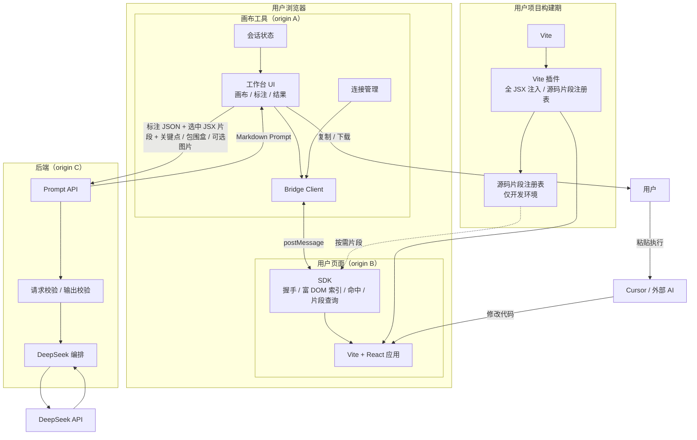
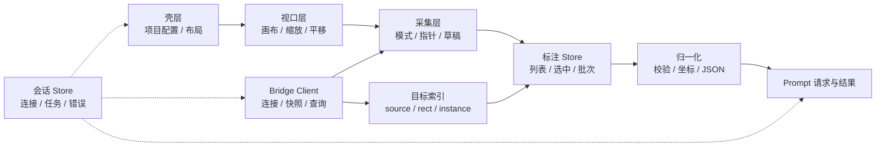
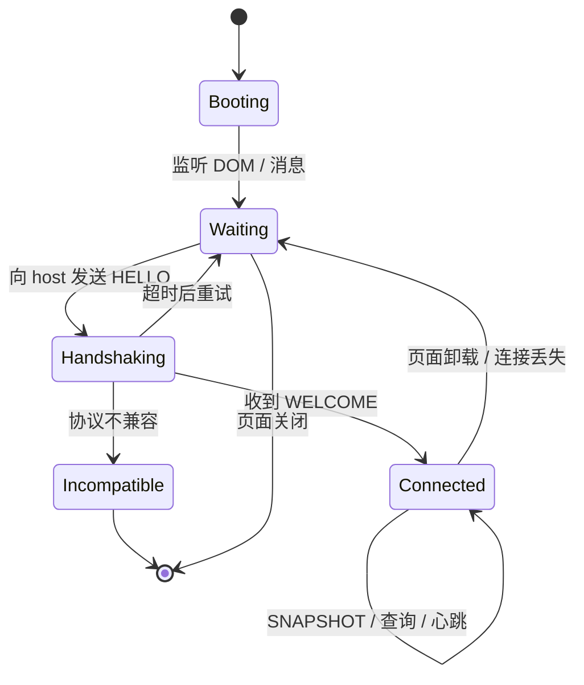
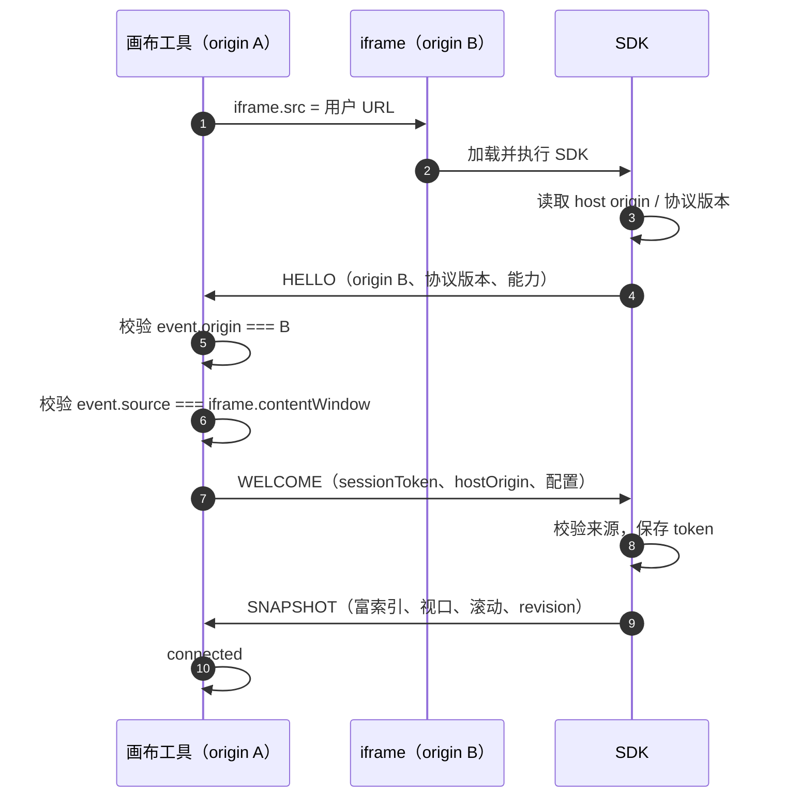
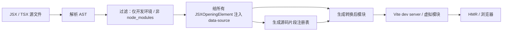
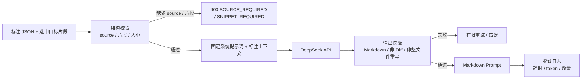
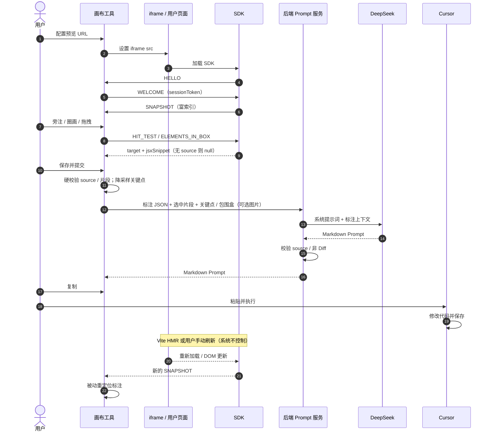
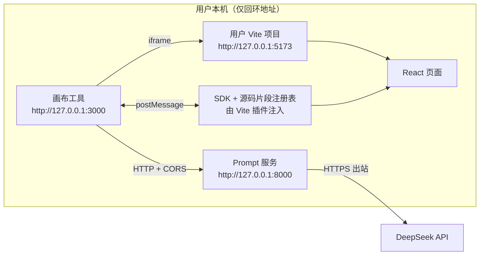

# 02. 整体架构设计

> 状态：v2.2 已确认，Q1–Q18 与接口细节已对齐，进入阶段四编码
> 日期：2026-11-02
> 依据：`01.功能模块梳理.md`、Q1–Q18 最终决策（含 Q6/Q7/Q8/Q9/Q10/Q11/Q12/Q14/Q15/Q16/Q17/Q18）
> 范围：整体架构、组件边界、跨域桥接、富快照、视觉标注、数据流、纯本地部署与安全；不包含数据库表、最终接口字段和业务代码

> 本文中的消息类别、字段名称、JSON 示例只用于说明架构职责，**不是最终接口契约**。具体字段、错误码、版本兼容策略在后续接口设计文档中细化。本文不创建任何代码文件。

## 1. 架构目标

### 1.1 目标

1. **Prompt-only**：系统只生成 Markdown Prompt，不修改代码、不生成 Diff、不编译、不回滚。
2. **源码文件零访问**：后端不读取用户源码文件；SDK 在浏览器内读取必要的 DOM 元数据；Vite 插件在本地构建期提供选中目标的精简 JSX 片段。
3. **跨域可用**：用户的 Vite 项目可以运行在任意本地端口，画布工具作为独立 Web 应用加载它。
4. **精确指认**：通过 Vite 插件给所有 JSX 节点注入 `data-source="文件:行号"`，让 Prompt 能直接指向目标文件。
5. **最小信任**：跨域消息必须校验 origin、source、会话 token 和协议版本。
6. **分层数据外发**：富快照留在浏览器；只把标注目标的结构化子集（文本预览、布局、邻居、精简 JSX 片段、降采样手绘关键点或包围盒、可选截图）发给后端；不上传完整 DOM、完整源码、表单值或 cookie。
7. **可替换 AI**：DeepSeek 只是 Prompt 生成器；模型、Prompt 文案和后端实现可以替换。
8. **可演进**：MVP 无数据库、无任务队列；视觉标注以本地原始点位、提交降采样关键点为主，可选用户上传图片；后续增加服务端历史、流式输出和资产持久化而不改变核心边界。

### 1.2 非目标

- 不做本地代码编辑 Agent。
- 不做 Diff / patch 生成与校验。
- 不启动、停止、重启或代理用户的 dev server。
- 不控制 iframe 刷新，不监听 Cursor 是否执行完成。
- 不做构建、类型检查、lint、测试、回滚。
- 不做云端托管、账号、协作、计费。
- 不做生产构建注入 `data-source`，不把 SDK 带入生产包。
- 不上传完整 DOM、完整源码文件或全量页面截图。
- 不在 MVP 中引入 MySQL / Redis / MinIO 作为强依赖。

## 2. 决策与架构后果

| 决策 | 结论 | 架构后果 |
|---|---|---|
| Q1 | 只读分析，生成指令；不修改代码、不回滚、不编译 | 后端只做 Prompt 服务；没有代码编辑器和构建系统 |
| Q2 | 输出 Markdown Prompt；标注上下文作为 Context；后端不做复杂模板 | 后端保持轻量、无状态；固定骨架序列化；Prompt 由 DeepSeek 生成；需做输出合规校验 |
| Q3 | 用户自己跑 Vite；跨域 iframe + SDK `postMessage` | 新增 SDK、连接状态机、协议版本、origin 校验；删除 dev server 管理 |
| Q4 | Vite 插件给所有 JSX 注入 `data-source="path:line"`，并生成片段注册表 | 新增构建期插件；覆盖自定义组件；Prompt 依赖路径、行号与 JSX 片段 |
| Q5 | 用户复制 Prompt 到 Cursor；HMR / 手动刷新由用户完成 | 删除刷新控制；系统只在 iframe 重新加载后被动重定位标注 |
| Q6 | 纯本地化部署 | 画布工具、Prompt 服务、用户 Vite 项目均运行在本机；天然规避 HTTPS→HTTP 混合内容 |
| Q8 | 编译期给所有 JSX 节点（含自定义组件）注入 `data-source` | 宿主元素直接落 DOM；自定义组件通过属性透传 + 组件根宿主节点兜底；仍无法定位时禁止提交 |
| Q9 | 必须检测到 `data-source` 才能生成 Prompt | 客户端与 Prompt 服务双重硬校验；无 source 只能预览，不能提交 |
| Q11 | 支持手绘与截图 | 手绘保留原始点位；用户手动上传的 base64 截图作为可选视觉补充；默认不持久化 |
| Q14 | Prompt 必须包含目标元素的精简 JSX 片段 | 插件生成源码片段注册表，SDK 命中时按需返回；只发送选中目标的片段 |
| Q15 | 快照不能只是最小索引 | 扩展为富索引：文本预览、标签、布局白名单、邻居标识；仍不发送完整 DOM |

## 3. 总体架构

### 3.1 组件图



### 3.2 运行时边界

| 边界 | 位置 | 可信度 | 说明 |
|---|---|---|---|
| A：画布工具 origin | 浏览器 / 静态站点 | 可信前端 | 拥有画布、标注、结果 UI；不直接访问 iframe DOM |
| B：用户项目 origin | 浏览器 / Vite dev server | 用户自己的代码 | 通过 SDK 提供 DOM 索引；可能包含业务数据 |
| C：后端 origin | 服务端 | 可信服务 | 持有 DeepSeek Key；不接触源码文件，只接收选中目标片段 |
| B ↔ A | `postMessage` | 跨域、不可信输入 | 必须校验 origin、source、token、协议版本；传输富快照与片段 |
| A ↔ C | HTTP(S) | 跨域或同域 | 需要 CORS；只传标注 JSON、选中目标片段、关键点 / 包围盒 / 可选图片 |
| C ↔ DeepSeek | HTTPS | 外部服务 | 只传 Prompt 上下文（含选中片段、视觉数据）和系统提示词 |
| 用户 ↔ Cursor | 人工 | 外部工具 | 系统不参与执行 |

### 3.3 组件职责

| 组件 | 职责 | 明确不做 |
|---|---|---|
| 画布工具 | 项目配置、iframe 加载、画布与标注、Prompt 展示 | 不读源码文件、不控制 dev server、不刷新 iframe |
| SDK | 握手、富 DOM 索引、命中查询、源码片段查询、生命周期上报 | 不修改业务 DOM、不上报表单值或完整文本 |
| Vite 插件 | 开发环境给所有 JSX 节点注入 `data-source`，生成源码片段注册表 | 不进入生产构建、不改变组件逻辑 |
| 后端 Prompt 服务 | 校验标注、调用 DeepSeek、返回 Markdown | 不读文件和完整源码、不生成 Diff、不执行代码 |
| DeepSeek | 生成 Cursor 友好的 Prompt | 不接触完整源码或文件系统、不执行代码 |
| Cursor | 用户手动执行 Prompt | 不属于本系统 |

## 4. 前端画布工具架构

### 4.1 内部分层



### 4.2 渲染层结构

画布工具使用“iframe + 覆盖层”的结构：

```text
Canvas
├── iframe（用户页面，跨域）
├── 透明捕获层（编辑模式下拦截指针）
├── SVG 标注层（笔迹、矩形、箭头）
├── 悬浮高亮层
├── 标注浮针层
└── 浮层 UI（旁注编辑框、结果面板、toast）
```

规则：

- **iframe 只负责展示和运行用户页面**，不向其中注入业务样式或业务脚本；SDK 由用户显式引入。
- **捕获层在编辑模式下拦截指针**，交互模式下 `pointer-events: none`，让用户操作真实页面。
- **父页面不能读取 iframe DOM**；所有目标信息来自 SDK 的富快照、命中结果或片段查询。
- 富快照只存在画布工具内存中，不整体上传后端。
- 标注层使用画布世界坐标渲染，缩放时保持贴合。
- 浮针反向缩放，保持屏幕尺寸稳定。

### 4.3 状态模型

画布工具至少维护三类状态：

| 状态类 | 内容 | 生命周期 |
|---|---|---|
| 连接状态 | `idle / loading / handshaking / connected / incompatible / disconnected / error` | 跟随 iframe 与 SDK |
| 标注状态 | 草稿、待提交、已提交、Prompt 已生成、已复制、失效、未定位 | 当前会话 |
| 请求状态 | 空闲、请求中、成功、失败、可重试 | 单次 Prompt 请求 |

互斥规则：

- 未 `connected` 时不能提交标注。
- 请求中不能修改当前批次。
- 草稿未保存时不能提交。
- 没有 `data-source` 的目标只能作为视觉草稿，不能进入提交批次。
- 目标失效或“未定位”的标注不能静默提交，必须提示或阻止。
- 提交前必须通过一次权威 `HIT_TEST` / `ELEMENTS_IN_BOX` 查询确认 `source`。

### 4.4 与 SDK 的交互方式

画布工具不直接操作 iframe，只通过 Bridge Client：

1. 接收 `SNAPSHOT`，更新富目标索引、文本 / 布局缓存和悬浮高亮。
2. 在点击 / 圈画结束时，发送 `HIT_TEST` 或 `ELEMENTS_IN_BOX`，获取权威目标与按需 JSX 片段。
3. 在 iframe 滚动 / resize / HMR 后，接收新快照并重定位。
4. 在连接断开时，把相关标注标记为“待重新连接”。
5. 提交前再次查询目标；没有 `data-source` 或片段缺失时阻断提交，不调用 Prompt 服务。

快照用于即时反馈，查询用于提交前的权威校验。两者不一致时，以查询结果为准。

## 5. SDK 架构

### 5.1 运行位置与加载

SDK 是运行在用户页面内的极简 JavaScript，并配套一个**开发期源码片段注册表**：

- **只由 Vite 插件在 `serve` 阶段自动注入**：通过虚拟模块写入 `<script type="module">`，用户不手写 `<script>` 标签，也不单独分发 SDK。
- 只在开发环境启用；生产构建不加载、不注入。
- 不依赖 React、Vue 或构建工具，直接操作 DOM API。
- 只向画布工具 origin 发送消息，不向其他窗口广播。
- 注册表保存 `source → { file, line, column, component, jsxSnippet, kind }`，只用于按需返回选中目标的片段，不随快照全量发送。

SDK 的宿主 origin 由插件配置注入，不靠运行时猜测：

1. 插件选项 `hostOrigin`（如 `http://127.0.0.1:5174`）；
2. 注入脚本的 `data-vibe-host` 属性；
3. 缺失或非法时 SDK 不启动，并在控制台给出接入错误。

### 5.2 生命周期



### 5.3 握手



安全规则：

- 握手前不接受任何 DOM / 标注相关消息。
- `HELLO` 之前，host 不回发敏感配置。
- `WELCOME` 必须发往用户页面 origin，不能使用 `*`。
- SDK 只接受来自配置的 host origin 的 `WELCOME`；收到后保存 token，并对后续消息校验 token。
- iframe 重新加载后，`contentWindow` 变化，host 必须重新绑定并重新握手。

### 5.4 消息类别（概念）

| 消息 | 方向 | 作用 |
|---|---|---|
| `HELLO` | SDK → Host | 上报 origin、协议版本、SDK 版本、能力 |
| `WELCOME` | Host → SDK | 下发 session token、host origin、配置 |
| `SNAPSHOT` | SDK → Host | 上报带 `data-source` 的富索引（文本、标签、布局、邻居）、视口、滚动、revision |
| `SNAPSHOT_REQUEST` | Host → SDK | 请求最新快照 |
| `HIT_TEST` | Host → SDK | 用 iframe 本地坐标查询点命中 |
| `HIT_RESULT` | SDK → Host | 返回目标或 null；目标可带 `jsxSnippet` |
| `ELEMENTS_IN_BOX` | Host → SDK | 查询与包围盒相交的目标 |
| `ELEMENTS_RESULT` | SDK → Host | 返回目标集合，按需带片段 |
| `SOURCE_SNIPPET_REQUEST` | Host → SDK | 按 `source` 请求目标 JSX 片段 |
| `SOURCE_SNIPPET_RESULT` | SDK → Host | 返回片段、是否截断、错误 |
| `PAGE_FOCUS` | SDK → Host | 用户点击真实页面内部；只带 session token，不传 DOM/坐标 |
| `PING` / `PONG` | 双向 | 心跳与连接健康 |
| `ERROR` | 双向 | 协议、查询、片段、渲染错误 |

具体字段、错误码、版本协商在后续接口文档中确定。所有消息必须带 `protocolVersion` 和 `sessionToken`（握手消息除外）。

### 5.5 跨域消息 JSON 结构示例（概念）

以下示例只表达字段关系，**不是最终接口契约**。所有消息由 `postMessage` 发送；除 `HELLO` 外都带 `protocolVersion` 和 `sessionToken`。`sessionToken` 是会话能力凭证，不写入日志、不持久化。

#### 5.5.1 HELLO / WELCOME

```json
{
  "type": "HELLO",
  "protocolVersion": "0.1",
  "sdkVersion": "0.1.0",
  "origin": "http://localhost:5173",
  "capabilities": ["snapshot", "hitTest", "boxQuery", "sourceSnippet", "visual"]
}
```

```json
{
  "type": "WELCOME",
  "protocolVersion": "0.1",
  "hostOrigin": "http://127.0.0.1:3000",
  "sessionToken": "st_7c1e...",
  "config": {
    "maxSnapshotElements": 200,
    "maxTextLength": 200,
    "maxNeighbors": 6,
    "maxSnippetLines": 40
  }
}
```

#### 5.5.2 SNAPSHOT（富索引）

```json
{
  "type": "SNAPSHOT",
  "protocolVersion": "0.1",
  "sessionToken": "st_7c1e...",
  "revision": 42,
  "viewport": { "width": 1280, "height": 800 },
  "scroll": { "x": 0, "y": 120 },
  "meta": { "elementCount": 128, "truncated": false },
  "elements": [
    {
      "elementId": "el_7f3a",
      "source": "src/components/Button.tsx:12",
      "sourceKind": "host",
      "component": "Button",
      "instance": 0,
      "tag": "button",
      "text": "保存",
      "rect": { "x": 320, "y": 180, "width": 96, "height": 36 },
      "layout": {
        "display": "inline-flex",
        "position": "static",
        "flexDirection": "row",
        "justifyContent": "center",
        "alignItems": "center",
        "gap": "8px",
        "width": "96px",
        "height": "36px",
        "padding": "8px 16px",
        "margin": "0px",
        "fontSize": "14px",
        "fontWeight": "500",
        "color": "rgb(255, 255, 255)",
        "backgroundColor": "rgb(37, 99, 235)",
        "borderRadius": "8px"
      },
      "depth": 5,
      "visible": true,
      "neighbors": [
        {
          "relation": "parent",
          "elementId": "el_11c2",
          "source": "src/components/Toolbar.tsx:20",
          "tag": "div",
          "component": "Toolbar"
        },
        {
          "relation": "prevSibling",
          "elementId": "el_9b01",
          "source": "src/components/Button.tsx:8",
          "tag": "button",
          "component": "Button",
          "text": "取消"
        }
      ]
    }
  ]
}
```

说明：

- `elementId` 是当前快照内的临时 ID，只用于邻居引用和画布高亮。
- `source + instance` 是跨 HMR 的目标引用；`instance` 表示同一 `source` 的第几个实例。
- `text` 是截断后的可见文本，不是输入框值，也不是完整 DOM 文本。
- `neighbors` 只给标识和关系，不展开子树。

#### 5.5.3 HIT_TEST / HIT_RESULT

```json
{
  "type": "HIT_TEST",
  "protocolVersion": "0.1",
  "sessionToken": "st_7c1e...",
  "requestId": "req_18",
  "point": { "x": 368, "y": 198 }
}
```

```json
{
  "type": "HIT_RESULT",
  "protocolVersion": "0.1",
  "sessionToken": "st_7c1e...",
  "requestId": "req_18",
  "target": {
    "elementId": "el_7f3a",
    "source": "src/components/Button.tsx:12",
    "sourceKind": "host",
    "component": "Button",
    "instance": 0,
    "tag": "button",
    "text": "保存",
    "rect": { "x": 320, "y": 180, "width": 96, "height": 36 },
    "layout": { "display": "inline-flex", "gap": "8px" },
    "neighbors": [
      {
        "relation": "parent",
        "elementId": "el_11c2",
        "source": "src/components/Toolbar.tsx:20",
        "tag": "div"
      }
    ],
    "jsxSnippet": "<button className=\"btn btn-primary\" onClick={handleSave}>\n  保存\n</button>",
    "snippetTruncated": false
  }
}
```

没有 `data-source` 时的命中结果：

```json
{
  "type": "HIT_RESULT",
  "protocolVersion": "0.1",
  "sessionToken": "st_7c1e...",
  "requestId": "req_19",
  "target": null,
  "reason": "SOURCE_NOT_FOUND"
}
```

#### 5.5.4 SOURCE_SNIPPET_REQUEST / RESULT

```json
{
  "type": "SOURCE_SNIPPET_REQUEST",
  "protocolVersion": "0.1",
  "sessionToken": "st_7c1e...",
  "requestId": "req_20",
  "source": "src/components/Button.tsx:12",
  "maxLines": 40
}
```

```json
{
  "type": "SOURCE_SNIPPET_RESULT",
  "protocolVersion": "0.1",
  "sessionToken": "st_7c1e...",
  "requestId": "req_20",
  "source": "src/components/Button.tsx:12",
  "jsxSnippet": "<button className=\"btn btn-primary\" onClick={handleSave}>\n  保存\n</button>",
  "truncated": false
}
```

#### 5.5.5 ERROR

```json
{
  "type": "ERROR",
  "protocolVersion": "0.1",
  "sessionToken": "st_7c1e...",
  "code": "SNIPPET_NOT_FOUND",
  "message": "未找到源码片段",
  "requestId": "req_20"
}
```

### 5.6 快照模型（富索引）

快照是 SDK 在用户页面内生成的**富 DOM 索引**，不是完整 DOM。它只索引带 `data-source` 的元素，并**只保留在画布工具内存中**，不会整体上传后端。

| 字段 | 说明 |
|---|---|
| `revision` | 快照版本，单调递增 |
| `viewport` | iframe 视口宽高（CSS 像素） |
| `scroll` | iframe 滚动位置 |
| `meta` | 元素数量、是否截断、生成时间等诊断信息 |
| `elements[]` | 带 `data-source` 的元素列表 |
| `element.elementId` | 当前快照内的临时 ID，用于邻居引用 |
| `element.source` | `相对路径:行号[:列号]`，来自 `data-source` |
| `element.sourceKind` | `host` / `component-usage` / `component-root`，标识标记来源 |
| `element.component` | 组件 / 元素名 |
| `element.instance` | 同一 source 的实例序号，跨 HMR 的稳定引用 |
| `element.tag` | 小写 DOM 标签名 |
| `element.text` | 可见文本预览，归一化并截断 |
| `element.rect` | iframe 本地坐标矩形 |
| `element.layout` | 计算样式白名单，不是完整 CSS |
| `element.depth` | 嵌套深度，用于去重 / 选择 |
| `element.visible` | 是否可见 |
| `element.neighbors[]` | 最多 6 个邻居标识：关系、elementId、source、tag、component、可选 text |

**文本规则（Q15）**

- 只采集带 `data-source` 元素的可见文本，合并连续空白，最多 200 字符。
- 不采集输入框值、`password`、`textarea` 内容、隐藏文本、`script` / `style` 内容。
- 文本可能包含业务数据；默认只留在浏览器，只有被选中的目标文本才会随标注发给后端。
- 截断时设置 `meta.truncated = true`，Prompt 中明确标注“文本已截断”。

**布局规则（Q15）**

- 只采集白名单属性：`display`、`position`、`flexDirection`、`flexWrap`、`justifyContent`、`alignItems`、`gap`、`gridTemplateColumns`、`width`、`height`、`padding`、`margin`、`color`、`backgroundColor`、`fontSize`、`fontWeight`、`lineHeight`、`borderRadius`。
- 不采集完整 `computedStyle`、CSS 变量、动画、伪元素、React props / state。
- 数值保留计算后的 CSS 字符串，避免 SDK 做布局推断。

**邻居规则（Q15）**

- 只给 `parent`、`prevSibling`、`nextSibling`、`firstChild` 四类关系。
- 每个邻居只给标识与关系，最多 6 个；不展开邻居的子树、样式或完整文本。
- 邻居也必须带 `data-source`，否则不进入邻居列表。

**明确不发送**

- 输入框值、密码、cookie、localStorage、sessionStorage；
- 完整 HTML、完整 DOM 树、网络请求、React props / state；
- 完整源码文件、整页截图（截图属于独立视觉资产，见 5.9）。

**容量与截断**

- 生成索引前过滤 `display: none` 的节点及其子树，再按最多 **200 个元素**计数；单元素 200 字符文本、6 个邻居、快照 2 MB。
- 超出时按“视口内优先、深度优先、可见优先”截断，并在 `meta` 标记。
- 快照只存在浏览器内存，刷新后由 SDK 重建；`localStorage` 只保存标注与 Prompt 摘要，不保存快照。

### 5.7 命中与坐标映射

坐标转换链：

```text
指针屏幕坐标
  → 减去 iframe 屏幕偏移
  → 除以画布缩放
  → iframe 本地坐标
  → SDK elementFromPoint / 矩形查询
  → iframe 本地目标矩形
  → 加上 iframe 世界偏移
  → 画布世界坐标
```

注意：

- SDK 返回的矩形是 iframe 视口坐标；滚动时需结合 `scroll`。
- 画布缩放只影响屏幕显示，不改变世界坐标。
- 捕获层覆盖 iframe 时，指针事件不会进入用户页面；命中必须由 SDK 查询。
- 圈画目标使用 `ELEMENTS_IN_BOX`，由 SDK 在用户页面内计算矩形相交，避免父页面持有过期快照。
- SDK 只返回带 `data-source` 的元素；没有 source 的命中返回 `null` 或 `SOURCE_NOT_FOUND`。
- 命中结果为空或无 `data-source` 时，不生成可提交标注；提示用户重新圈选或检查 Vite 插件。
- 命中结果按需返回 `jsxSnippet`；未命中片段时，前端阻断提交，不静默降级。

### 5.8 HMR / 手动刷新

- 系统不触发刷新。
- Vite HMR 可能只更新部分 DOM，SDK 通过 MutationObserver / resize / scroll 更新快照。
- 整页刷新时，iframe `load` 触发，SDK 重新握手，host 替换快照。
- host 按 `source + instance` 重定位已有标注；找不到则标记失效。
- 重定位后刷新文本、布局、邻居和 JSX 片段；片段变化时提示“Prompt 可能过期”。
- 已生成的 Prompt 不自动更新；UI 提示“预览已变化，Prompt 可能过期”，由用户决定是否重新生成。
- 系统不等待 HMR，也不判断 HMR 成功；连接状态只反映 iframe / SDK 是否可用。

### 5.9 视觉标注：手绘与截图（Q11）

手绘是核心输入，采用**矢量优先、栅格可选**的方案。

#### 5.9.1 手绘轨迹

- 画布捕获指针轨迹，转换为**画布世界坐标**的原始点数组，避免缩放 / 平移改变语义。
- 前端本地最多保留 5000 个原始点，保存 `points[]`（保持采集顺序）、`renderedPath`（仅供画布渲染）、描边、包围盒、覆盖的目标元素、点数。
- **不做平滑、不拟合曲线**；提交后端前必须降采样到 50–100 个关键点，或只传包围盒（Q16 定稿）。
- 同时生成一段确定性的 `spatialSummary`，例如“圈选范围覆盖按钮 A 与输入框 B”，帮助纯文本模型理解空间关系。
- 发送给后端的是关键点 / 包围盒，不是 5000 个原始点；模型上下文只使用包围盒与空间摘要。

#### 5.9.2 可选截图

- iframe 跨域，父页面不能静默读取 iframe 像素；**不做自动截屏，也不请求屏幕捕获权限**。
- 画布工具栏提供 **“上传截图”按钮**（Q17），支持选择文件或粘贴剪贴板图片。
- 用户上传的图片由前端按标注包围盒加边距裁剪，不使用整页截图；裁剪结果需用户可见。
- 格式优先 WebP / PNG，最长边不超过 1600 px，单张不超过 1 MB，以 base64 data URL 内联。
- 只有用户显式上传时才随标注发送；不持久化，MVP 不依赖 MinIO。
- 如果配置的模型不支持图片输入，则只发送关键点 / 包围盒 + `spatialSummary`；如果支持，再附加图片。多模态不是硬依赖。

#### 5.9.3 视觉数据结构（概念）

```json
{
  "visual": {
    "points": [
      { "x": 120, "y": 80 },
      { "x": 132, "y": 72 },
      { "x": 148, "y": 68 },
      { "x": 200, "y": 80 }
    ],
    "pointCount": 4,
    "downsampledFrom": 5000,
    "renderedPath": "M 120 80 L 132 72 L 148 68 L 200 80",
    "bbox": { "x": 120, "y": 60, "width": 80, "height": 20 },
    "stroke": { "color": "#ef4444", "width": 3 },
    "relatedSources": ["src/components/Button.tsx:12"],
    "spatialSummary": "手绘轨迹覆盖按钮和输入框",
    "raster": null
  }
}
```

`points` 是降采样后的关键点（≤100），`downsampledFrom` 记录本地原始点数；原始 5000 点不上传。

`raster` 启用时示意：

```json
{
  "raster": {
    "mime": "image/png",
    "dataUrl": "data:image/png;base64,iVBORw0KGgo...",
    "width": 960,
    "height": 540,
    "bytes": 182000
  }
}
```

## 6. Vite 插件架构

### 6.1 转换流程



### 6.2 注入规则

- 只在 Vite `serve` 阶段生效，生产构建不注入。
- 只处理第一方项目源码，排除 `node_modules`、构建产物、测试夹具。
- **遍历所有 `JSXOpeningElement`**，包括宿主元素和自定义组件，不只注入 `div` / `button` 等宿主节点。
- `data-source` 使用相对项目根目录的 POSIX 路径 + JSX 元素起始行号，例如 `src/components/Button.tsx:12`；同一行有多个 JSX 元素时追加列号，例如 `src/components/Button.tsx:12:5`。
- 注入 `data-source-kind="host|component-usage|component-root"`，区分宿主元素、自定义组件使用处和组件定义根节点。
- 可选注入 `data-component`，用于 Prompt 中的可读描述。
- 同一元素只注入一次，避免 HMR 重复叠加。
- 行号是定位提示，不是稳定主键；Prompt 必须要求 Cursor 以文件内容为准。

### 6.3 自定义组件覆盖策略（Q8）

React 自定义组件不保证把未知 props 透传到 DOM，但本方案要求覆盖自定义组件，因此采用**全 JSX 注入 + 组件根宿主节点兜底**：

1. 编译期遍历所有第一方 `JSXOpeningElement`，全部注入 `data-source`。
2. 宿主元素：属性直接进入真实 DOM。
3. 自定义组件：属性作为 prop 传入，`sourceKind=component-usage`；如果组件把 rest props 透传给根 DOM，DOM 上会得到使用处 `source`。
4. 兜底：组件定义内部的所有 JSX 也已被注入，组件渲染出的根宿主节点携带定义处 `data-source`，`sourceKind=component-root`。即使组件吞掉未知 props，DOM 仍有一个可定位锚点。
5. SDK 取最近的 `data-source` 作为目标，并用 `sourceKind`、`component` 辅助判断：`component-usage` 表示使用处，`component-root` 表示组件定义根节点。两者同时存在时，以离点击点最近的 DOM 标记为准，并在 Prompt 中说明来源差异。
6. 如果组件返回 `null`、只返回第三方组件且不透传属性、或使用动态 `React.createElement`，且没有任何带 `data-source` 的祖先节点，SDK 返回 `SOURCE_NOT_FOUND`，前端禁止提交，不做模糊降级。
7. 第三方 `node_modules` 默认不注入；若其最近的第一方祖先节点有 `source`，可以明确使用该祖先作为目标，但不承诺第三方组件内部精确到行。

> 覆盖语义：所有第一方 JSX 节点都有标记；DOM 锚点优先使用最近的标记。无法得到 DOM 锚点的节点视为“不可定位”，不进入 Prompt。

### 6.4 开发环境约束

- 生产构建不得包含 `data-source`、源码片段注册表和 SDK，避免泄露源码路径与代码。
- 插件版本与 SDK 协议版本分开管理；插件负责标记与片段，SDK 负责查询。
- 插件不把源码发送到后端；所有转换和注册表都在用户本地完成。
- 如果用户使用自定义 Vite 配置、多个 root 或 monorepo，路径基准需要在接入文档中说明。
- 动态生成 JSX、运行时字符串模板、`innerHTML` 插入的 DOM 不在编译期覆盖范围内；这些节点没有 `data-source`，因此不可提交。

### 6.5 源码片段注册表（Q14）

- 转换时同时记录每个 JSX 元素的源码片段，键为 `source`（路径 + 行 + 可选列）。
- 片段只包含当前 JSX 元素及其直接子节点，归一化缩进，去掉无关空行；默认最多 40 行 / 4 KB。
- 超长片段只保留起始标签、关键属性和前若干个直接子节点，并标记 `truncated: true`。
- 注册表通过开发期虚拟模块或等价的本地注入方式提供给 SDK，不进入生产包。
- 注册表不随 `SNAPSHOT` 全量发送；只在 `HIT_RESULT` 或 `SOURCE_SNIPPET_RESULT` 中按需返回选中目标的片段。
- 片段是源码内容：只发送被标注的目标；提交前 UI 明确提示“将发送目标 JSX 片段给 DeepSeek”。

## 7. 后端 Prompt 服务架构

### 7.1 定位

后端不是 Agent，也不是代码执行器，而是一个**无状态 Prompt 生成服务**：

- 输入：结构化标注 JSON、选中目标的结构化投影（文本、布局、邻居、精简 JSX 片段、降采样关键点 / 包围盒、可选图片）、项目名、预览 origin、视口等最小上下文。
- 处理：固定短系统提示词 + 序列化后的标注上下文 → DeepSeek。
- 输出：Markdown Prompt。
- 不接触源码文件、不访问 DOM、不保存历史。
- 不按业务拼接复杂模板；只使用稳定的序列化骨架。

### 7.2 请求处理流程



### 7.3 输入内容

后端接收：

- 项目名、预览 origin、视口尺寸；
- 标注数组：类型、意图、目标 `source` / `component` / `instance`、矩形 / 包围盒 / 位移；
- 选中目标的文本预览、标签、布局白名单、邻居标识；
- 选中目标的 `jsxSnippet` 与 `snippetTruncated`；
- 手绘降采样关键点 `points[]`（≤100）、包围盒、`spatialSummary`、关联目标；
- 可选的 base64 截图（仅用户显式提交）；
- 必要的生成参数（模型、语言等）。

后端不接收：

- 完整源码文件、完整 DOM、表单值、cookie、localStorage；
- 默认的整页截图；
- Cursor 的执行结果。

**硬校验（Q9 / Q14）**

- 每个标注目标必须有非空 `source`，且符合 `相对路径:行号[:列号]` 格式；否则返回 400，不调用模型。
- 每个需要修改的目标必须有 `jsxSnippet`；缺失时返回 `SNIPPET_REQUIRED`，不降级为“无片段 Prompt”。
- `source` 只校验结构与存在性；后端不能验证文件真实存在，文件是否存在由 Cursor 执行时确认。

### 7.4 系统提示词的最小职责

按 Q2，后端不做复杂模板，只用简短系统提示词约束模型：

1. 角色：资深前端工程师，为 Cursor 生成可直接执行的修改指令。
2. 输出：Markdown 自然语言指令，包含目标文件 / 行号、逐条修改意图、约束、验收标准。
3. 片段：输入中的 `jsxSnippet` 只是选中目标的定位上下文，不是完整文件；可以使用它，但不得假设未提供的代码。
4. 禁止：不输出 unified diff、patch、整文件重写；可以引用少量目标 JSX。
5. 行为：要求 Cursor 先阅读目标文件，再按标注修改；`source` 和行号只是定位提示，可能漂移。
6. 信息不足时写明假设或待确认点，不编造代码细节。
7. 语言：跟随用户标注语言，默认中文。

系统提示词不拼接具体业务规则、不注入完整源码、不做复杂 Few-shot。

### 7.5 输出校验

必须做最低限度的合规校验：

- 非空、长度合理；
- 是 Markdown 文本；
- 不包含 `diff --git`、`@@` 等明显补丁标记；如果检测到，重试一次，仍失败则返回错误；
- 不包含整文件重写或大段无关代码；允许引用目标 JSX 片段；
- 不包含后端密钥、系统提示词全文等敏感内容；
- 不把模型输出直接作为 HTML 插入页面；展示时使用纯文本或经过净化的 Markdown 渲染。

### 7.6 错误、超时与重试

| 场景 | 行为 |
|---|---|
| 缺少 `data-source` | 400 `SOURCE_REQUIRED`；不调用模型 |
| 缺少 `jsxSnippet` | 400 `SNIPPET_REQUIRED`；不调用模型 |
| DeepSeek 超时 | 返回可重试错误；前端保留标注 |
| 429 / 限流 | 返回等待提示；不自动无限重试 |
| 5xx | 有限重试（如 1 次） |
| 输出不合规 | 重试 1 次；仍失败则报错 |
| 请求体过大 / 图片过大 | 413；提示减少标注或压缩图片 |
| 未配置 Key | 服务启动时或请求时明确报错 |

MVP 使用同步 HTTP 请求 / 响应，不使用 WebSocket。Prompt 生成通常数秒，前端展示加载状态即可；流式输出属于后续增强。

### 7.7 配置与日志

- DeepSeek Key 只存在后端环境变量，绝不进入浏览器。
- 模型、超时、最大 token、重试次数、图片大小限制可配置。
- 日志记录：请求 ID、标注数量、目标文件列表、文本 / 片段长度、图片字节数、耗时、token 用量、错误类型。
- 日志不记录：完整源码、完整 DOM、元素文本原文、JSX 片段原文、手绘点位原文、图片内容。
- 后端只监听本地回环地址；CORS 只允许画布工具 origin；不提供公网鉴权与多租户能力。
- 如果未来需要公网部署，必须单独做安全评审，不沿用本文的本地信任假设。

### 7.8 发给大模型的 Prompt 模板形态

本节描述**输入给 DeepSeek 的固定骨架**，不是最终接口契约。后端只做字段序列化，不按每个业务场景拼接不同模板。

#### 7.8.1 系统提示词（固定、简短）

```text
你是资深前端工程师。你的任务是根据用户的可视化标注，为 Cursor 生成一段可直接执行的修改 Prompt。

规则：
1. 目标以 source（文件:行号）为准；行号只是提示，执行时必须先阅读文件。
2. 输入中的 jsxSnippet 只是选中目标的定位上下文，不是完整文件；不得假设未提供的代码。
3. 输出 Markdown 自然语言指令，包含目标文件、修改点、约束、验收标准。
4. 不得输出 unified diff、patch 或整文件重写；可以引用少量目标 JSX。
5. 信息不足时写明假设或待确认点，不编造代码。
6. 语言跟随用户标注，默认中文。
```

#### 7.8.2 用户上下文 JSON 骨架

```json
{
  "project": {
    "name": "my-vite-app",
    "previewOrigin": "http://localhost:5173",
    "viewport": { "width": 1280, "height": 800 }
  },
  "annotations": [
    {
      "id": "A1",
      "type": "draw",
      "intent": "按钮再往左一点，和输入框左边缘对齐",
      "targets": [
        {
          "source": "src/components/Button.tsx:12",
          "component": "Button",
          "instance": 0,
          "tag": "button",
          "text": "保存",
          "rect": { "x": 320, "y": 180, "width": 96, "height": 36 },
          "layout": { "display": "inline-flex", "gap": "8px" },
          "neighbors": [
            {
              "relation": "prevSibling",
              "source": "src/components/Input.tsx:30",
              "tag": "input"
            }
          ],
          "jsxSnippet": "<button className=\"btn btn-primary\" onClick={handleSave}>\n  保存\n</button>",
          "snippetTruncated": false
        }
      ],
      "visual": {
        "points": [
          { "x": 120, "y": 80 },
          { "x": 140, "y": 60 },
          { "x": 180, "y": 60 },
          { "x": 200, "y": 80 }
        ],
        "pointCount": 4,
        "renderedPath": "M 120 80 L 140 60 L 180 60 L 200 80",
        "bbox": { "x": 120, "y": 60, "width": 80, "height": 20 },
        "spatialSummary": "手绘轨迹覆盖按钮和输入框",
        "relatedSources": ["src/components/Button.tsx:12", "src/components/Input.tsx:30"],
        "raster": null
      }
    }
  ],
  "constraints": {
    "outputLanguage": "zh-CN",
    "mustReadFiles": true,
    "forbidDiff": true,
    "maxCodeReferenceLines": 40
  }
}
```

#### 7.8.3 模型输出的 Markdown Prompt 结构（建议）

模型输出的是给 Cursor 的 Prompt，不是代码补丁。建议结构：

```text
# 修改任务

## 目标文件
- src/components/Button.tsx:12（Button）

## 当前 JSX（定位上下文）
<button className="btn btn-primary" onClick={handleSave}>
  保存
</button>

## 修改要求
1. 将按钮向左移动，使其左边缘与相邻输入框对齐。
2. 保持现有颜色、圆角和交互逻辑不变。

## 空间与视觉说明
- 手绘轨迹覆盖按钮和输入框，意图是“左对齐”。
- 参考相邻输入框：src/components/Input.tsx:30。

## 约束
- 先阅读目标文件，再修改。
- 不要修改无关文件或重写整个组件。
- 行号可能漂移，以文件内容为准。

## 验收标准
- 按钮左边缘与输入框左边缘对齐。
- 按钮文案、点击事件和样式保持不变。
```

## 8. 端到端数据流

### 8.1 标注到 Prompt



### 8.2 数据边界

| 数据 | 留在浏览器 | 发给后端 | 发给 DeepSeek | 说明 |
|---|---|---|---|---|
| 用户源码文件 | 是（本地项目） | 否 | 否 | 后端无文件访问 |
| 完整 DOM | 是（页面本身） | 否 | 否 | SDK 只生成富索引 |
| 元素文本（截断） | 是 | 是（仅选中目标） | 是（仅选中目标） | 不含表单值 / 密码 |
| 输入框值 / 密码 | 是（页面本身） | 否 | 否 | SDK 不采集 |
| 标注意图 | 是 | 是 | 是 | 用户主动提交 |
| 文件路径 / 行号 | 是 | 是 | 是 | 来自 `data-source` |
| 布局 / 邻居 | 是 | 是（仅选中目标） | 是（仅选中目标） | 布局白名单，邻居只给标识 |
| JSX 片段 | 是（本地注册表） | 是（仅选中目标） | 是（仅选中目标） | 默认 40 行 / 4 KB |
| 手绘原始点位 | 是（仅画布） | 否 | 否 | 最多 5000，保持采集顺序 |
| 手绘关键点 / 包围盒 | 是 | 是（≤100 点） | 是（仅 bbox / 摘要） | 提交前降采样；原始点不上传 |
| 可选截图 | 是（用户提供） | 是（显式提交） | 是（显式提交） | base64，不持久化 |
| DeepSeek Key | 否 | 否（服务端读取） | 否 | 只配置在后端 |
| Cursor 执行结果 | 否 | 否 | 否 | 系统不掌握 |

### 8.3 隐私原则

- 用户必须知道：提交标注会把意图、文件路径、选中目标的文本预览、布局、JSX 片段和降采样手绘关键点 / 包围盒发送给 DeepSeek。
- 默认不发送输入框值、密码、cookie、localStorage、完整源码文件和完整 DOM。
- 元素文本截断到 200 字符；JSX 片段默认 40 行 / 4 KB；提交前展示“将发送的目标摘要”。
- 截图只有用户显式上传 / 粘贴 / 授权时才发送；不默认截取 iframe 像素，不持久化。
- 日志脱敏；不记录文本原文、JSX 片段原文、手绘点位原文、图片内容或完整 Prompt。
- 后端不持久化标注；除非后续明确增加历史功能。
- 纯本地部署降低了传输暴露面，但 DeepSeek 仍是外部服务，不能把“本地”当成“数据不出本机”。

## 9. 部署架构

### 9.1 纯本地化部署（Q6 最终决策）



特点：

- 画布工具、Prompt 服务、用户 Vite 项目全部运行在用户本机，使用 HTTP + 回环地址，天然规避 HTTPS 页面加载 `http://localhost` 的混合内容限制。
- 所有本地服务只监听 `127.0.0.1`，不监听 `0.0.0.0`，不暴露到局域网或公网。
- 画布工具和 Prompt 服务可以同源部署，也可以分开端口；推荐同源以减少 CORS 配置。
- 用户自己的 Vite 项目保持独立，系统不管理其进程。
- DeepSeek 是唯一的外部出站依赖；Key 只在后端环境变量。
- 不需要 MySQL / Redis / MinIO；现有 Docker 中间件不参与 MVP。

### 9.2 本地部署约束

- 启动顺序：先启动用户 Vite 项目，再启动 Prompt 服务，最后打开画布工具；画布工具支持重试连接。
- 端口冲突时允许配置端口，但 origin 必须同步更新，不能写死。
- 本地模式不提供账号、登录、多租户；本地 API 依靠回环绑定、CORS 白名单和会话 token 防护。
- 不提供云端 / 托管部署形态；如果未来需要远程访问，必须单独做安全评审，不能直接复用本地信任模型。
- 不接受用户通过反向代理把本地服务暴露到公网而不加鉴权。

### 9.3 CORS 与 origin

- iframe 与 `postMessage` 不走 CORS，但必须严格校验 origin。
- 画布工具调用 Prompt API：如果跨域，使用精确 CORS 白名单，不使用 `*`；如果同源，仍需校验 `Origin`。
- 本地 API 要求 JSON `Content-Type` 和自定义会话头（如 `X-Vibe-Session`），避免简单请求被其他网页直接触发。
- SDK 只向配置的 host origin 发送消息；host 只向配置的 preview origin 发送消息。
- `localhost` 与 `127.0.0.1` 是不同 origin，接入配置必须精确；推荐统一使用 `127.0.0.1`。

### 9.4 中间件

MVP 不依赖数据库、Redis、MinIO：

- 会话状态在浏览器内存；本地操作历史写 `localStorage`（`vibe.history.v1`）。
- Prompt 服务无状态，无服务端历史。
- 截图以 base64 内联，不落盘。
- 如果后续增加服务端历史、审计、截图持久化，再引入 MySQL / MinIO；Redis 可用于限流 / 短期任务状态，但不是当前必需。

## 10. 安全设计

### 10.1 威胁与对策

| 威胁 | 场景 | 对策 |
|---|---|---|
| 伪造消息 | 任意页面向画布工具 `postMessage` | 校验 `event.origin`、`event.source === iframe.contentWindow`、session token、协议版本 |
| 恶意 host | 用户页面收到伪造的 `WELCOME` | SDK 只接受配置的 host origin；收到 WELCOME 后对后续消息校验 token |
| 数据泄露 | 富快照包含文本、布局、邻居 | 快照只留本地；文本截断；不采集表单值 / 密码；只外发选中目标 |
| 源码片段泄露 | JSX 片段含硬编码密钥或业务数据 | 只发选中目标；默认 40 行 / 4 KB；提交前提示；日志不记录原文 |
| 截图泄露 | 截图包含业务数据或个人信息 | 用户显式上传 / 授权；裁剪到标注区域；可选发送；不持久化 |
| 本地 API 被其他网页调用 | 恶意网页向 `127.0.0.1` 发请求 | 只监听回环地址；精确 CORS；JSON + 自定义会话头；校验 token |
| API Key 泄露 | Key 写进前端 | Key 只在后端环境变量；前端不接触 |
| Prompt 注入 | 标注、文本、JSX 片段含恶意指令 | 系统提示词明确把 JSON 当数据；字段分隔；输出只展示不执行；用户自行决定是否复制 |
| XSS | 模型输出含 HTML / script | 纯文本或净化 Markdown 渲染；不 `innerHTML` 模型输出 |
| 资源滥用 | 本地 API 被刷或大请求 / 大图片 | 回环绑定、限流、请求体大小、图片大小、标注数量限制 |
| 供应链 | SDK / 插件版本漂移 | 协议版本号、最低版本检查、接入诊断 |
| 开发标记泄露 | 生产包包含 `data-source` 或片段注册表 | 插件只在 `serve` 生效；生产不加载 SDK / 注册表 |
| iframe 逃逸 | 用户页面恶意跳转 / 弹窗 | 最小 sandbox；不允许 top navigation；用户项目本身可信 |

### 10.2 iframe 安全建议

- iframe 使用用户配置的 URL，不使用 `srcdoc`。
- 推荐 `sandbox="allow-scripts allow-same-origin allow-forms"`；不要默认允许 `allow-top-navigation`。
- 如果 sandbox 导致 Vite HMR 或用户应用异常，需要在接入文档中说明取舍。
- `postMessage` 的 `targetOrigin` 不使用 `*`（握手后的消息）。
- 画布工具不静默截取 iframe 像素；截图必须由用户显式上传、粘贴或授权屏幕捕获。
- iframe 加载失败、origin 不匹配、SDK 未加载、片段注册表缺失时，显示明确诊断，不静默降级。
- 本地 Prompt API 只监听 `127.0.0.1`，并要求自定义会话头；不要用 `*` CORS 方便调试。

## 11. 可靠性与错误处理

### 11.1 连接错误

| 场景 | 用户看到 | 系统行为 |
|---|---|---|
| iframe 加载失败 | 预览加载失败 | 保留配置，允许重试 |
| SDK 未加载 | 未检测到 SDK | 显示接入文档；禁止提交标注 |
| origin 不匹配 | 预览来源不匹配 | 拒绝消息；提示检查 URL |
| 协议不兼容 | SDK 版本过旧 | 阻止连接；提示升级 |
| 心跳超时 | 连接已断开 | 标记标注待重连 |
| 快照为空 | 页面没有可标注元素 | 提示检查 Vite 插件 / 组件 |
| 快照被截断 | 部分元素未进入索引 | 显示截断提示；视口内优先 |
| 命中失败 | 未找到目标元素 | 不生成标注；提示重选 |
| 目标无 `data-source` | 该元素不可定位 | 禁止生成标注；提示检查插件 / 自定义组件 |
| 目标无 JSX 片段 | 片段注册表缺失 | 禁止提交；提示检查 Vite 插件 |
| 自定义组件无 DOM 锚点 | 组件返回第三方 / 动态节点 | 标记不可定位；不模糊降级 |
| 图片过大 | 截图无法提交 | 提示压缩 / 缩小裁剪范围 |

### 11.2 Prompt 错误

| 场景 | 用户看到 | 系统行为 |
|---|---|---|
| 缺少 `data-source` | 目标不可定位 | 400 `SOURCE_REQUIRED`；不调用模型 |
| 缺少 JSX 片段 | 无法生成含片段的 Prompt | 400 `SNIPPET_REQUIRED`；不调用模型 |
| 请求中 | 正在生成 Prompt | 禁止重复提交和修改批次 |
| DeepSeek 超时 | 生成超时，可重试 | 保留标注与上一次结果 |
| 限流 | 请求过于频繁 | 显示等待提示 |
| 图片过大 | 截图超出限制 | 413；提示压缩 |
| 模型不支持图片 | 已忽略截图 | 降级为关键点 / 包围盒 + 空间摘要，并提示 |
| 输出不合规 | 生成结果不可用 | 有限重试；仍失败则报错 |
| 复制失败 | 无法自动复制 | 提供手动选择 / 下载 |

### 11.3 不承诺的事情

- 不承诺 Prompt 一定被 Cursor 正确执行。
- 不承诺 HMR 一定成功。
- 不承诺刷新后标注一定还能定位。
- 不承诺所有第三方组件、动态 DOM、运行时字符串模板都能定位。
- 不承诺模型理解所有空间意图；信息不足时要求用户补充标注。
- 模型看不到完整源码文件；Prompt 精度依赖 `source`、JSX 片段、布局和标注质量。

## 12. 演进路线

| 阶段 | 增强 | 对架构的影响 |
|---|---|---|
| MVP | 项目接入、全 JSX 注入、富快照、原始点位视觉标注 + 手动截图、Prompt 生成与复制 | 当前架构 |
| 后续 1 | Prompt 历史、会话恢复 | 增加持久化；Prompt 服务保持无状态 |
| 后续 2 | 流式 Prompt、取消、重试 | 可增加 SSE；不改变边界 |
| 后续 3 | 视觉资产持久化、模型多模态增强 | 增加 MinIO；接口增加资产引用 |
| 后续 4 | 多项目、团队、权限 | 增加账号与项目模型；SDK 协议保持 |
| 后续 5 | Vue / Svelte / 其他构建工具 | 新增对应插件；SDK 与画布核心不变 |

## 13. 架构决策记录（ADR）

| 编号 | 决策 | 理由 | 代价 |
|---|---|---|---|
| ADR-01 | 只输出 Prompt，不修改代码 | 符合 Q1/Q2；边界清晰、风险低 | Prompt 质量依赖标注和模型 |
| ADR-02 | 跨域 iframe + SDK，而不是同源代理 | 不控制用户 dev server；用户可在任意本地端口运行 | 需要协议、握手、版本管理 |
| ADR-03 | Vite 插件给所有 JSX 注入 `data-source` 并生成片段注册表 | 直接获得文件路径、行号与 JSX 定位片段；Prompt 可定位 | 插件接入成本；片段与源码处理更复杂 |
| ADR-04 | 后端无状态、无数据库 | MVP 简单；不持久化敏感内容 | 无服务端历史、无跨设备恢复；仅 `localStorage` |
| ADR-05 | 用户手动复制 Prompt | 不集成 Cursor API；最小权限 | 多一步人工操作 |
| ADR-06 | 系统不控制刷新，只被动重定位 | 符合 Q5；不介入用户构建 | 标注可能过期，需要提示 |
| ADR-07 | 富快照留在浏览器，只外发选中目标投影 | 兼顾空间理解与数据最小化 | 快照更大，需要文本 / 布局 / 容量治理 |
| ADR-08 | 全 JSX 注入 + 组件根宿主节点兜底 | 覆盖自定义组件，同时避免 wrapper 改变布局 | 部分 source 指向定义处而非使用处 |
| ADR-09 | 纯本地化部署 | 规避混合内容；降低传输暴露面 | 不支持远程协作与云端托管 |
| ADR-10 | 前端保留原始点位，提交前降采样；截图为用户手动上传的可选项 | 本地不失真；请求体积可控；截图补足视觉理解 | 需维护降采样逻辑；纯文本模型对空间理解有限，需要空间摘要 |
| ADR-11 | 无 `data-source` 硬拒绝 | 保证 Prompt 可定位，避免假装成功 | 覆盖不足时用户会看到阻断 |
| ADR-12 | Prompt 输入包含精简 JSX 片段 | 降低 Cursor 搜索成本 | 片段属于源码，需要外发提示与日志脱敏 |

## 14. 主要风险

| 风险 | 影响 | 缓解 |
|---|---|---|
| 自定义组件无 DOM 锚点 | 部分组件无法定位 | 全 JSX 注入 + 根宿主节点兜底；诊断；不可定位则阻断 |
| 使用处 / 定义处 source 混淆 | Prompt 指向错误位置 | `sourceKind` + component 辅助；Prompt 说明可能来源 |
| 第三方组件 / 动态 DOM | 无法注入 `data-source` | 明确边界；最近第一方祖先可用时作为目标；否则阻断 |
| 本地 origin / 端口不一致 | iframe 或 API 连接失败 | 统一 `127.0.0.1`；origin 可配置；诊断提示 |
| 富快照过大 | 内存、查询、上下文压力 | 元素 / 文本 / 邻居 / 字节上限；视口内优先；截断标记 |
| 文本 / JSX 片段敏感 | 业务数据或密钥外发 | 只发选中目标；截断；提交前提示；日志脱敏 |
| 截图敏感 | 业务数据或个人信息外发 | 用户显式触发；裁剪；不持久化；可关闭 |
| Prompt 注入 / XSS | 输出被污染或页面被攻击 | 数据分隔、输出净化、不执行模型输出 |
| 协议版本漂移 | 连接失败 | 版本号、兼容检查、诊断 |
| 无“已应用”反馈 | 用户不确定执行结果 | 文案只承诺生成 / 复制；不伪装成功 |
| 生产误带 SDK / 注册表 | 源码路径与片段泄露 | 插件 `serve` only；生产不加载 |

## 15. 决策状态与剩余问题

### 15.1 已确认决策

| 编号 | 结论 | 架构落点 |
|---|---|---|
| Q6 | 纯本地化部署 | 第 9 节；所有服务只监听回环地址 |
| Q7 | SDK 由 Vite 插件自动注入 | 第 5.1 节；不提供手动 `<script>` 接入 |
| Q8 | 所有 JSX 节点（含自定义组件）注入 `data-source` | 第 6.2 / 6.3 节；根宿主节点兜底 |
| Q9 | 无 `data-source` 坚决拒绝生成 Prompt | 第 4.3 / 7.3 / 11 节；客户端 + 服务端双重校验 |
| Q10 | 无数据库；历史仅 `localStorage` | 第 9.4 节；Prompt 服务保持无状态 |
| Q11 | 支持原始手绘与用户手动上传截图 | 第 5.9 节；不自动截屏 |
| Q12 | 只支持 Vite + React | 第 6 节；其他框架不进入 MVP |
| Q14 | Prompt 必须包含精简 JSX 片段 | 第 6.5 / 7.3 / 7.8 节；片段注册表按需返回 |
| Q15 | 快照扩展文本、标签、布局、邻居 | 第 5.6 节；富索引只留本地 |
| Q16 | 前端保留原始点位（≤5000），提交前降采样到 50–100 关键点或 bbox | 第 5.9.1 节；不平滑 |
| Q17 | 工具栏“上传截图”按钮 | 第 5.9.2 节；仅手动上传，1 MB |
| Q18 | 过滤 `display:none` 后最多 200 个 DOM 节点 | 第 5.6 节；超出截断并标记 |

### 15.2 仍需在 API 设计中定稿

没有新的产品决策待确认；以下工程细节在 `03.API接口设计.md` 定稿：

- 单条手绘轨迹最大点数与总请求体大小。
- JSX 片段 40 行 / 4 KB 的截断字段与提示。
- 快照截断后的目标补查协议。
- 图片压缩参数与模型多模态能力开关。

## 16. 审核清单

请重点确认：

1. 第 3 节的系统边界是否与你的定位一致：画布工具 + SDK + 无状态 Prompt 服务，没有本地代码 Agent。
2. 第 5.3–5.5 节的握手、origin/source/token 校验和 JSON 示例是否足够。
3. 第 5.6 节的富快照范围（文本、标签、布局、邻居）与隐私边界是否接受。
4. 第 6.3 节“全 JSX 注入 + 组件根宿主节点兜底”的自定义组件覆盖策略是否接受。
5. 第 6.5 / 7.3 节的 JSX 片段注册表与硬校验是否符合 Q14。
6. 第 7.8 节的 Prompt 模板形态是否满足“交给 Cursor 执行”的目标。
7. 第 9 节纯本地化部署是否作为最终形态。
8. 第 10 节对文本、片段、截图和本地 API 的安全边界是否还有遗漏。
9. 第 15.2 节剩余问题是否需要现在回答。

审核通过后再进入下一层设计：跨域消息契约、后端 Prompt API、前端状态机或 SDK / 插件实现方案。**当前不创建任何代码文件，不写 `.py` / `.ts` / `.tsx` 业务代码。**
