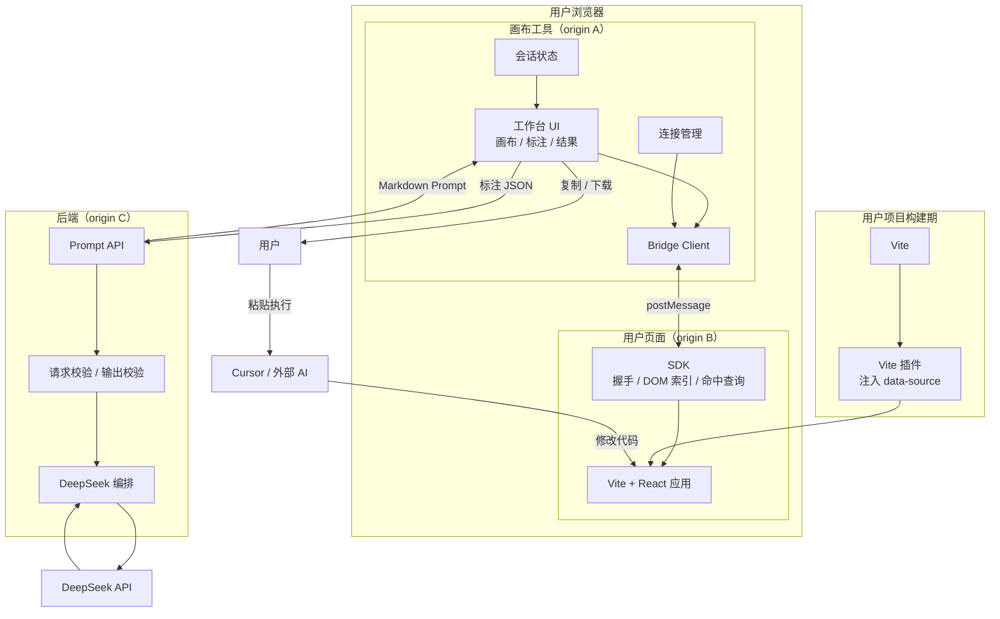
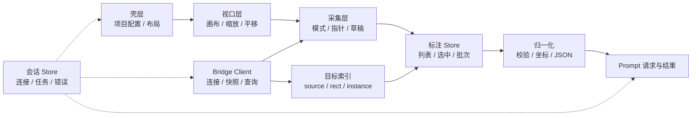
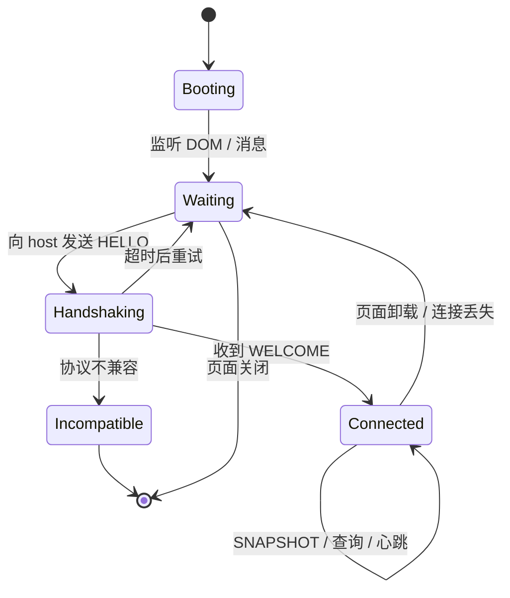
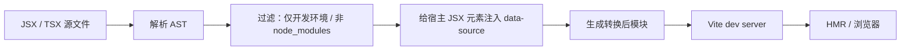
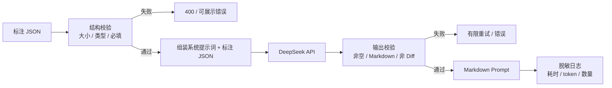
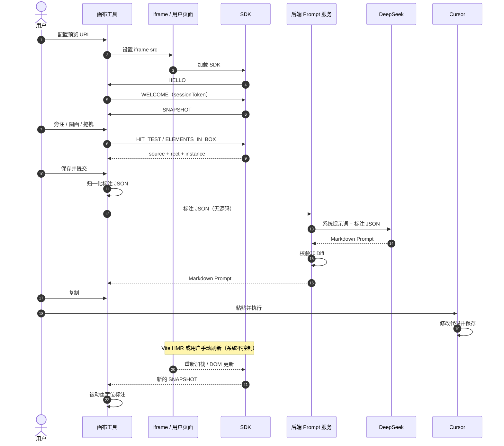
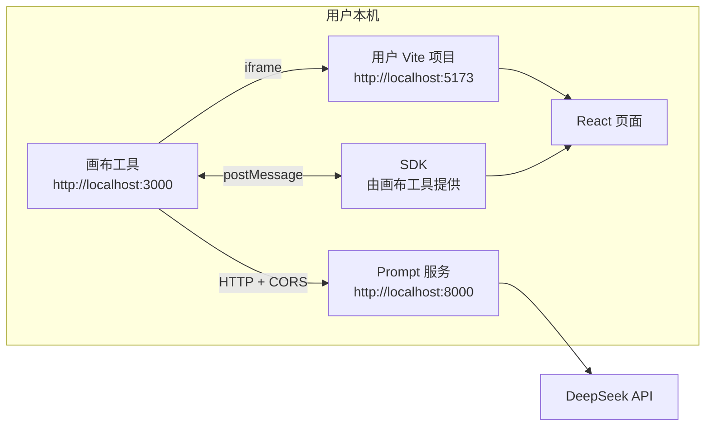

# 02. 整体架构设计

> 状态：草案，等待负责人审核
> 日期：2026-11-02
> 依据：`01.功能模块梳理.md`、Q1–Q5 最终决策
> 范围：整体架构、组件边界、跨域桥接、数据流、部署与安全；不包含数据库表、接口字段和业务代码

> 本文中的消息类别、字段名称只用于说明架构职责，**不是最终接口契约**。具体字段、错误码、版本兼容策略在后续接口设计文档中细化。

## 1. 架构目标

### 1.1 目标

1. **Prompt-only**：系统只生成 Markdown Prompt，不修改代码、不生成 Diff、不编译、不回滚。
2. **零源码访问**：后端不读取用户源码；SDK 只在用户浏览器内读取必要的 DOM 元数据。
3. **跨域可用**：用户的 Vite 项目可以运行在任意本地端口，画布工具作为独立 Web 应用加载它。
4. **精确指认**：通过 Vite 插件注入 `data-source="文件:行号"`，让 Prompt 能直接指向目标文件。
5. **最小信任**：跨域消息必须校验 origin、source、会话 token 和协议版本。
6. **最小数据外发**：只把结构化标注发给后端；不发送源码、完整 DOM、输入值、cookie。
7. **可替换 AI**：DeepSeek 只是 Prompt 生成器；模型、Prompt 文案和后端实现可以替换。
8. **可演进**：MVP 无数据库、无任务队列；后续可以在不改变核心边界的前提下增加历史、截图、流式输出。

### 1.2 非目标

- 不做本地代码编辑 Agent。
- 不做 Diff / patch 生成与校验。
- 不启动、停止、重启或代理用户的 dev server。
- 不控制 iframe 刷新，不监听 Cursor 是否执行完成。
- 不做构建、类型检查、lint、测试、回滚。
- 不做账号、协作、计费、部署。
- 不在 MVP 中引入 MySQL / Redis / MinIO 作为强依赖。

## 2. 决策与架构后果

| 决策 | 结论 | 架构后果 |
|---|---|---|
| Q1 | 只读分析，生成指令；不修改代码、不回滚、不编译 | 后端只做 Prompt 服务；没有代码编辑器和构建系统 |
| Q2 | 输出 Markdown Prompt；标注 JSON 作为 Context；后端不做复杂模板 | 后端保持轻量、无状态；Prompt 由 DeepSeek 生成；需做输出合规校验 |
| Q3 | 用户自己跑 Vite；跨域 iframe + SDK `postMessage` | 新增 SDK、连接状态机、协议版本、origin 校验；删除 dev server 管理 |
| Q4 | Vite 插件注入 `data-source="path:line"` | 新增构建期插件；Prompt 依赖文件路径与行号；需处理插件注入范围 |
| Q5 | 用户复制 Prompt 到 Cursor；HMR / 手动刷新由用户完成 | 删除刷新控制；系统只在 iframe 重新加载后被动重定位标注 |

## 3. 总体架构

### 3.1 组件图



### 3.2 运行时边界

| 边界 | 位置 | 可信度 | 说明 |
|---|---|---|---|
| A：画布工具 origin | 浏览器 / 静态站点 | 可信前端 | 拥有画布、标注、结果 UI；不直接访问 iframe DOM |
| B：用户项目 origin | 浏览器 / Vite dev server | 用户自己的代码 | 通过 SDK 提供 DOM 索引；可能包含业务数据 |
| C：后端 origin | 服务端 | 可信服务 | 持有 DeepSeek Key；不接触源码 |
| B ↔ A | `postMessage` | 跨域、不可信输入 | 必须校验 origin、source、token、协议版本 |
| A ↔ C | HTTP(S) | 跨域或同域 | 需要 CORS / 鉴权策略；只传标注 JSON |
| C ↔ DeepSeek | HTTPS | 外部服务 | 只传标注 JSON 和系统提示词 |
| 用户 ↔ Cursor | 人工 | 外部工具 | 系统不参与执行 |

### 3.3 组件职责

| 组件 | 职责 | 明确不做 |
|---|---|---|
| 画布工具 | 项目配置、iframe 加载、画布与标注、Prompt 展示 | 不读源码、不控制 dev server、不刷新 iframe |
| SDK | 握手、DOM 索引、命中查询、生命周期上报 | 不修改业务 DOM、不上报输入值/完整文本 |
| Vite 插件 | 开发环境注入 `data-source` | 不进入生产构建、不改变组件逻辑 |
| 后端 Prompt 服务 | 校验标注、调用 DeepSeek、返回 Markdown | 不读文件、不生成 Diff、不执行代码 |
| DeepSeek | 生成 Cursor 友好的 Prompt | 不接触源码、不执行代码 |
| Cursor | 用户手动执行 Prompt | 不属于本系统 |

## 4. 前端画布工具架构

### 4.1 内部分层



### 4.2 渲染层结构

画布工具使用“iframe + 覆盖层”的结构：

```text
Canvas
├── iframe（用户页面，跨域）
├── 透明捕获层（编辑模式下拦截指针）
├── SVG 标注层（笔迹、矩形、箭头）
├── 悬浮高亮层
├── 标注浮针层
└── 浮层 UI（旁注编辑框、结果面板、toast）
```

规则：

- **iframe 只负责展示和运行用户页面**，不向其中注入样式或业务脚本。
- **捕获层在编辑模式下拦截指针**，交互模式下 `pointer-events: none`，让用户操作真实页面。
- **父页面不能读取 iframe DOM**；所有目标信息来自 SDK 快照或查询。
- 标注层使用画布世界坐标渲染，缩放时保持贴合。
- 浮针反向缩放，保持屏幕尺寸稳定。

### 4.3 状态模型

画布工具至少维护三类状态：

| 状态类 | 内容 | 生命周期 |
|---|---|---|
| 连接状态 | `idle / loading / handshaking / connected / incompatible / disconnected / error` | 跟随 iframe 与 SDK |
| 标注状态 | 草稿、待提交、已提交、Prompt 已生成、已复制、失效 | 当前会话 |
| 请求状态 | 空闲、请求中、成功、失败、可重试 | 单次 Prompt 请求 |

互斥规则：

- 未 `connected` 时不能提交标注。
- 请求中不能修改当前批次。
- 草稿未保存时不能提交。
- 目标失效的标注不能静默提交，必须提示或阻止。

### 4.4 与 SDK 的交互方式

画布工具不直接操作 iframe，只通过 Bridge Client：

1. 接收 `SNAPSHOT`，更新目标索引和悬浮高亮。
2. 在点击 / 圈画结束时，发送 `HIT_TEST` 或 `ELEMENTS_IN_BOX`，获取权威目标。
3. 在 iframe 滚动 / resize / HMR 后，接收新快照并重定位。
4. 在连接断开时，把相关标注标记为“待重新连接”。

快照用于即时反馈，查询用于提交前的权威校验。两者不一致时，以查询结果为准。

## 5. SDK 架构

### 5.1 运行位置与加载

SDK 是运行在用户页面内的极简 JavaScript：

- 由用户在自己的 `index.html` 中通过 `<script>` 引入，或由接入文档给出等价方式。
- 只在开发环境启用；生产不加载。
- 不依赖 React、Vue 或构建工具，直接操作 DOM API。
- 只向画布工具 origin 发送消息，不向其他窗口广播。

SDK 需要知道画布工具的 origin。优先级：

1. 脚本标签显式配置的 `data-vibe-host`；
2. 从 `document.currentScript.src` 推导；
3. 由接入文档要求显式配置，避免猜测。

### 5.2 生命周期



### 5.3 握手


安全规则：

- 握手前不接受任何 DOM / 标注相关消息。
- `HELLO` 之前，host 不回发敏感配置。
- `WELCOME` 必须发往用户页面 origin，不能使用 `*`。
- SDK 只接受来自配置的 host origin 的 `WELCOME`；收到后保存 token，并对后续消息校验 token。
- iframe 重新加载后，`contentWindow` 变化，host 必须重新绑定并重新握手。

### 5.4 消息类别（概念）

| 消息 | 方向 | 作用 |
|---|---|---|
| `HELLO` | SDK → Host | 上报 origin、协议版本、SDK 版本、能力 |
| `WELCOME` | Host → SDK | 下发 session token、host origin、配置 |
| `SNAPSHOT` | SDK → Host | 上报带 `data-source` 的元素索引、视口、滚动、revision |
| `SNAPSHOT_REQUEST` | Host → SDK | 请求最新快照 |
| `HIT_TEST` | Host → SDK | 用 iframe 本地坐标查询点命中 |
| `HIT_RESULT` | SDK → Host | 返回目标或 null |
| `ELEMENTS_IN_BOX` | Host → SDK | 查询与包围盒相交的目标 |
| `ELEMENTS_RESULT` | SDK → Host | 返回目标集合 |
| `PING` / `PONG` | 双向 | 心跳与连接健康 |
| `ERROR` | 双向 | 协议、查询、渲染错误 |

具体字段、错误码、版本协商在后续接口文档中确定。所有消息必须带 `protocolVersion` 和 `sessionToken`（握手消息除外）。

### 5.5 快照模型

快照不是完整 DOM，而是**用于标注的最小 DOM 索引**：

| 字段 | 说明 |
|---|---|
| `revision` | 快照版本，单调递增 |
| `viewport` | iframe 视口宽高（CSS 像素） |
| `scroll` | iframe 滚动位置 |
| `elements[]` | 带 `data-source` 的元素列表 |
| `element.source` | `相对路径:行号` |
| `element.component` | 组件 / 元素名 |
| `element.instance` | 同一 source 的实例序号 |
| `element.rect` | iframe 本地坐标矩形 |
| `element.depth` | 嵌套深度，用于去重 / 选择 |
| `element.visible` | 是否可见 |

明确不发送：

- 输入框的值、文本内容、cookie、localStorage、sessionStorage；
- 完整 HTML、完整 DOM 树、网络请求、React props / state；
- 源码内容。

如果后续确实需要元素文本作为 Prompt 上下文，必须单独评审，并遵守用户知情与最小化原则。

### 5.6 命中与坐标映射

坐标转换链：

```text
指针屏幕坐标
  → 减去 iframe 屏幕偏移
  → 除以画布缩放
  → iframe 本地坐标
  → SDK elementFromPoint / 矩形查询
  → iframe 本地目标矩形
  → 加上 iframe 世界偏移
  → 画布世界坐标
```

注意：

- SDK 返回的矩形是 iframe 视口坐标；滚动时需结合 `scroll`。
- 画布缩放只影响屏幕显示，不改变世界坐标。
- 捕获层覆盖 iframe 时，指针事件不会进入用户页面；命中必须由 SDK 查询。
- 圈画目标使用 `ELEMENTS_IN_BOX`，由 SDK 在用户页面内计算矩形相交，避免父页面持有过期快照。
- 命中结果为空时，不生成无目标标注；提示用户重新圈选或检查 `data-source`。

### 5.7 HMR / 手动刷新

- 系统不触发刷新。
- Vite HMR 可能只更新部分 DOM，SDK 通过 MutationObserver / resize / scroll 更新快照。
- 整页刷新时，iframe `load` 触发，SDK 重新握手，host 替换快照。
- host 按 `source + instance` 重定位已有标注；找不到则标记失效。
- 已生成的 Prompt 不自动更新；UI 提示“预览已变化，Prompt 可能过期”，由用户决定是否重新生成。
- 系统不等待 HMR，也不判断 HMR 成功；连接状态只反映 iframe / SDK 是否可用。

## 6. Vite 插件架构

### 6.1 转换流程



### 6.2 注入规则

- 只在 Vite `serve` 阶段生效，生产构建不注入。
- 只处理项目源码，排除 `node_modules`、构建产物、测试夹具。
- 默认只给宿主元素（`div`、`button`、`input`、`section` 等）注入，降低自定义组件不透传 `data-*` 的风险。
- `data-source` 使用相对项目根目录的 POSIX 路径 + JSX 元素起始行号，例如 `src/components/Button.tsx:12`。
- 可选注入 `data-component`，用于可读性和 Prompt 描述。
- 同一元素只注入一次，避免 HMR 重复叠加。
- 行号是定位提示，不是稳定主键；Prompt 必须要求 Cursor 以文件内容为准。

### 6.3 自定义组件问题

React 自定义组件不保证把未知 props 透传到 DOM。因此：

- 如果注入到 `<Button>` 这样的组件元素，`data-source` 可能不会出现在真实 DOM 中。
- 注入到组件内部的宿主元素更可靠，但源码位置指向组件内部实现，而不是使用处。
- MVP 建议：**只注入宿主元素**；接入文档说明“组件内部需要有可标注的 DOM 节点”。
- 后续可以评估运行时包装、React DevTools 协议或组件库适配，但不进入 MVP。

### 6.4 开发环境约束

- 生产构建不得包含 `data-source` 和 SDK，避免泄露源码路径。
- 插件版本与 SDK 协议版本分开管理；插件只负责生成标记。
- 插件不读取源码发送到后端；所有转换在用户本地完成。
- 如果用户使用自定义 Vite 配置、多个 root 或 monorepo，路径基准需要在接入文档中说明。

## 7. 后端 Prompt 服务架构

### 7.1 定位

后端不是 Agent，也不是代码执行器，而是一个**无状态 Prompt 生成服务**：

- 输入：结构化标注 JSON、项目名、预览 origin、视口等最小上下文。
- 处理：简单系统提示词 + 标注 JSON → DeepSeek。
- 输出：Markdown Prompt。
- 不接触源码、不接触 DOM、不保存历史。

### 7.2 请求处理流程



### 7.3 输入内容

后端只接收：

- 项目名、预览 origin、视口尺寸；
- 标注数组：类型、意图、目标 `source` / `component` / `instance`、矩形 / 包围盒 / 位移；
- 必要的生成参数（模型、语言等）。

后端不接收：

- 源码、完整 DOM、元素文本、截图（MVP）；
- 用户 cookie、token、localStorage；
- Cursor 的执行结果。

### 7.4 系统提示词的最小职责

按 Q2，后端不做复杂模板，只用简短系统提示词约束模型：

1. 角色：资深前端工程师，为 Cursor 生成可直接执行的修改指令。
2. 输出：Markdown 自然语言指令，包含目标文件 / 行号、逐条修改意图、约束、验收标准。
3. 禁止：不输出 unified diff、patch、完整代码重写；不假设未提供的源码细节。
4. 行为：要求 Cursor 先阅读目标文件；信息不足时写明假设或待确认点。
5. 语言：跟随用户标注语言，默认中文。

系统提示词不拼接具体业务规则、不注入项目源码、不做复杂 Few-shot。

### 7.5 输出校验

必须做最低限度的合规校验：

- 非空、长度合理；
- 是 Markdown 文本；
- 不包含 `diff --git`、`@@` 等明显补丁标记；如果检测到，重试一次，仍失败则返回错误；
- 不包含后端密钥、系统提示词全文等敏感内容；
- 不把模型输出直接作为 HTML 插入页面；展示时使用纯文本或经过净化的 Markdown 渲染。

### 7.6 错误、超时与重试

| 场景 | 行为 |
|---|---|
| DeepSeek 超时 | 返回可重试错误；前端保留标注 |
| 429 / 限流 | 返回等待提示；不自动无限重试 |
| 5xx | 有限重试（如 1 次） |
| 输出不合规 | 重试 1 次；仍失败则报错 |
| 请求体过大 | 拒绝并提示减少标注 |
| 未配置 Key | 服务启动时或请求时明确报错 |

MVP 使用同步 HTTP 请求 / 响应，不使用 WebSocket。Prompt 生成通常数秒，前端展示加载状态即可；流式输出属于后续增强。

### 7.7 配置与日志

- DeepSeek Key 只存在后端环境变量，绝不进入浏览器。
- 模型、超时、最大 token、重试次数可配置。
- 日志记录：请求 ID、标注数量、目标文件列表、耗时、token 用量、错误类型。
- 日志不记录：源码、完整 DOM、用户输入原文（除非用户明确同意）。
- 若后端公网部署，需要鉴权、限流、请求大小限制和配额；本地部署可先最小化。

## 8. 端到端数据流

### 8.1 标注到 Prompt



### 8.2 数据边界

| 数据 | 留在浏览器 | 发给后端 | 发给 DeepSeek | 说明 |
|---|---|---|---|---|
| 用户源码 | 是 | 否 | 否 | 后端无文件访问 |
| 完整 DOM | 是（页面本身） | 否 | 否 | SDK 只采集最小索引 |
| 输入框值 / 文本 | 是（页面本身） | 否 | 否 | SDK 不采集 |
| 标注意图 | 是 | 是 | 是 | 用户主动提交 |
| 文件路径 / 行号 | 是 | 是 | 是 | 来自 `data-source` |
| 元素矩形 / 位移 | 是 | 是 | 是 | 用于描述空间意图 |
| 截图 / 手绘图 | 默认否 | 否 | 否 | M15 待确认 |
| DeepSeek Key | 否 | 否（服务端读取） | 否 | 只配置在后端 |
| Cursor 执行结果 | 否 | 否 | 否 | 系统不掌握 |

### 8.3 隐私原则

- 用户必须知道：提交标注会把意图、文件路径和空间数据发送给 DeepSeek。
- 默认不发送元素文本和表单值；如果未来需要，必须单独开关和说明。
- 日志脱敏；不记录源码和完整 Prompt。
- 后端不持久化标注；除非后续明确增加历史功能。

## 9. 部署架构

### 9.1 MVP：本地优先



特点：

- 所有本地服务使用 HTTP + localhost，避免 HTTPS 混合内容问题。
- 画布工具和 Prompt 服务可以同源部署，也可以分开端口。
- 用户自己的 Vite 项目保持独立，系统不管理其进程。
- 不需要 MySQL / Redis / MinIO；现有 Docker 中间件不参与 MVP。

### 9.2 托管部署（后续）

- 画布工具和 Prompt 服务使用 HTTPS。
- 用户 Vite 仍可能运行在 `http://localhost:5173`；HTTPS 页面嵌入 HTTP localhost iframe 可能被浏览器按混合内容阻止。
- 可选方案：用户通过 HTTPS 隧道暴露本地 dev server；或画布工具提供本地运行版本；或浏览器策略允许 localhost。
- 这是部署风险，不是模块边界问题；MVP 先以本地优先为准。

### 9.3 CORS 与 origin

- iframe 与 `postMessage` 不走 CORS，但必须严格校验 origin。
- 画布工具调用 Prompt API 如果跨域，需要 CORS 白名单，不使用 `*`。
- SDK 只向配置的 host origin 发送消息；host 只向配置的 preview origin 发送消息。
- `localhost` 与 `127.0.0.1` 是不同 origin，接入配置必须精确。

### 9.4 中间件

MVP 不依赖数据库、Redis、MinIO：

- 会话状态在浏览器内存。
- Prompt 服务无状态。
- 如果后续增加 Prompt 历史、审计、截图，再引入 MySQL / MinIO；Redis 可用于限流 / 短期任务状态，但不是当前必需。

## 10. 安全设计

### 10.1 威胁与对策

| 威胁 | 场景 | 对策 |
|---|---|---|
| 伪造消息 | 任意页面向画布工具 `postMessage` | 校验 `event.origin`、`event.source === iframe.contentWindow`、session token、协议版本 |
| 恶意 host | 用户页面收到伪造的 `WELCOME` | SDK 只接受配置的 host origin；收到 WELCOME 后对后续消息校验 token |
| 数据泄露 | SDK 上报输入值 / 文本 | 快照只含 `data-source` 元数据；不采集表单值与文本 |
| API Key 泄露 | Key 写进前端 | Key 只在后端环境变量；前端不接触 |
| Prompt 注入 | 用户标注含恶意指令 | 系统提示词明确把 JSON 当数据；输出只展示不执行；用户自行决定是否复制 |
| XSS | 模型输出含 HTML / script | 纯文本或净化 Markdown 渲染；不 `innerHTML` 模型输出 |
| 资源滥用 | 公网后端被刷 | 鉴权、限流、请求体大小、配额；MVP 本地最小化 |
| 供应链 | SDK / 插件版本漂移 | 协议版本号、最低版本检查、接入诊断 |
| 开发标记泄露 | 生产包包含 `data-source` | 插件只在 `serve` 生效；生产不加载 SDK |
| iframe 逃逸 | 用户页面恶意跳转 / 弹窗 | 最小 sandbox；不允许 top navigation；用户项目本身可信 |

### 10.2 iframe 安全建议

- iframe 使用用户配置的 URL，不使用 `srcdoc`。
- 推荐 `sandbox="allow-scripts allow-same-origin allow-forms"`；不要默认允许 `allow-top-navigation`。
- 如果 sandbox 导致 Vite HMR 或用户应用异常，需要在接入文档中说明取舍。
- `postMessage` 的 `targetOrigin` 不使用 `*`（握手后的消息）。
- iframe 加载失败、origin 不匹配、SDK 未加载时，显示明确诊断，不静默降级。

## 11. 可靠性与错误处理

### 11.1 连接错误

| 场景 | 用户看到 | 系统行为 |
|---|---|---|
| iframe 加载失败 | 预览加载失败 | 保留配置，允许重试 |
| SDK 未加载 | 未检测到 SDK | 显示接入文档；禁止提交标注 |
| origin 不匹配 | 预览来源不匹配 | 拒绝消息；提示检查 URL |
| 协议不兼容 | SDK 版本过旧 | 阻止连接；提示升级 |
| 心跳超时 | 连接已断开 | 标记标注待重连 |
| 快照为空 | 页面没有可标注元素 | 提示检查 Vite 插件 / 组件 |
| 命中失败 | 未找到目标元素 | 不生成标注；提示重选 |

### 11.2 Prompt 错误

| 场景 | 用户看到 | 系统行为 |
|---|---|---|
| 请求中 | 正在生成 Prompt | 禁止重复提交和修改批次 |
| DeepSeek 超时 | 生成超时，可重试 | 保留标注与上一次结果 |
| 限流 | 请求过于频繁 | 显示等待提示 |
| 输出不合规 | 生成结果不可用 | 有限重试；仍失败则报错 |
| 复制失败 | 无法自动复制 | 提供手动选择 / 下载 |

### 11.3 不承诺的事情

- 不承诺 Prompt 一定被 Cursor 正确执行。
- 不承诺 HMR 一定成功。
- 不承诺刷新后标注一定还能定位。
- 不承诺模型理解所有空间意图；信息不足时要求用户补充标注。

## 12. 演进路线

| 阶段 | 增强 | 对架构的影响 |
|---|---|---|
| MVP | 项目接入、SDK、画布、标注、Prompt 生成与复制 | 当前架构 |
| 后续 1 | Prompt 历史、会话恢复 | 增加持久化；Prompt 服务保持无状态 |
| 后续 2 | 流式 Prompt、取消、重试 | 可增加 SSE；不改变边界 |
| 后续 3 | 截图 / 手绘图输入 | 增加 MinIO；DeepSeek 多模态 |
| 后续 4 | 多项目、团队、权限 | 增加账号与项目模型；SDK 协议保持 |
| 后续 5 | Vue / Svelte / 其他构建工具 | 新增对应插件；SDK 与画布核心不变 |

## 13. 架构决策记录（ADR）

| 编号 | 决策 | 理由 | 代价 |
|---|---|---|---|
| ADR-01 | 只输出 Prompt，不修改代码 | 符合 Q1/Q2；边界清晰、风险低 | Prompt 质量依赖标注和模型 |
| ADR-02 | 跨域 iframe + SDK，而不是同源代理 | 不控制用户 dev server；用户可在任意端口运行 | 需要协议、握手、版本管理 |
| ADR-03 | Vite 插件注入 `data-source` | 直接获得文件路径与行号；Prompt 可定位 | 插件接入成本；自定义组件限制 |
| ADR-04 | 后端无状态、无数据库 | MVP 简单；Prompt 服务可水平扩展 | 无历史、无跨设备恢复 |
| ADR-05 | 用户手动复制 Prompt | 不集成 Cursor API；最小权限 | 多一步人工操作 |
| ADR-06 | 系统不控制刷新，只被动重定位 | 符合 Q5；不介入用户构建 | 标注可能过期，需要提示 |
| ADR-07 | 快照只含 `data-source` 元数据 | 数据最小化；避免泄露业务内容 | 模型看不到元素文本，Prompt 上下文有限 |
| ADR-08 | 先只注入宿主元素 | 避免自定义组件不透传 `data-*` | 部分组件定位粒度较粗 |

## 14. 主要风险

| 风险 | 影响 | 缓解 |
|---|---|---|
| Vite 插件覆盖不足 | 部分元素没有 source，无法精确 Prompt | 宿主元素优先；接入诊断；文档说明 |
| 跨域 / 混合内容 | iframe 无法加载 | 本地 HTTP 优先；托管方案单独设计 |
| SDK 快照过期 | 标注矩形偏移 | revision + scroll/resize + 查询兜底 |
| 无源码上下文 | Prompt 可能泛泛 | 文件 / 行号 + 要求 Cursor 先读文件 |
| Prompt 注入 / XSS | 输出被污染或页面被攻击 | 数据分隔、输出净化、不执行模型输出 |
| 协议版本漂移 | 连接失败 | 版本号、兼容检查、诊断 |
| 无“已应用”反馈 | 用户不确定执行结果 | 文案只承诺生成 / 复制；不伪装成功 |
| 生产误带 SDK | 源码路径泄露 | 插件 `serve` only；SDK 仅开发加载 |

## 15. 待确认问题

这些问题不阻塞本文的模块边界，但会影响后续接口与实现：

| 编号 | 问题 | 当前建议 |
|---|---|---|
| Q6 | 画布工具与 Prompt 服务部署在本地还是云端？ | MVP 本地优先；架构保持无状态 |
| Q7 | SDK 如何分发：手动脚本、npm 包、插件自动注入？ | 先手动脚本；后续可封装 |
| Q8 | Vite 插件只注入宿主元素，还是也注入自定义组件？ | 先宿主元素 |
| Q9 | 无 SDK / 无 source 时是否允许提交？ | 建议不允许；只允许预览 |
| Q10 | 是否需要 Prompt 历史 / 标注持久化？ | MVP 会话内；后续加数据库 |
| Q11 | 是否需要截图 / 手绘图片输入？ | 默认不做；M15 待确认 |
| Q12 | 是否支持 Vue / 其他构建工具？ | MVP 只做 Vite + React |
| Q13 | 公网部署是否需要账号、鉴权、限流？ | 如果公网必须做；本地可最小化 |
| Q14 | Prompt 是否允许包含少量代码片段？ | 以自然语言指令为主；不输出 Diff / 完整代码 |
| Q15 | SDK 的“DOM 树”范围：完整 DOM，还是只发送带 `data-source` 的最小索引？ | 建议最小索引；完整 DOM 会带来文本 / 表单值泄露风险 |

## 16. 审核清单

请重点确认：

1. 第 3 节的系统边界是否与你的定位一致：画布工具 + SDK + 无状态 Prompt 服务，没有本地代码 Agent。
2. 第 5 节的跨域握手、origin/source/token 校验是否足够。
3. 第 5.5 节“只发送 data-source 元数据”的数据最小化范围是否接受。
4. 第 6 节 Vite 插件只注入宿主元素是否接受，还是要求覆盖自定义组件。
5. 第 7 节后端只接收标注 JSON、不读源码、只输出 Markdown，是否符合 Q2。
6. 第 9 节本地优先部署、MVP 不依赖 MySQL / Redis / MinIO 是否接受。
7. 第 10 节安全边界是否还有遗漏。
8. 第 15 节 Q6–Q15 是否需要现在回答。

审核通过后再进入下一层设计：跨域消息契约、后端 Prompt API、前端状态机或 SDK / 插件实现方案。当前不开始编码。
