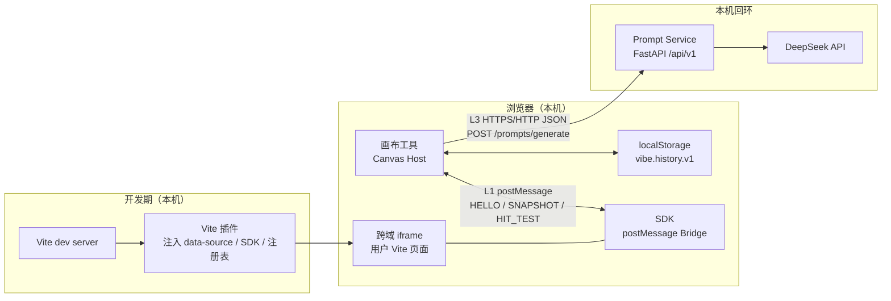
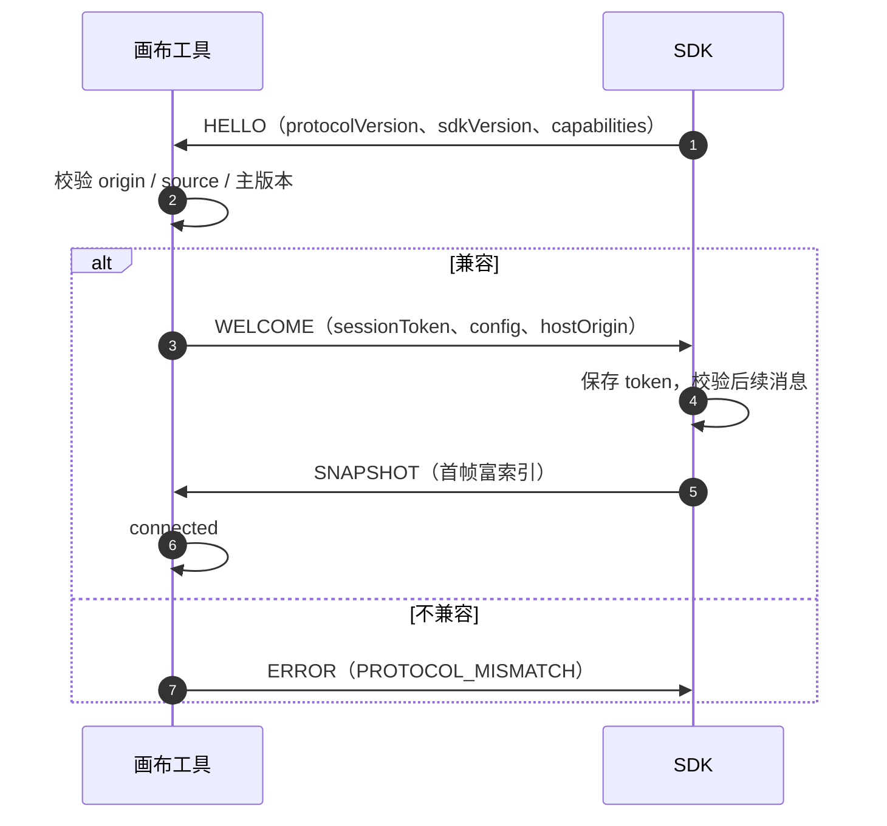
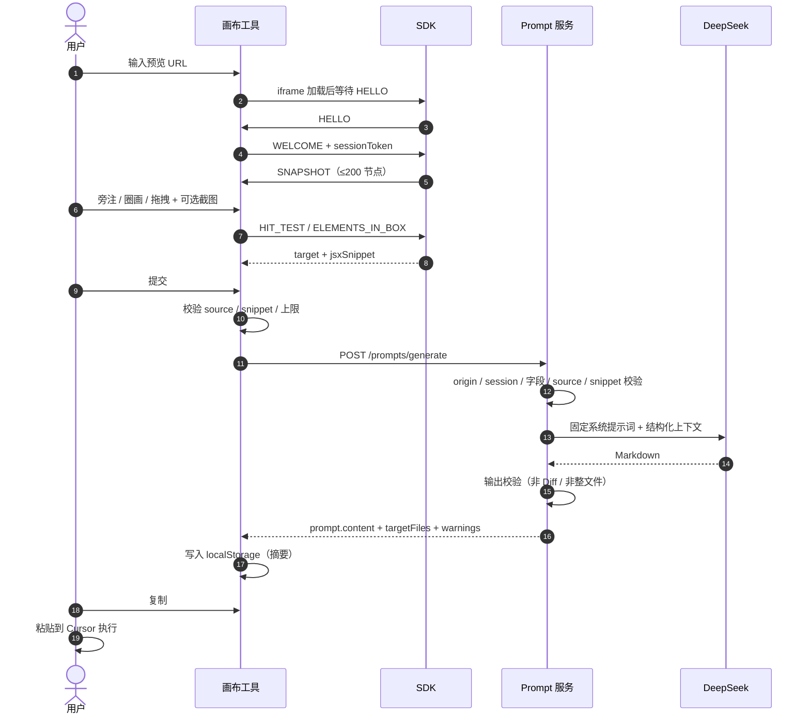

# 03. API 接口设计（v1）

> 状态：v1 已确认，进入阶段四编码（先实现 L3）
> 日期：2026-11-02
> 依据：`01.功能模块梳理.md` v3、`02.整体架构设计.md` v2.2、Q1–Q18 最终决策
> 范围：画布工具 ↔ SDK 的跨域消息协议、Vite 插件注入与片段注册表、画布工具 ↔ Prompt 服务的 HTTP API、`localStorage` 历史结构
> 不包含：数据库表结构、实际代码实现、部署脚本、DeepSeek 账号配置

> 本文只定义契约，不创建任何 `.ts` / `.py` 文件，也不实现接口。所有字段名、错误码与上限在本稿中作为**待评审的接口契约**，评审通过后才进入编码。

## 1. 文档目的

这份文档回答四个问题：

1. 画布工具如何与跨域 iframe 里的 SDK 交换消息；
2. Vite 插件如何自动注入 SDK、`data-source` 与源码片段注册表；
3. 画布工具如何把标注上下文发给后端 Prompt 服务，后端如何返回 Markdown；
4. 本地历史如何存放在 `localStorage`，以及哪些数据永远不进入接口。

接口设计遵循三条硬边界：

- **无源码文件访问**：Prompt 服务只接收客户端提供的片段与结构化上下文，不读用户项目目录。
- **无源码目标不提交**：没有 `data-source` 或没有 JSX 片段，客户端与服务端都拒绝生成 Prompt。
- **无服务端状态**：Prompt 服务不保存会话、标注、Prompt 或图片；历史只在浏览器 `localStorage`。

## 2. 接口分层与总体数据流



| 层 | 方向 | 传输 | 用途 | 是否持久化 |
|---|---|---|---|---|
| L1 跨域桥接 | 画布 ↔ SDK | `window.postMessage` | 握手、快照、命中、片段 | 否 |
| L2 构建期注入 | Vite 插件 → 页面 | Vite 虚拟模块 / 转换 | `data-source`、SDK、片段注册表 | 否（仅 dev server 内存） |
| L3 Prompt API | 画布 → Prompt 服务 | HTTP + JSON | 生成 Markdown Prompt | 否 |
| L4 本地历史 | 画布 ↔ 浏览器 | `localStorage` | 最近操作与 Prompt 摘要 | 仅本机 |

## 3. 通用约定

### 3.1 编码与命名

| 项 | 约定 |
|---|---|
| 字符集 | UTF-8 |
| JSON | RFC 8259；不接受注释、尾逗号、`NaN` / `Infinity` |
| 字段命名 | `camelCase` |
| 时间 | ISO 8601 UTC，毫秒精度，例如 `2026-11-02T10:00:00.000Z` |
| 路径 | 相对项目根目录，POSIX 分隔符，例如 `src/components/Button.tsx` |
| 坐标 | 明确标注坐标系，不使用隐式单位 |
| 空值 | 缺省字段省略；明确无值用 `null`，不用空字符串代替 |
| 版本 | `protocolVersion` 为 `主版本.次版本`，当前 `0.1` |

### 3.2 ID 约定

| 前缀 | 用途 | 生成方 | 生命周期 |
|---|---|---|---|
| `msg_` | 单条桥接消息 | 发送方 | 单次请求 |
| `el_` | 快照内元素临时 ID | SDK | 单次快照 |
| `ann_` | 标注 ID | 画布工具 | 会话 / 本地历史 |
| `req_` | Prompt 请求 ID | 画布工具 | 单次请求 |
| `hist_` | 本地历史条目 ID | 画布工具 | 本地 |
| `st_` | iframe 桥接会话 token | 画布工具 | 单次 iframe 会话 |

ID 只用于关联与排障，不包含用户信息、文件路径或时间戳明文。

### 3.3 统一错误对象

L1 与 L3 都使用同一套错误语义，字段名保持一致：

```json
{
  "error": {
    "code": "SNIPPET_REQUIRED",
    "message": "目标元素缺少 JSX 片段，已阻止生成 Prompt。",
    "details": {
      "annotationId": "ann_01",
      "source": "src/components/Button.tsx:12:5"
    },
    "retryable": false,
    "requestId": "req_01"
  }
}
```

| 字段 | 类型 | 必填 | 说明 |
|---|---|---|---|
| `code` | string | 是 | 稳定错误码，前端按码分支 |
| `message` | string | 是 | 面向用户的中文提示，不包含源码内容 |
| `details` | object | 否 | 结构化定位信息，不含敏感原文 |
| `retryable` | boolean | 是 | 是否建议重试 |
| `requestId` | string | 否 | 关联请求；L1 可为 `messageId` |

### 3.4 全局上限（本稿默认值）

| 项 | 默认值 | 说明 |
|---|---|---|
| `maxSnapshotElements` | 200 | 快照最多 DOM 节点，超出截断（Q18） |
| `maxTextLength` | 200 | 单元素可见文本预览字符数 |
| `maxNeighbors` | 6 | 单元素邻居标识数量 |
| `maxSnippetLines` | 40 | 单个 JSX 片段最大行数 |
| `maxSnippetBytes` | 4096 | 单个 JSX 片段最大字节数 |
| `maxImageBytes` | 1048576 | 单张上传图片 1 MB |
| `maxImageEdge` | 1600 | 图片最长边像素 |
| `maxPointsPerStroke` | 100 | 后端接收的单条手绘关键点数（前端降采样后） |
| `maxRecordedPointsPerStroke` | 5000 | 前端本地可记录的原始点数；不进入 L3 |
| `maxAnnotationsPerRequest` | 50 | 单次生成最多标注数 |
| `maxRequestBodyBytes` | 8388608 | 单次 HTTP 请求体 8 MB |
| `maxHistoryEntries` | 20 | `localStorage` 历史条数 |
| `maxPromptChars` | 20000 | 返回 Markdown 最大字符数 |

上限均可由服务端配置收紧；客户端必须以 `/capabilities` 返回值为准，不得写死。

### 3.5 截断语义

- 任何截断都必须显式标记，不允许静默丢弃。
- 文本截断：`target.truncated.text = true`。
- 邻居截断：`target.truncated.neighbors = true`。
- 片段截断：`jsxSnippet.truncated = true`，并给出 `originalLineCount`。
- 快照截断：`snapshot.meta.truncated = true`，并给出 `omittedCount`。
- 图片超限：直接拒绝，返回 `IMAGE_TOO_LARGE`，不做静默压缩到失真。
- 手绘点位：前端可保留最多 5000 个原始点，但 L3 前必须降采样到 50–100 个关键点，或只传 `bbox`；后端拒绝超过 100 个点。

## 4. 跨域 SDK 协议（L1）

### 4.1 传输与安全

- 传输：`window.postMessage(message, targetOrigin)`。
- 画布 → iframe：`targetOrigin` 必须是配置的预览 origin，禁止 `*`。
- SDK → 画布：`targetOrigin` 必须是插件配置的 `hostOrigin`，禁止 `*`。
- 画布接收消息时必须同时校验：
  1. `event.origin === previewOrigin`；
  2. `event.source === iframe.contentWindow`；
  3. `protocolVersion` 主版本兼容；
  4. 握手完成后 `sessionToken` 匹配。
- SDK 接收消息时必须同时校验：
  1. `event.origin === hostOrigin`；
  2. `event.source === window.parent`；
  3. `protocolVersion` 主版本兼容；
  4. 握手完成后 `sessionToken` 匹配。
- 任一校验失败：丢弃消息；连续失败可断开并提示 `ORIGIN_NOT_ALLOWED` 或 `SESSION_INVALID`。
- 不在消息中传递 API Key、cookie、localStorage、表单值或完整源码文件。

### 4.2 消息信封

所有 L1 消息共享以下顶层字段，消息特有字段与它们平级：

| 字段 | 类型 | 必填 | 说明 |
|---|---|---|---|
| `protocolVersion` | string | 是 | 当前 `0.1` |
| `type` | string | 是 | 消息类型 |
| `messageId` | string | 是 | `msg_` 前缀 |
| `timestamp` | string | 是 | ISO 8601 |
| `sessionToken` | string | 握手后必填 | `WELCOME` 之后的所有消息 |
| `replyTo` | string | 响应必填 | 被响应消息的 `messageId` |

消息类型总览：

| 类型 | 方向 | 用途 |
|---|---|---|
| `HELLO` | SDK → 画布 | 宣告就绪、版本与能力 |
| `WELCOME` | 画布 → SDK | 接受连接、下发 token 与配置 |
| `SNAPSHOT` | SDK → 画布 | 富 DOM 快照 |
| `SNAPSHOT_REQUEST` | 画布 → SDK | 主动请求刷新快照 |
| `HIT_TEST` | 画布 → SDK | 点命中查询 |
| `HIT_RESULT` | SDK → 画布 | 点命中结果 |
| `ELEMENTS_IN_BOX` | 画布 → SDK | 包围盒查询 |
| `ELEMENTS_RESULT` | SDK → 画布 | 包围盒结果 |
| `SOURCE_SNIPPET_REQUEST` | 画布 → SDK | 按 source 取 JSX 片段 |
| `SOURCE_SNIPPET_RESULT` | SDK → 画布 | 片段结果 |
| `PING` / `PONG` | 双向 | 心跳 |
| `ERROR` | 双向 | 协议级错误 |

### 4.3 握手



#### 4.3.1 HELLO

```json
{
  "protocolVersion": "0.1",
  "type": "HELLO",
  "messageId": "msg_hello_01",
  "timestamp": "2026-11-02T10:00:00.000Z",
  "sdkVersion": "0.1.0",
  "pluginVersion": "0.1.0",
  "page": {
    "origin": "http://127.0.0.1:5173",
    "pathname": "/dashboard"
  },
  "capabilities": {
    "snapshot": true,
    "hitTest": true,
    "elementsInBox": true,
    "sourceSnippet": true,
    "maxSnapshotElements": 200,
    "maxSnippetLines": 40,
    "maxSnippetBytes": 4096
  }
}
```

约束：

- `page.pathname` 只保留路径，不带 query / hash，避免泄露查询参数。
- `capabilities` 只声明能力与上限，不包含页面内容。
- HELLO 不携带 `sessionToken`。

#### 4.3.2 WELCOME

```json
{
  "protocolVersion": "0.1",
  "type": "WELCOME",
  "messageId": "msg_welcome_01",
  "replyTo": "msg_hello_01",
  "timestamp": "2026-11-02T10:00:00.120Z",
  "hostOrigin": "http://127.0.0.1:5174",
  "sessionToken": "st_7c1e9a2b",
  "config": {
    "maxSnapshotElements": 200,
    "maxTextLength": 200,
    "maxNeighbors": 6,
    "maxSnippetLines": 40,
    "maxSnippetBytes": 4096,
    "snapshotDebounceMs": 150
  }
}
```

约束：

- `sessionToken` 只在 iframe 会话内有效；页面刷新后重新握手、重新生成。
- 画布不得把 `sessionToken` 写入 `localStorage`、URL 或日志。
- `config` 是服务端 / 画布下发的上限，SDK 必须遵守；SDK 能力更低时取更小值。

#### 4.3.3 握手失败

```json
{
  "protocolVersion": "0.1",
  "type": "ERROR",
  "messageId": "msg_err_01",
  "replyTo": "msg_hello_01",
  "timestamp": "2026-11-02T10:00:00.150Z",
  "error": {
    "code": "PROTOCOL_MISMATCH",
    "message": "SDK 协议版本与画布不兼容，请升级 Vite 插件。",
    "details": {
      "sdkProtocolVersion": "0.1",
      "hostProtocolVersion": "1.0"
    },
    "retryable": false
  }
}
```

### 4.4 富快照 SNAPSHOT

快照是 SDK 生成的富 DOM 索引，只包含带 `data-source` 的元素，由画布保存在内存中。

```json
{
  "protocolVersion": "0.1",
  "type": "SNAPSHOT",
  "messageId": "msg_snap_42",
  "sessionToken": "st_7c1e9a2b",
  "timestamp": "2026-11-02T10:00:01.000Z",
  "revision": 42,
  "viewport": {
    "width": 1280,
    "height": 800,
    "devicePixelRatio": 1
  },
  "scroll": {
    "x": 0,
    "y": 120
  },
  "meta": {
    "elementCount": 3,
    "truncated": false,
    "omittedCount": 0,
    "generatedAt": "2026-11-02T10:00:01.000Z"
  },
  "elements": [
    {
      "elementId": "el_7f3a",
      "source": "src/components/Button.tsx:12:5",
      "sourceKind": "host",
      "component": "Button",
      "instance": 0,
      "tag": "button",
      "text": "保存",
      "rect": {
        "x": 320,
        "y": 180,
        "width": 96,
        "height": 36
      },
      "layout": {
        "display": "inline-flex",
        "position": "static",
        "flexDirection": "row",
        "justifyContent": "center",
        "alignItems": "center",
        "gap": "8px",
        "padding": "8px 16px",
        "margin": "0px",
        "color": "rgb(255, 255, 255)",
        "backgroundColor": "rgb(37, 99, 235)",
        "fontSize": "14px",
        "fontWeight": "500",
        "lineHeight": "20px",
        "borderRadius": "8px"
      },
      "depth": 6,
      "visible": true,
      "neighbors": [
        {
          "relation": "prevSibling",
          "elementId": "el_7f39",
          "source": "src/components/FormActions.tsx:8:7",
          "tag": "button",
          "component": "Button",
          "text": "取消"
        }
      ]
    }
  ]
}
```

字段规则：

| 字段 | 必填 | 说明 |
|---|---|---|
| `revision` | 是 | 单调递增；画布只接受不小于当前值的快照 |
| `viewport` | 是 | iframe 视口 CSS 像素 |
| `scroll` | 是 | iframe 滚动位置 |
| `meta.truncated` | 是 | 是否因 200 节点上限截断 |
| `meta.omittedCount` | 是 | 被省略节点数，未知时为 `0` |
| `elements[].elementId` | 是 | 仅当前快照有效，用于邻居引用 |
| `elements[].source` | 是 | 来自 `data-source`，格式见 4.8 |
| `elements[].sourceKind` | 是 | `host` / `component-usage` / `component-root` |
| `elements[].instance` | 是 | 同一 source 的实例序号，从 0 开始 |
| `elements[].text` | 否 | 可见文本预览，最多 200 字符；无文本时省略 |
| `elements[].rect` | 是 | iframe 视口坐标，不是画布世界坐标 |
| `elements[].layout` | 是 | 白名单属性，缺失属性省略 |
| `elements[].neighbors` | 否 | 最多 6 个，只含带 `data-source` 的邻居 |

快照过滤规则（Q18）：

- 生成索引前过滤 `display: none` 的节点；其子树同样不进入快照。
- 200 节点上限按过滤后的元素计数。
- 不因过滤而伪造 `text` / 布局数据；被过滤元素视为不可命中。

禁止字段：

- 表单值、`password`、`textarea` 内容、隐藏文本；
- cookie、`localStorage`、`sessionStorage`、网络请求；
- 完整 HTML、完整 DOM 树、React props / state；
- 完整源码文件、图片二进制。

### 4.5 目标对象 Target

`HIT_RESULT`、`ELEMENTS_RESULT` 与 L3 请求复用同一目标结构。

```json
{
  "elementId": "el_7f3a",
  "source": "src/components/Button.tsx:12:5",
  "sourceKind": "host",
  "component": "Button",
  "instance": 0,
  "tag": "button",
  "text": "保存",
  "rect": {
    "x": 320,
    "y": 180,
    "width": 96,
    "height": 36
  },
  "coordinateSpace": "iframe-viewport",
  "layout": {
    "display": "inline-flex",
    "gap": "8px",
    "padding": "8px 16px",
    "backgroundColor": "rgb(37, 99, 235)",
    "borderRadius": "8px"
  },
  "neighbors": [],
  "truncated": {
    "text": false,
    "neighbors": false
  },
  "snippetAvailable": true
}
```

- `coordinateSpace` 在 L1 固定为 `iframe-viewport`；进入 L3 时由画布转换为 `world`，并写入 `annotation.worldRect`。
- `snippetAvailable` 是快照内的提示；提交前必须用 `SOURCE_SNIPPET_REQUEST` 复核。
- 没有 `data-source` 时，SDK 返回 `SOURCE_NOT_FOUND`，不构造 Target。

### 4.6 查询消息

#### 4.6.1 SNAPSHOT_REQUEST

```json
{
  "protocolVersion": "0.1",
  "type": "SNAPSHOT_REQUEST",
  "messageId": "msg_snapreq_01",
  "sessionToken": "st_7c1e9a2b",
  "timestamp": "2026-11-02T10:00:02.000Z",
  "reason": "manual-refresh",
  "includeSnippets": false
}
```

`reason` 取值：`manual-refresh`、`hmr`、`scroll`、`resize`、`reconnect`。

#### 4.6.2 HIT_TEST

坐标为 iframe 视口 CSS 像素，由画布完成屏幕 → iframe 坐标换算后传入。

```json
{
  "protocolVersion": "0.1",
  "type": "HIT_TEST",
  "messageId": "msg_hit_01",
  "sessionToken": "st_7c1e9a2b",
  "timestamp": "2026-11-02T10:00:03.000Z",
  "x": 368,
  "y": 198,
  "includeSnippet": true,
  "includeContext": true
}
```

#### 4.6.3 HIT_RESULT

```json
{
  "protocolVersion": "0.1",
  "type": "HIT_RESULT",
  "messageId": "msg_hit_02",
  "replyTo": "msg_hit_01",
  "sessionToken": "st_7c1e9a2b",
  "timestamp": "2026-11-02T10:00:03.040Z",
  "hit": true,
  "target": {
    "elementId": "el_7f3a",
    "source": "src/components/Button.tsx:12:5",
    "sourceKind": "host",
    "component": "Button",
    "instance": 0,
    "tag": "button",
    "text": "保存",
    "rect": {
      "x": 320,
      "y": 180,
      "width": 96,
      "height": 36
    },
    "coordinateSpace": "iframe-viewport",
    "layout": {
      "display": "inline-flex",
      "gap": "8px",
      "padding": "8px 16px",
      "backgroundColor": "rgb(37, 99, 235)",
      "borderRadius": "8px"
    },
    "neighbors": [],
    "truncated": {
      "text": false,
      "neighbors": false
    },
    "snippetAvailable": true
  },
  "jsxSnippet": {
    "source": "src/components/Button.tsx:12:5",
    "startLine": 10,
    "endLine": 18,
    "content": "<button className=\"btn btn-primary\" onClick={onSave}>\n  保存\n</button>",
    "truncated": false,
    "originalLineCount": 9,
    "contentHash": "sha256:9c1f0e7a"
  }
}
```

未命中：

```json
{
  "protocolVersion": "0.1",
  "type": "HIT_RESULT",
  "messageId": "msg_hit_03",
  "replyTo": "msg_hit_01",
  "sessionToken": "st_7c1e9a2b",
  "timestamp": "2026-11-02T10:00:03.040Z",
  "hit": false,
  "target": null,
  "error": {
    "code": "SOURCE_NOT_FOUND",
    "message": "该位置没有带 data-source 的元素，无法生成可定位的标注。",
    "details": {
      "x": 368,
      "y": 198
    },
    "retryable": false
  }
}
```

规则：

- 命中链路上最近的 `data-source` 元素胜出；父容器不因包含子元素而被误选。
- 未命中或无 `data-source`：`hit=false`，不生成可提交标注。
- `includeSnippet=true` 但注册表未命中：`target` 仍返回，`jsxSnippet` 省略，并带 `SNIPPET_NOT_FOUND` 错误；画布必须阻止提交。
- `includeContext=false` 时，`text`、`layout`、`neighbors` 可省略；提交前仍会重新查询。

#### 4.6.4 ELEMENTS_IN_BOX

```json
{
  "protocolVersion": "0.1",
  "type": "ELEMENTS_IN_BOX",
  "messageId": "msg_box_01",
  "sessionToken": "st_7c1e9a2b",
  "timestamp": "2026-11-02T10:00:04.000Z",
  "rect": {
    "x": 200,
    "y": 100,
    "width": 400,
    "height": 240
  },
  "coordinateSpace": "iframe-viewport",
  "limit": 50,
  "includeSnippet": false
}
```

#### 4.6.5 ELEMENTS_RESULT

```json
{
  "protocolVersion": "0.1",
  "type": "ELEMENTS_RESULT",
  "messageId": "msg_box_02",
  "replyTo": "msg_box_01",
  "sessionToken": "st_7c1e9a2b",
  "timestamp": "2026-11-02T10:00:04.050Z",
  "truncated": false,
  "elements": [
    {
      "elementId": "el_7f3a",
      "source": "src/components/Button.tsx:12:5",
      "sourceKind": "host",
      "component": "Button",
      "instance": 0,
      "tag": "button",
      "text": "保存",
      "rect": {
        "x": 320,
        "y": 180,
        "width": 96,
        "height": 36
      },
      "coordinateSpace": "iframe-viewport",
      "layout": {
        "display": "inline-flex",
        "gap": "8px",
        "padding": "8px 16px",
        "backgroundColor": "rgb(37, 99, 235)",
        "borderRadius": "8px"
      },
      "neighbors": [],
      "truncated": {
        "text": false,
        "neighbors": false
      },
      "snippetAvailable": true
    }
  ]
}
```

规则：

- 只返回与包围盒相交且带 `data-source` 的元素。
- 默认按“面积大 → 深度浅”排序；嵌套父容器可能同时命中，由用户在画布上确认目标集合。
- 超过 `limit` 时截断，`truncated=true`，不静默丢弃。
- 圈画目标集合用于生成 `relatedSources`；主目标仍以用户点选或第一个命中为准。

#### 4.6.6 SOURCE_SNIPPET_REQUEST

```json
{
  "protocolVersion": "0.1",
  "type": "SOURCE_SNIPPET_REQUEST",
  "messageId": "msg_snip_01",
  "sessionToken": "st_7c1e9a2b",
  "timestamp": "2026-11-02T10:00:05.000Z",
  "source": "src/components/Button.tsx:12:5",
  "maxLines": 40,
  "maxBytes": 4096
}
```

#### 4.6.7 SOURCE_SNIPPET_RESULT

```json
{
  "protocolVersion": "0.1",
  "type": "SOURCE_SNIPPET_RESULT",
  "messageId": "msg_snip_02",
  "replyTo": "msg_snip_01",
  "sessionToken": "st_7c1e9a2b",
  "timestamp": "2026-11-02T10:00:05.030Z",
  "found": true,
  "jsxSnippet": {
    "source": "src/components/Button.tsx:12:5",
    "startLine": 10,
    "endLine": 18,
    "content": "<button className=\"btn btn-primary\" onClick={onSave}>\n  保存\n</button>",
    "truncated": false,
    "originalLineCount": 9,
    "contentHash": "sha256:9c1f0e7a"
  }
}
```

未找到：

```json
{
  "protocolVersion": "0.1",
  "type": "SOURCE_SNIPPET_RESULT",
  "messageId": "msg_snip_03",
  "replyTo": "msg_snip_01",
  "sessionToken": "st_7c1e9a2b",
  "timestamp": "2026-11-02T10:00:05.030Z",
  "found": false,
  "jsxSnippet": null,
  "error": {
    "code": "SNIPPET_NOT_FOUND",
    "message": "源码片段注册表未命中该 source，可能已重命名或 HMR 尚未完成。",
    "details": {
      "source": "src/components/Button.tsx:12:5"
    },
    "retryable": true
  }
}
```

### 4.7 心跳与协议错误

#### 4.7.1 PING / PONG

```json
{
  "protocolVersion": "0.1",
  "type": "PING",
  "messageId": "msg_ping_01",
  "sessionToken": "st_7c1e9a2b",
  "timestamp": "2026-11-02T10:00:10.000Z"
}
```

```json
{
  "protocolVersion": "0.1",
  "type": "PONG",
  "messageId": "msg_pong_01",
  "replyTo": "msg_ping_01",
  "sessionToken": "st_7c1e9a2b",
  "timestamp": "2026-11-02T10:00:10.010Z"
}
```

- 画布每 15 秒发一次 `PING`；连续 3 次无 `PONG` 视为连接丢失。
- 页面隐藏时暂停心跳；恢复可见时立即发一次。

#### 4.7.2 ERROR 错误码

| 错误码 | 触发方 | 含义 | 客户端行为 |
|---|---|---|---|
| `ORIGIN_NOT_ALLOWED` | 画布 / SDK | origin 不在白名单 | 丢弃消息，提示检查配置 |
| `SESSION_INVALID` | 画布 / SDK | token 缺失或不匹配 | 断开并重新握手 |
| `PROTOCOL_MISMATCH` | 画布 / SDK | 主版本不兼容 | 阻止连接，提示升级插件 |
| `SOURCE_NOT_FOUND` | SDK | 命中位置无 `data-source` | 不生成标注，提示重新选择 |
| `SNIPPET_NOT_FOUND` | SDK | 注册表无该 source | 阻止提交，允许重试 |
| `SNAPSHOT_TRUNCATED` | SDK | 快照被截断且目标不在其中 | 提示补查或缩小视口 |
| `INVALID_MESSAGE` | 双向 | 字段缺失或类型错误 | 丢弃并记录计数 |
| `INTERNAL_ERROR` | 双向 | SDK 内部异常 | 提示重连；可重试一次 |

### 4.8 `source` 与 `sourceKind`

`source` 格式：

```text
相对路径:行号[:列号]
```

示例：

```text
src/components/Button.tsx:12:5
src/pages/Dashboard.tsx:88
```

规则：

- 路径相对项目根目录，POSIX 分隔符，不带 `..`、盘符、`file://` 或绝对路径。
- 行号、列号从 1 开始；列号可省略。
- 同一 DOM 节点只保留一个 `source`，以最近的 `data-source` 为准。
- `instance` 是同一 `source` 在快照中的出现序号，用于 HMR 后重定位；不是稳定主键。

| `sourceKind` | 含义 | 产生方式 |
|---|---|---|
| `host` | DOM 宿主元素自身的 JSX | 插件给 `JSXOpeningElement` 注入，属性透传到 DOM |
| `component-usage` | 自定义组件的使用处 | 插件在使用处注入，组件把 `data-*` 透传到根 DOM |
| `component-root` | 组件定义内部的根宿主节点 | 使用处无法透传时，由组件根节点兜底 |

### 4.9 JSX 片段规则

- 只包含与 `source` 对应的单个 JSX 元素及其直接子节点，不返回整文件。
- 最多 40 行、4 KB；超出时截断并标记 `truncated=true`。
- `content` 是纯文本，不含 source map、注释或文件头。
- `contentHash` 用于检测 HMR 后片段是否变化；算法由实现决定，契约只要求稳定。
- 片段可能包含硬编码文案或测试数据；只在 L1 内传输，提交前必须提示用户“片段会发送给模型”。
- 片段不写入日志、不写入 `localStorage`。

### 4.10 快照截断后的补查

当 `meta.truncated=true` 且目标不在快照内：

1. 画布不再依赖快照判断，直接发送 `HIT_TEST` / `ELEMENTS_IN_BOX`。
2. SDK 在实时 DOM 上查询，不受 200 节点快照限制。
3. 查询结果仍受单次 `limit` 与消息大小限制。
4. 若实时查询也找不到 `data-source`，返回 `SOURCE_NOT_FOUND`。
5. 查询结果不自动回写整份快照，避免快照无限增长；只更新相关标注的目标缓存。

## 5. Vite 插件与 SDK 注入接口（L2）

### 5.1 适用范围

- 仅支持 **Vite + React**（Q12）。
- 仅在 `vite serve` 开发环境启用；`vite build` 不注入 `data-source`、SDK 或注册表。
- 只处理项目第一方源码；默认排除 `node_modules`、`dist`、`.git`。
- 不改变组件 API、不包裹 DOM、不修改运行时行为。

### 5.2 插件选项

| 选项 | 类型 | 必填 | 默认 | 说明 |
|---|---|---|---|---|
| `hostOrigin` | string | 是 | 无 | 画布工具 origin，必须精确匹配 |
| `enabled` | boolean | 否 | `true` | 仅 `serve` 生效；`false` 时完全不注入 |
| `include` | string[] | 否 | `["src/**/*.{jsx,tsx}"]` | 参与转换的第一方文件 |
| `exclude` | string[] | 否 | `["**/node_modules/**"]` | 排除文件 |
| `sourceRoot` | string | 否 | 项目根 | `source` 相对路径的基准 |
| `injectSdk` | boolean | 否 | `true` | 自动注入 SDK；MVP 不允许关闭 |
| `maxSnapshotElements` | number | 否 | `200` | 下发给 SDK 的快照上限 |
| `maxTextLength` | number | 否 | `200` | 文本预览上限 |
| `maxNeighbors` | number | 否 | `6` | 邻居上限 |
| `maxSnippetLines` | number | 否 | `40` | 片段行数上限 |
| `maxSnippetBytes` | number | 否 | `4096` | 片段字节上限 |
| `snapshotDebounceMs` | number | 否 | `150` | DOM 变化合并窗口 |

配置示例（概念）：

```json
{
  "hostOrigin": "http://127.0.0.1:5174",
  "include": ["src/**/*.{jsx,tsx}"],
  "sourceRoot": ".",
  "maxSnapshotElements": 200,
  "maxSnippetLines": 40
}
```

### 5.3 自动注入契约

插件在开发环境向页面注入一个模块脚本，至少包含：

| 注入项 | 形式 | 说明 |
|---|---|---|
| SDK 脚本 | `<script type="module">` | 由插件生成，用户不手写 |
| 宿主 origin | `data-vibe-host="http://127.0.0.1:5174"` | SDK 只向该 origin 发消息 |
| 协议版本 | `data-vibe-protocol="0.1"` | 版本不匹配时拒绝启动 |
| SDK 版本 | `data-vibe-sdk-version="0.1.0"` | 诊断用 |
| 注册表 | 虚拟模块 / 内联映射 | `source → snippet`，只在 dev server 内存 |

约束：

- 不提供手动 `<script>` 接入方式（Q7）。
- `hostOrigin` 缺失或非法时，SDK 不启动，控制台输出接入错误；画布显示“未检测到 SDK”。
- 同一页面只注入一次；HMR 后复用同一注册表实例并更新版本。
- 注入内容不写入生产构建产物。

### 5.4 源码片段注册表

注册表是插件在转换阶段生成的内存映射：

| 字段 | 类型 | 说明 |
|---|---|---|
| `source` | string | `相对路径:行号[:列号]` |
| `file` | string | 相对路径，不含行号 |
| `line` | number | 起始行 |
| `column` | number | 起始列，未知时为 `1` |
| `component` | string | 最近组件名，未知时为标签名 |
| `kind` | string | `host` / `component-usage` / `component-root` |
| `jsxSnippet` | string | 最多 40 行 / 4 KB |
| `contentHash` | string | 片段哈希 |
| `updatedAt` | string | 最近转换时间 |

查询语义：

- 精确匹配 `source`；不做模糊匹配、不做文本搜索。
- 未命中返回 `SNIPPET_NOT_FOUND`，不返回空片段冒充成功。
- HMR 后按文件更新对应条目；删除的 source 从注册表移除。
- 注册表不通过 HTTP 暴露，只由 SDK 在页面内按需读取。

### 5.5 注入规则

| 节点 | 注入 | 说明 |
|---|---|---|
| 第一方宿主 JSX | `data-source` + `data-source-kind="host"` | 直接在 DOM 上生效 |
| 第一方自定义组件使用处 | `data-source` + `data-source-kind="component-usage"` | 依赖组件透传 `data-*` 到根 DOM |
| 自定义组件根宿主节点 | `data-source` + `data-source-kind="component-root"` | 使用处不透传时的兜底 |
| 第三方组件 | 不注入 | 无 `data-source` 祖先时阻断 |
| 动态 `React.createElement` / `innerHTML` | 不保证 | 没有插件标记则阻断 |
| 生产构建 | 不注入 | 避免源码路径泄露 |

`data-component` 可选，用于诊断与 Prompt 可读性；没有时不伪造。

### 5.6 接入诊断

画布在连接阶段展示以下状态：

| 状态 | 判定 | 用户提示 |
|---|---|---|
| `NO_SDK` | 超时未收到 HELLO | 检查插件是否启用、`hostOrigin` 是否正确 |
| `NO_SOURCE` | 快照为空 | 检查 `include` 是否覆盖源码、是否 Vite + React |
| `SNIPPET_REGISTRY_EMPTY` | 有 source 但所有片段缺失 | 检查插件版本与转换错误 |
| `TRUNCATED` | `meta.truncated=true` | 快照已截断，目标可能需补查 |
| `PROTOCOL_MISMATCH` | 主版本不兼容 | 升级插件 / 画布 |
| `CONNECTED` | 握手成功且快照非空 | 可开始标注 |

## 6. Prompt Service HTTP API（L3）

### 6.1 基础约定

| 项 | 约定 |
|---|---|
| Base URL | `http://127.0.0.1:8000/api/v1` |
| 监听地址 | 仅 `127.0.0.1`，不监听 `0.0.0.0` |
| 协议 | HTTP/1.1；本地不做 TLS |
| 内容类型 | `application/json; charset=utf-8` |
| 认证 | 本地会话头 + 精确 CORS；不做账号体系 |
| 版本 | URL 路径 `/api/v1` |
| 状态 | 无状态；不保存请求、标注、Prompt、图片 |

### 6.2 请求头

| 头 | 必填 | 说明 |
|---|---|---|
| `Content-Type` | POST 必填 | `application/json` |
| `Accept` | 否 | 固定 `application/json` |
| `Origin` | 浏览器自动 | 必须在 `VIBE_ALLOWED_ORIGINS` 白名单 |
| `X-Vibe-Session` | 是 | 画布本地生成的 opaque 会话标识，格式 `st_[A-Za-z0-9_-]{8,64}`；服务端只校验格式与存在性，不建立服务端会话 |
| `X-Vibe-Request-Id` | 是 | 与请求体 `requestId` 一致，便于排障 |
| `X-Vibe-Client-Version` | 否 | 画布版本，用于兼容诊断 |

约束：

- 不使用 cookie、不使用 `Authorization`、不启用 CORS credentials。
- `X-Vibe-Session` 不是身份认证，只是本地 CSRF / 误调用防护；不得写入日志。
- 服务端不把 `X-Vibe-Session` 与任何用户身份关联。

### 6.3 端点总览

| 方法 | 路径 | 用途 | 是否调用模型 |
|---|---|---|---|
| `GET` | `/health` | 存活检查 | 否 |
| `GET` | `/capabilities` | 返回版本、上限、模型能力 | 否 |
| `POST` | `/prompts/generate` | 生成 Markdown Prompt | 是 |

### 6.4 GET /health

响应 `200`：

```json
{
  "status": "ok",
  "service": "vibe-prompt-service",
  "apiVersion": "v1",
  "protocolVersion": "0.1",
  "time": "2026-11-02T10:00:00.000Z"
}
```

- 不返回模型 Key、内部路径、依赖版本明细。
- 服务未就绪时返回 `503`，结构同上，`status` 为 `degraded`。

### 6.5 GET /capabilities

响应 `200`：

```json
{
  "apiVersion": "v1",
  "protocolVersion": "0.1",
  "model": {
    "provider": "deepseek",
    "name": "deepseek-chat",
    "visionModel": "deepseek-flash",
    "multimodal": true
  },
  "limits": {
    "maxSnapshotElements": 200,
    "maxTextLength": 200,
    "maxNeighbors": 6,
    "maxSnippetLines": 40,
    "maxSnippetBytes": 4096,
    "maxImageBytes": 1048576,
    "maxImageEdge": 1600,
    "maxPointsPerStroke": 100,
    "maxRecordedPointsPerStroke": 5000,
    "maxAnnotationsPerRequest": 50,
    "maxRequestBodyBytes": 8388608,
    "maxPromptChars": 20000
  },
  "features": {
    "markdownOnly": true,
    "sourceRequired": true,
    "snippetRequired": true,
    "serverHistory": false,
    "streaming": false,
    "imageInput": true,
    "visualOnlyAnnotations": true,
    "snapshotFiltersDisplayNone": true
  }
}
```

- 画布启动时拉取一次；失败时使用本地默认值，但提交仍以服务端校验为准。
- `features.imageInput=true`：接口接受顶层 `image_base64`。Mock 模式下也可用于本地联调（返回 `mock-vision-v1`，不做真实识图）。
- `model.multimodal` 只表示是否具备真实识图能力；`model.visionModel` 是携带图片时实际使用的模型。
- `features.sourceRequired` / `features.snippetRequired` 针对源码标注；`visual-draw` 豁免，但必须同时提供顶层 `image_base64`。
- `features.visualOnlyAnnotations=true` 时，前端可在未握手页面使用上传 / 粘贴截图 + 圈画。

### 6.6 POST /prompts/generate

#### 6.6.1 请求结构

```json
{
  "requestId": "req_01",
  "protocolVersion": "0.1",
  "project": {
    "name": "my-dashboard",
    "framework": "vite-react",
    "previewOrigin": "http://127.0.0.1:5173"
  },
  "locale": "zh-CN",
  "annotations": [
    {
      "annotationId": "ann_01",
      "type": "note",
      "intent": "把按钮主色改成品牌蓝，并保持圆角不变。",
      "createdAt": "2026-11-02T10:01:00.000Z",
      "target": {
        "source": "src/components/Button.tsx:12:5",
        "sourceKind": "host",
        "component": "Button",
        "instance": 0,
        "tag": "button",
        "text": "保存",
        "rect": {
          "x": 320,
          "y": 180,
          "width": 96,
          "height": 36
        },
        "coordinateSpace": "world",
        "layout": {
          "display": "inline-flex",
          "gap": "8px",
          "padding": "8px 16px",
          "backgroundColor": "rgb(37, 99, 235)",
          "borderRadius": "8px"
        },
        "neighbors": [],
        "truncated": {
          "text": false,
          "neighbors": false
        }
      },
      "jsxSnippet": {
        "source": "src/components/Button.tsx:12:5",
        "startLine": 10,
        "endLine": 18,
        "content": "<button className=\"btn btn-primary\" onClick={onSave}>\n  保存\n</button>",
        "truncated": false,
        "originalLineCount": 9,
        "contentHash": "sha256:9c1f0e7a"
      },
      "visual": null
    }
  ],
  "options": {
    "outputLanguage": "zh-CN",
    "maxPromptChars": 12000
  }
}
```

字段说明：

| 字段 | 必填 | 说明 |
|---|---|---|
| `requestId` | 是 | `req_` 前缀，与请求头一致；仅用于排障，不做服务端去重 |
| `protocolVersion` | 是 | 必须与服务端主版本兼容 |
| `project.name` | 是 | 展示用项目名，不含路径 |
| `project.framework` | 是 | MVP 固定 `vite-react` |
| `project.previewOrigin` | 是 | 必须是回环地址，服务端只做格式校验 |
| `locale` | 否 | Prompt 语言，默认 `zh-CN` |
| `annotations` | 是 | 0–50 条；无截图时至少 1 条；有 `image_base64` 时可为空 |
| `image_base64` | 否 | 视觉模式合成图，PNG / JPEG / WebP base64 data URL，解码后 ≤ 1 MB |
| `options.outputLanguage` | 否 | `zh-CN` / `en`；默认跟随 `locale` |
| `options.maxPromptChars` | 否 | 不得超过 `/capabilities` 上限 |

#### 6.6.2 标注结构

| 字段 | 类型 | 必填 | 说明 |
|---|---|---|---|
| `annotationId` | string | 是 | `ann_` 前缀 |
| `type` | string | 是 | `note` / `draw` / `drag` / `visual-draw` |
| `intent` | string | 是 | 用户输入的修改意图，1–2000 字符 |
| `createdAt` | string | 是 | ISO 8601 |
| `target` | object | 条件必填 | 源码标注必填，见 6.6.3；`visual-draw` 必须为空 |
| `jsxSnippet` | object | 条件必填 | 源码标注必填，见 6.6.4；`visual-draw` 必须为空 |
| `visual` | object / null | 条件必填 | 见 6.6.5；`draw` / `visual-draw` 必填 |
| `drag` | object / null | 否 | 见 6.6.6；`drag` 必填；`visual-draw` 不允许 |

`visual-draw` 是仅视觉模式的唯一标注类型：没有 `target` / `jsxSnippet` / `drag`，
但请求必须携带顶层 `image_base64`，否则返回 `SOURCE_REQUIRED`。

#### 6.6.3 target

| 字段 | 必填 | 说明 |
|---|---|---|
| `source` | 是 | 非空；服务端不解析文件，只校验格式 |
| `sourceKind` | 是 | `host` / `component-usage` / `component-root` |
| `component` | 否 | 组件名 |
| `instance` | 否 | 实例序号，默认 `0` |
| `tag` | 否 | 小写标签名 |
| `text` | 否 | 可见文本预览，最多 200 字符 |
| `rect` | 是 | 画布世界坐标矩形 |
| `coordinateSpace` | 是 | L3 固定 `world` |
| `layout` | 否 | 白名单属性；未知属性服务端忽略 |
| `neighbors` | 否 | 最多 6 个，只含标识与关系 |
| `truncated` | 否 | 文本 / 邻居截断标记 |

`source` 格式校验：

```text
^(?!.*\.\.)(?!.*\\)[A-Za-z0-9._@/-]+\.(jsx|tsx|js|ts):[1-9][0-9]*(?::[1-9][0-9]*)?$
```

不满足即 `VALIDATION_FAILED`；`source` 缺失或空字符串即 `SOURCE_REQUIRED`。

#### 6.6.4 jsxSnippet

| 字段 | 必填 | 说明 |
|---|---|---|
| `source` | 是 | 必须与 `target.source` 完全一致 |
| `startLine` | 是 | 起始行，≥ 1 |
| `endLine` | 是 | 结束行，≥ `startLine` |
| `content` | 是 | 非空纯文本，≤ 4 KB |
| `truncated` | 是 | 是否截断 |
| `originalLineCount` | 否 | 截断前总行数 |
| `contentHash` | 否 | 客户端计算的哈希 |

服务端校验：

- `source` 不一致 → `SNIPPET_REQUIRED`；
- `content` 为空 → `SNIPPET_REQUIRED`；
- 超过 4 KB 或 40 行 → `REQUEST_TOO_LARGE`；
- 片段只作为上下文，不允许模型原样输出为代码块。

#### 6.6.5 visual（手绘）

```json
{
  "kind": "draw",
  "points": [
    { "x": 120, "y": 80 },
    { "x": 132, "y": 72 },
    { "x": 148, "y": 68 },
    { "x": 200, "y": 80 }
  ],
  "pointCount": 4,
  "bbox": {
    "x": 120,
    "y": 60,
    "width": 80,
    "height": 20
  },
  "stroke": {
    "color": "#ef4444",
    "width": 3
  },
  "relatedSources": [
    "src/components/Button.tsx:12:5"
  ],
  "spatialSummary": "手绘轨迹覆盖保存按钮，终点靠近按钮右侧。",
  "image": null
}
```

规则：

- 前端本地可记录最多 5000 个原始点；**提交 L3 前必须降采样**到 50–100 个关键点，或只传 `bbox`。不平滑、不拟合曲线，只做等距 / 特征点抽样。
- `points` 是画布世界坐标的关键点，保持顺序；单条最多 100 点，可省略（仅传 `bbox`）。
- `pointCount` 必填，表示降采样后的关键点数；与 `points.length` 不一致时返回 `VALIDATION_FAILED`。
- `relatedSources` 最多 20 个，必须都带 `source`。
- `spatialSummary` 由客户端确定性生成，不调用模型；用于纯文本模型理解空间关系。
- 服务端只把 `bbox`、`relatedSources`、`spatialSummary`、`pointCount` 传给模型，**不把点位数组原样传给大模型**。
- `visual-draw` 的 `relatedSources` 必须为空，`spatialSummary` 使用「基于用户上传截图…未解析源码元素」的确定性文案；
  真实视觉理解由模型结合顶层 `image_base64` 完成。

#### 6.6.6 drag（拖拽）

```json
{
  "kind": "drag",
  "from": { "x": 320, "y": 180 },
  "to": { "x": 320, "y": 240 },
  "delta": { "dx": 0, "dy": 60 },
  "axis": "y",
  "relatedSources": [
    "src/components/Button.tsx:12:5"
  ],
  "spatialSummary": "保存按钮向下移动 60 像素，与下方卡片对齐。"
}
```

- 只表达意图，不修改真实 DOM。
- `delta` 由 `to - from` 得出，服务端可复核；不一致返回 `VALIDATION_FAILED`。
- `axis` 取值 `x` / `y` / `both`。

#### 6.6.7 image_base64（视觉模式合成图）

```json
{
  "image_base64": "data:image/png;base64,iVBORw0KGgoAAAANSUhEUgAAAAEAAAAB..."
}
```

视觉模式由前端完成合成：先把用户上传的网页截图绘制到离屏 Canvas，再叠加红色手绘轨迹，
导出 data URL 放入顶层 `image_base64`。服务端不会自动截屏，也不接受远程图片 URL。

规则：

- 只允许 `image/png`、`image/webp`、`image/jpeg` base64 data URL；格式不符返回 `VALIDATION_FAILED`。
- 解码后字节数 ≤ 1 MB，超限返回 `413 IMAGE_TOO_LARGE`；前端会先把截图最长边压缩到 1600 px。
- **自动裁剪**：存在红色圈画时，前端取所有红圈包围盒的并集，向四周外扩 20%
  （并叠加红笔线宽边距），映射到截图像素坐标后裁剪，仅提交局部图；靠近图片边缘时
  裁剪框被夹在图片内。没有红圈时提交完整截图。后端只看到最终图片，不需要也不接收裁剪参数。
- **压缩策略**：原始文件 > 2 MB 时直接以 JPEG 质量 0.8 合成；普通图片先尝试 PNG，
  超 1 MB 再转 JPEG 0.8；仍超限则按 0.85 比例逐级降分辨率，直到解码后 ≤ 1 MB。
- 有红圈时 `image_base64` 是局部图，其像素尺寸不能用于反推完整截图尺寸；模型只需理解
  红圈区域及其上下文。
- 携带 `image_base64` 时，生成器切换到 `DEEPSEEK_VISION_MODEL`（默认 `deepseek-flash`），
  以 OpenAI 兼容的 `image_url` content part 发送图片；文本路径继续使用 `DEEPSEEK_MODEL`。
- 图片只在本请求内使用：不落盘、不写日志、不进入 `localStorage`。
- 顶层 `image_base64` 始终按视觉请求路由，即使 `PROMPT_PROVIDER=mock`；Mock 返回
  `mock-vision-v1` 仅用于本地联调，不识别图片内容。
- 旧版 `visual.image` 内嵌截图字段仍被 Schema 接受，但前端不再使用；新实现统一走顶层字段。

#### 6.6.8 请求示例：视觉模式圈画 + 合成图

```json
{
  "requestId": "req_02",
  "protocolVersion": "0.1",
  "project": {
    "name": "my-dashboard",
    "framework": "vite-react",
    "previewOrigin": "http://127.0.0.1:5173"
  },
  "locale": "zh-CN",
  "annotations": [
    {
      "annotationId": "ann_02",
      "type": "visual-draw",
      "intent": "把红圈里的搜索框加宽并提高对比度。",
      "createdAt": "2026-11-02T10:02:00.000Z",
      "target": null,
      "jsxSnippet": null,
      "visual": {
        "kind": "draw",
        "points": [
          { "x": 210, "y": 130 },
          { "x": 340, "y": 126 },
          { "x": 470, "y": 132 },
          { "x": 610, "y": 128 }
        ],
        "pointCount": 4,
        "bbox": {
          "x": 210,
          "y": 120,
          "width": 410,
          "height": 20
        },
        "stroke": {
          "color": "#ef4444",
          "width": 3
        },
        "relatedSources": [],
        "spatialSummary": "基于用户上传截图手绘区域，包围盒 410×20 像素；未解析源码元素。"
      },
      "drag": null
    }
  ],
  "image_base64": "data:image/png;base64,iVBORw0KGgoAAAANSUhEUgAAAAEAAAAB...",
  "options": {
    "outputLanguage": "zh-CN",
    "maxPromptChars": 12000
  }
}
```

该请求等价于：前端把原截图 + 红圈合成为局部图（红圈包围盒并集外扩 20%，必要时 JPEG 0.8），
后端携带 `image_url` 调用 `deepseek-flash`；系统提示词要求模型结合红笔位置和文字旁注生成指令，
并明确告知接收方这是基于视觉标注、需要结合原有框架进行重构的修改需求。

#### 6.6.9 成功响应

```json
{
  "requestId": "req_01",
  "status": "ok",
  "prompt": {
    "format": "markdown",
    "content": "# 修改任务：调整保存按钮主色\n\n## 目标文件\n- `src/components/Button.tsx`\n\n## 修改要求\n1. 将保存按钮的主色改为品牌蓝，保持现有圆角与内边距。\n2. 先读取目标文件，再修改；不要重写整个文件。\n\n## 约束\n- 不改变按钮尺寸、交互逻辑与文案。\n\n## 验收\n- 按钮背景为品牌蓝，圆角与间距不变。\n",
    "targetFiles": [
      "src/components/Button.tsx"
    ],
    "charCount": 186,
    "truncated": false
  },
  "model": {
    "provider": "deepseek",
    "name": "deepseek-chat"
  },
  "usage": {
    "promptTokens": 1200,
    "completionTokens": 260,
    "totalTokens": 1460
  },
  "warnings": [],
  "createdAt": "2026-11-02T10:00:06.000Z"
}
```

响应字段：

| 字段 | 必填 | 说明 |
|---|---|---|
| `requestId` | 是 | 回显请求 ID |
| `status` | 是 | `ok` / `partial` |
| `prompt.format` | 是 | MVP 固定 `markdown` |
| `prompt.content` | 是 | 非空 Markdown，≤ `maxPromptChars` |
| `prompt.targetFiles` | 是 | 去重后的相对路径，不超过 20 个 |
| `prompt.charCount` | 是 | 字符数 |
| `prompt.truncated` | 是 | 是否因长度上限截断 |
| `model` | 是 | 实际使用的模型；携带 `image_base64` 时为 `deepseek-flash` |
| `usage` | 否 | token 用量；上游不返回时省略 |
| `warnings` | 是 | 可为空数组 |
| `createdAt` | 是 | 生成时间 |

`warnings` 错误码：

| 警告码 | 含义 |
|---|---|
| `TEXT_TRUNCATED` | 目标文本被截断 |
| `NEIGHBORS_TRUNCATED` | 邻居列表被截断 |
| `SNIPPET_TRUNCATED` | JSX 片段被截断 |
| `SNAPSHOT_TRUNCATED` | 目标来自被截断的快照 |
| `IMAGE_IGNORED_MODEL_NO_VISION` | 旧版 `visual.image` 在模型未启用图片时被忽略；顶层 `image_base64` 不会触发该警告 |
| `PROMPT_TRUNCATED` | 输出达到长度上限被截断 |

#### 6.6.10 服务端校验顺序

1. `Origin` 白名单 → `ORIGIN_NOT_ALLOWED`；
2. `X-Vibe-Session` 格式 → `SESSION_INVALID`；
3. `Content-Type` / JSON 可解析 → `UNSUPPORTED_MEDIA_TYPE` / `INVALID_REQUEST`；
4. 请求体大小 → `REQUEST_TOO_LARGE`；
5. 必填字段、枚举、数组长度、图片 data URL 格式 → `VALIDATION_FAILED`；
6. `target.source` 缺失且不是 `visual-draw` → `SOURCE_REQUIRED`；
7. `jsxSnippet` 缺失 / 不匹配 / 空且不是 `visual-draw` → `SNIPPET_REQUIRED`；
8. `visual-draw` 缺少顶层 `image_base64` → `SOURCE_REQUIRED`；
9. 片段、图片、点位数超限 → `REQUEST_TOO_LARGE` / `IMAGE_TOO_LARGE`（点位数 > 100 同属 `REQUEST_TOO_LARGE`）；
10. 调用 DeepSeek → 超时 / 限流 / 不可用 / 未配置 Key；
11. 输出校验 → `OUTPUT_INVALID`。

任何一步失败都不调用模型，也不写入日志中的原文。

### 6.7 错误响应

```json
{
  "requestId": "req_01",
  "status": "error",
  "error": {
    "code": "SNIPPET_REQUIRED",
    "message": "标注缺少目标元素的 JSX 片段，已阻止生成 Prompt。",
    "details": {
      "annotationId": "ann_01",
      "source": "src/components/Button.tsx:12:5"
    },
    "retryable": false,
    "requestId": "req_01"
  }
}
```

| HTTP | 错误码 | 含义 | 可重试 |
|---|---|---|---|
| 400 | `INVALID_REQUEST` | JSON 结构错误、字段类型错误 | 否 |
| 400 | `VALIDATION_FAILED` | 枚举、长度、格式校验失败 | 否 |
| 400 | `SOURCE_REQUIRED` | 缺少 `data-source` | 否 |
| 400 | `SNIPPET_REQUIRED` | 缺少或无效 JSX 片段 | 否 |
| 401 | `SESSION_INVALID` | 会话头缺失或格式错误 | 否 |
| 403 | `ORIGIN_NOT_ALLOWED` | origin 不在白名单 | 否 |
| 413 | `REQUEST_TOO_LARGE` | 请求体或片段超限 | 否（需精简） |
| 413 | `IMAGE_TOO_LARGE` | 图片超过 1 MB 或 1600 px | 否（需压缩） |
| 415 | `UNSUPPORTED_MEDIA_TYPE` | 非 JSON | 否 |
| 429 | `RATE_LIMITED` | 本地频率限制 | 是（退避） |
| 502 | `MODEL_UNAVAILABLE` | DeepSeek 不可用 | 是 |
| 502 | `OUTPUT_INVALID` | 模型输出不合规 | 是（最多 1 次） |
| 504 | `UPSTREAM_TIMEOUT` | 模型超时 | 是 |
| 500 | `INTERNAL_ERROR` | 未分类内部错误 | 是（最多 1 次） |

重试策略：

- `400` / `401` / `403` / `413` / `415`：不自动重试，提示用户修正。
- `429` / `502` / `504`：指数退避，最多 2 次；仍失败则展示“稍后重试”。
- `OUTPUT_INVALID`：服务端可内部重试 1 次；仍失败返回错误，客户端不自动重试。
- 不做服务端幂等去重；`requestId` 只用于排障，客户端必须在生成中禁用提交按钮。

### 6.8 输出契约

Markdown 必须包含以下一级 / 二级结构（顺序可微调）：

1. **任务目标**：一句话说明要改什么。
2. **目标文件**：列出 `source` 对应的相对路径。
3. **现状证据**：引用目标文本、布局、邻居或片段中的关键事实。
4. **修改要求**：按标注逐条给出可执行要求。
5. **约束**：不改变无关结构、不重写整文件、不引入未要求依赖。
6. **验收标准**：可肉眼或测试验证的结果。

服务端输出校验：

- 必须是非空 Markdown，且包含至少一个目标文件路径。
- 禁止 ` ```diff `、`--- a/`、`+++ b/`、`@@` 等补丁标记。
- 禁止输出完整文件重写；单个代码块超过 80 行视为高风险，直接 `OUTPUT_INVALID`。
- 禁止 HTML `<script>`、事件处理器属性、`javascript:` 链接。
- 输出只展示，不执行；前端渲染时禁用原始 HTML。

### 6.9 服务端 Prompt 组装

- 系统提示词固定，不随用户输入变化；只定义角色、输出结构、禁止 Diff / 整文件重写、要求先读文件。
- 用户消息由结构化 JSON 组成，字段顺序稳定；`intent`、`text`、`jsxSnippet.content` 都放在明确的数据分隔块中。
- 用户输入不得拼接进系统提示词；模型输出不得回写为新的系统指令。
- 点位数组不进入模型上下文；服务端只用 `bbox`、`relatedSources`、`spatialSummary`、`pointCount` 生成空间描述。
- 图片不是硬依赖：只有用户手动上传且模型支持时才附加；不支持时忽略并返回警告。
- Prompt 服务不读取 `source` 指向的文件，不验证文件是否存在；文件中是否真有该行由 Cursor 读取时确认。

## 7. `localStorage` 历史接口（L4）

### 7.1 键与版本

| 项 | 约定 |
|---|---|
| 键 | `vibe.history.v1` |
| 版本 | `version: 1` |
| 上限 | 20 条 |
| 单条 Prompt 上限 | 16000 字符 |
| 总大小目标 | < 256 KB |
| 同步 | 不同步、不跨设备、不上传 |

### 7.2 结构

```json
{
  "version": 1,
  "updatedAt": "2026-11-02T10:05:00.000Z",
  "entries": [
    {
      "id": "hist_01",
      "createdAt": "2026-11-02T10:00:06.000Z",
      "projectName": "my-dashboard",
      "previewOrigin": "http://127.0.0.1:5173",
      "annotationCount": 1,
      "targetFiles": [
        "src/components/Button.tsx"
      ],
      "promptPreview": "# 修改任务：调整保存按钮主色…",
      "promptMarkdown": "# 修改任务：调整保存按钮主色\n\n## 目标文件\n- `src/components/Button.tsx`\n",
      "warnings": []
    }
  ]
}
```

### 7.3 存储规则

- 只存最近 20 条；超出按 `createdAt` 淘汰最旧条目。
- `promptMarkdown` 截断到 16000 字符；`promptPreview` 最多 200 字符。
- **不存**：图片、原始点位、JSX 片段、快照、`sessionToken`、API Key、完整源码。
- 写入失败（配额、隐私模式）不阻塞生成流程；只提示“本地历史未保存”。
- 读取时校验 `version`；未知版本不解析，提示用户清空。
- 提供“清空本地历史”入口；清空后不得残留条目。
- 历史只用于展示与复制，不作为审计或恢复代码的依据。

## 8. 版本与兼容

| 层 | 版本字段 | 兼容策略 |
|---|---|---|
| L1 桥接 | `protocolVersion` | 主版本必须一致；次版本向后兼容，未知字段忽略 |
| L2 插件 / SDK | `pluginVersion` / `sdkVersion` | 诊断展示；协议主版本决定是否连接 |
| L3 HTTP | URL `/api/v1` + `protocolVersion` | 路径主版本；新增字段向后兼容；删除字段升主版本 |
| L4 历史 | `version: 1` | 未知版本不解析，提示清空 |

规则：

- 新增可选字段不升主版本；客户端必须忽略未知字段。
- 枚举新增值：旧客户端按未知值处理，不崩溃；服务端对未知枚举返回 `VALIDATION_FAILED`。
- 删除 / 重命名字段、改变语义、收紧必填：升主版本。
- 不支持的主版本：L1 返回 `PROTOCOL_MISMATCH`；L3 返回 `INVALID_REQUEST`。
- 画布启动时对比 `/capabilities` 与本地默认值，取更严格的上限。

## 9. 安全与隐私

| 面 | 措施 |
|---|---|
| 网络 | 所有服务只监听 `127.0.0.1`；不使用 `0.0.0.0` |
| CORS | 精确 origin 白名单；不使用 `*`；不启用 credentials |
| CSRF | 要求 JSON `Content-Type` + `X-Vibe-Session` 自定义头 |
| 桥接 | 校验 origin、source、token、协议版本；禁止 `*` targetOrigin |
| API Key | 只在服务端 `.env`；前端、日志、历史均不出现 |
| 文本 | 只发选中目标预览；最多 200 字符；不采集表单值 / 密码 |
| JSX 片段 | 只发选中目标；最多 40 行 / 4 KB；提交前明示 |
| 图片 | 用户手动上传；≤ 1 MB；不落盘；不写日志 |
| 日志 | 只记录 requestId、标注数、目标文件列表、耗时、错误码；不记录文本 / 片段 / 图片 / Prompt 原文 |
| 本地历史 | 只存 Prompt 摘要与必要元数据；不存片段、点位、图片、token |
| XSS | 前端渲染 Markdown 时禁用原始 HTML；模型输出不执行 |
| 提示注入 | 系统提示词固定；用户内容放在数据分隔块；输出形态校验 |

## 10. 端到端时序



## 11. 与决策的追溯

| 决策 | 接口落点 |
|---|---|
| Q1 只读、不修改代码 | L3 只返回 Markdown；无写文件 / 执行端点 |
| Q2 Markdown + 结构化上下文 | 6.6 请求、6.6.9 响应、6.8 输出契约 |
| Q3 跨域 iframe + SDK | 第 4 节 L1 协议 |
| Q4 Vite 插件 + `data-source` | 5.2 / 5.3 / 5.5 |
| Q5 用户手动复制、自行刷新 | 无刷新端点；L1 仅被动快照 |
| Q6 纯本地部署 | 6.1 / 9 只监听回环 |
| Q7 插件自动注入 SDK | 5.3；无手动 `<script>` 契约 |
| Q8 全 JSX + 组件根兜底 | 5.5；`sourceKind` 见 4.8 |
| Q9 无源码阻断 | 4.6.3、6.6.10、6.7 |
| Q10 无数据库、localStorage 历史 | 第 7 节；L3 无状态 |
| Q11 手绘 + 手动截图 | 6.6.5 / 6.6.7 |
| Q12 只支持 Vite + React | 5.1 |
| Q13 本地最小鉴权 | 6.2 / 9 |
| Q14 Prompt 含 JSX 片段 | 6.6.4；服务端 `SNIPPET_REQUIRED` |
| Q15 富快照 | 4.4 / 4.5 |
| Q16 手绘点位 | 6.6.5；前端最多 5000 原始点，L3 降采样到 ≤100 关键点或 bbox，不平滑 |
| Q17 工具栏上传截图 | 6.6.7；仅手动上传，不支持远程 URL |
| Q18 200 节点上限 | 3.4 / 4.4 / 6.5；过滤 `display:none` 后计数 |

## 12. 已确认的接口细节（2026-11-02）

以下决策已由负责人确认，编码实现以此为准：

| 项 | 最终决策 |
|---|---|
| 手绘点位 | 前端本地最多记录 5000 点；提交 L3 前必须降采样到 50–100 个关键点，或只传 `bbox`；后端拒绝 > 100 点 |
| JSX 片段 | 维持 40 行 / 4 KB |
| 快照截断 | 维持 200 节点；生成索引前过滤 `display: none` 节点，按过滤后数量计数 |
| 图片范围 | 仅工具栏手动上传；单张 1 MB；不做自动截屏、不做静默截屏 |
| 多模态 | 不作为硬依赖；文本、布局、bbox、空间摘要为主，图片可选 |
| 预检端点 | 不增加 `POST /prompts/validate`；`/prompts/generate` 统一校验，前端本地先拦截 |
| 输出校验 | 单代码块 80 行阈值维持本稿默认，编码阶段可按实际输出调整 |

## 13. 实现状态

- 接口契约已确认，进入阶段四编码。
- 第一步只实现 L3 后端：`/api/v1/health`、`/api/v1/capabilities`、`/api/v1/prompts/generate`。
- DeepSeek 调用逻辑保留真实实现入口；默认使用本地 Mock 生成器，不发起外部请求。
- L1 / L2 / L4 在前端阶段实现，不在本次后端任务范围内。
- 编码完成后必须提供 pytest 测试，并运行 `black .`。
