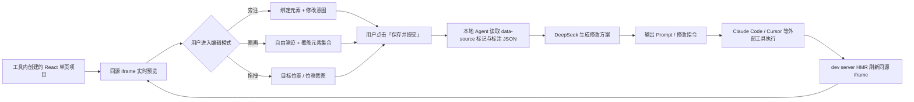

# vibe-app 项目简报

> 最后更新：2026-11-02（阶段一决策确认 + 阶段二原型启动）

## 1. 项目名称与目标

- **名称**：vibe-app
- **一句话定位**：面向 Vibe Coding 的可视化意图编辑器——在实时预览上圈画、旁注、拖拽，把空间操作转成结构化的代码修改指令。
- **核心痛点**：用 AI 写代码时，纯文字描述界面问题缺乏空间感，修改 UI 需要反复对话。
- **核心目标**：提供无限画布 + 可交互界面预览；用户像画图一样标注，系统调用 DeepSeek 生成精准修改指令，完成后刷新预览。

## 2. 已确认的产品决策（2026-11-02 第一轮问答）

| 编号 | 决策项 | 确认结果 |
|---|---|---|
| U | 首要用户 | A：独立开发者 / AI 编程用户 |
| P1 | 交付形态与代码位置 | B：独立 Web 应用 + 本地 agent，读写用户本地代码 |
| P2 | 预览加载方式 | A：系统自己启动 dev server，同源 iframe + 注入控制脚本 |
| P3 | 编辑交互模型 | 独立的修改/编辑模式；用户主动保存上传后才触发 Agent；拖拽仅采集意图，不直接改真实 DOM |
| P4 | 代码修改执行方 | B：系统生成修改指令 / Prompt，交给 Claude Code、Cursor 等外部工具执行 |
| P5 | MVP 代码范围 | A：工具内新建的 React 单页项目 |
| P6 | 源码绑定约束 | D：只支持自有创建的项目，可自由注入源码标记 |
| P7 | 刷新体验 | A：AI 完成后整体刷新，3–10 秒可接受 |

## 3. 目标用户与核心价值

### 3.1 首要用户

独立开发者 / AI 编程重度用户：使用 Claude Code、Cursor 等工具生成 React 页面，需要通过可视化方式指出界面偏差，而不是反复用文字描述“按钮往左一点、卡片间距大一些”。

### 3.2 核心价值

1. **空间意图结构化**：圈画、旁注、拖拽 → 明确的目标元素与修改意图，降低自然语言歧义。
2. **缩短反馈环**：从“描述 → 生成 → 肉眼比对 → 再描述”压缩为“指认 → 提交 → 修改 → 刷新”。
3. **真实预览**：预览是可交互的真实页面，不是静态设计稿。
4. **可追溯**：每条标注保留目标源码位置、意图文本与生成指令。

## 4. 端到端核心流程

> **边界说明**：按 P4-B，vibe-app 不直接写业务代码；它负责“空间意图 → 修改指令”。若后续改为本地 Agent 直接执行，需要将 P4 调整为 A，并补充代码编辑、校验与回滚机制。

## 5. MVP 范围

### 5.1 本期包含

- 工具内新建的 React 单页项目；构建期注入 `data-source` 等源码标记。
- 同源 iframe 预览，系统可注入脚本、读取 DOM、拦截交互。
- 独立编辑模式：交互 / 抓手 / 旁注 / 圈画 / 拖拽。
- 标注数据：目标元素、源码位置、意图文本、路径、位移。
- 点击「保存并提交」后由本地 Agent 分析，生成结构化 JSON 与给外部 AI 工具的 Prompt。
- AI 完成后整体刷新，目标 3–10 秒。
- 标注清单、单条删除、撤销、清空、示例数据。

### 5.2 本期不做

- 导入用户已有仓库、Vue、多页面/多路由、移动端预览。
- 拖拽时直接修改真实 DOM 布局。
- 多文件/整个仓库的自动修改（由外部 AI 工具承担）。
- 多用户、登录、协作、分享、计费。
- 手绘图片/截图理解、草图生成 UI。
- 数据库表结构与 API 设计（阶段三再定）。

## 6. 技术栈与基础设施

| 层 | 技术 | 状态 |
|---|---|---|
| 后端 | Python 3.14 + FastAPI + Uvicorn | 骨架已就绪 |
| ORM | SQLAlchemy 2.0（当前同步引擎） | 骨架已就绪 |
| 数据库 | MySQL 8.0（Docker，`127.0.0.1:3306/geo_ai_db`） | 已运行 |
| 缓存 | Redis 7.0（Docker，`127.0.0.1:6379`） | 已运行 |
| 对象存储 | MinIO（Docker，`127.0.0.1:9000`，控制台 9001） | 已运行 |
| 本地 Agent | 待设计（读写本地项目、调用 DeepSeek） | 未开始 |
| 预览目标 | React 单页项目（工具内创建） | 未开始 |
| 大模型 | DeepSeek API | 未接入 |
| 配置 | pydantic-settings + `.env` | 已就绪 |

> 中间件全部复用 `~/Workspace/infra` 中的常驻 Docker 实例，本项目不再自带 `docker-compose.yml`。

## 7. 预期核心模块（阶段三细化）

1. **本地 Agent / 项目运行时**：创建 React 项目、启动 dev server、读写文件、注入源码标记。
2. **画布与预览**：无限画布、缩放平移、同源 iframe、交互/编辑模式切换。
3. **标注与意图采集**：元素命中、旁注、自由圈画、拖拽位移、标注持久化。
4. **AI 编排**：标注 JSON → DeepSeek → 修改方案 / 指令。
5. **指令输出与刷新**：生成 Prompt / diff 指令，交给外部工具，完成后刷新预览。
6. **项目与会话管理**：项目、版本、标注历史（待设计）。
7. **文件服务**：MinIO 的用途与时机仍待确认。

## 8. 关键约束

- 预览必须同源可控，否则无法读取 DOM、绑定元素。
- 只支持自有创建的项目，构建期可注入源码标记（P6-D）。
- 编辑模式下不直接改真实 DOM；所有修改必须经过“保存提交 → Agent → 指令 → 执行 → 刷新”。
- 系统输出的是指令/Prompt，不是直接落盘的代码（P4-B）。
- 刷新发生在 AI 完成之后，3–10 秒可接受，不承诺 1 秒级实时。
- 阶段三之前不设计数据库表与 API 细节。

## 9. 待确认事项与风险

| 编号 | 待确认 | 影响 |
|---|---|---|
| R1 | **P3 与 P4 冲突**：本地 Agent 只生成指令，还是也执行代码修改？ | 决定是否要实现代码编辑、校验、回滚 |
| R2 | “上传”具体上传什么：仅标注 JSON，还是含画布截图？MinIO 存什么？ | 影响存储设计与 Agent 输入 |
| R3 | 修改范围：只改样式/文案/布局，还是也改交互逻辑与数据？ | 决定 AI Prompt 约束与验收方式 |
| R4 | 修改后的校验：构建、类型检查、lint、截图对比？失败如何回滚？ | 决定可用性与安全边界 |
| R5 | `data-source` 标记如何注入：构建插件、运行时包装还是脚手架模板？ | 阶段三核心技术方案 |
| R6 | 标注在页面刷新/元素消失后如何重定位或标记失效？ | 影响标注模型与用户体验 |
| R7 | DeepSeek 是否需要图片输入？手绘/截图理解是否在范围？ | 可能需要多模态模型 |
| R8 | 多项目、登录、权限、并发是否在后续版本？ | 影响数据模型与部署 |
| R9 | 撤销粒度：单条标注、单次提交，还是整个会话？ | 影响版本与历史设计 |

## 10. 当前进度

- [x] 阶段一：需求探索与第一轮决策确认（2026-11-02）
- [x] 阶段二：可交互原型 `docs/prototypes/stage-2-canvas.html`（2026-11-02）
- [ ] 阶段二后续：原型评审、交互细节修正
- [ ] 阶段三：架构 / 数据库 / API 设计（等待原型确认）
- [ ] 阶段四：编码实现

> 当前没有任何业务代码；`app/` 仍为初始骨架。

## 11. 约定

- 敏感信息只写入 `.env`，`.env.example` 保持占位符。
- 业务表必须通过 SQLAlchemy ORM 定义，禁止手拼原生 SQL。
- 文档统一放在 `docs/`，架构与流程使用 Mermaid。
- 每次完成独立任务后运行 `black .` 与 `pytest`，并提交 Git。
