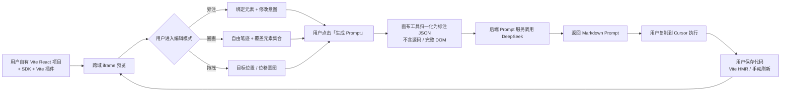

# vibe-app 项目简报

> 最后更新：2026-11-02（Q1–Q5 最终决策 + 阶段三设计启动）

## 1. 项目名称与目标

- **名称**：vibe-app
- **一句话定位**：面向 Vibe Coding 的**可视化交互辅助层**——在真实前端预览上圈画、旁注、拖拽，把空间操作转成极度精准的 Markdown Prompt，交给 Cursor 等外部 AI 执行。
- **核心痛点**：用 AI 写代码时，纯文字描述界面问题缺乏空间感，修改 UI 需要反复对话。
- **核心目标**：提供无限画布 + 用户真实前端预览；用户像画图一样标注；系统调用 DeepSeek 生成可直接复制到 Cursor 的修改指令。

**明确边界**：系统不修改代码，不生成 Diff，不编译，不回滚，不控制用户的 dev server，也不介入刷新。

## 2. 最终决策

### 2.1 2026-11-02 Q1–Q5 最终决策

| 编号 | 决策项 | 最终结论 |
|---|---|---|
| U | 首要用户 | 独立开发者 / AI 编程用户 |
| P3 | 编辑交互模型 | 独立编辑模式；用户主动保存提交后才触发 Prompt 生成；拖拽仅采集意图，不直接改真实 DOM |
| Q1 | Agent 边界 | 只读分析并生成指令；本地/后端服务绝对不修改用户代码；不涉及代码修改、回滚和编译 |
| Q2 | DeepSeek 输出契约 | 模型输出 Markdown 自然语言 Prompt；后端只把标注 JSON 作为 Context + 简单系统提示词发给模型；不生成 Diff、不做复杂模板 |
| Q3 | 预览方式 | 用户自己启动 Vite（如 5173）；画布工具作为独立 Web 应用，通过跨域 iframe 加载用户 URL；用户项目引入极简 SDK，通过 `postMessage` 传递 DOM 索引与坐标 |
| Q4 | 源码标记 | Vite 构建插件在开发环境给 React 组件注入 `data-source="src/components/Button.tsx:12"` |
| Q5 | 刷新方式 | 用户复制 Prompt 到 Cursor 执行；Cursor 改完代码后用户保存；Vite HMR 或手动刷新 iframe；系统完全不介入刷新逻辑 |

### 2.2 第一轮决策的覆盖关系

第一轮 P1–P7 中，以下条目已被 Q1–Q5 覆盖，仅作为历史记录保留：

| 原决策 | 原内容 | 当前状态 |
|---|---|---|
| P1 | 独立 Web 应用 + 本地 Agent，读写用户本地代码 | 覆盖为：独立 Web 应用 + 后端 Prompt 服务 + 用户项目 SDK；不读源码、不写代码 |
| P2 | 系统启动 dev server，同源 iframe | 覆盖为：用户自己启动 Vite；跨域 iframe + SDK |
| P4 | 生成指令 / Prompt，外部工具执行 | 保留，并明确：只输出 Markdown Prompt，不输出 Diff |
| P5 | 工具内新建的 React 单页项目 | 覆盖为：用户自有 Vite React 项目 |
| P6 | 只支持自有创建的项目，可自由注入源码标记 | 覆盖为：接入 Vite 插件 + SDK 的 React 项目；不再要求工具内创建 |
| P7 | AI 完成后整体刷新，3–10 秒 | 覆盖为：系统不控制刷新；HMR / 手动刷新由用户环境完成 |

## 3. 目标用户与核心价值

### 3.1 首要用户

独立开发者 / AI 编程重度用户：使用 Claude Code、Cursor 等工具生成 React 页面，需要通过可视化方式指出界面偏差，而不是反复用文字描述“按钮往左一点、卡片间距大一些”。

### 3.2 核心价值

1. **空间意图结构化**：圈画、旁注、拖拽 → 明确的目标元素、源码路径与修改意图。
2. **Prompt 更精准**：Prompt 直接引用 `文件:行号`，减少 Cursor 的定位成本。
3. **缩短反馈环**：从“描述 → 生成 → 肉眼比对 → 再描述”压缩为“指认 → 生成 Prompt → 粘贴执行”。
4. **边界清晰**：系统只做可视化辅助层，不承担代码修改、构建和回滚风险。
5. **可追溯**：每条标注保留目标源码位置、意图、空间数据与生成的 Prompt。

## 4. 端到端核心流程

> **边界说明**：系统不写代码、不生成 Diff、不控制 dev server、不触发刷新。HMR 后画布工具只被动接收新的 SDK 快照并重定位标注；找不到目标时标记失效。

## 5. MVP 范围

### 5.1 本期包含

- 用户自有 Vite React 项目接入：Vite 插件注入 `data-source`，页面引入极简 SDK。
- 跨域 iframe 预览 + `postMessage` 桥接；严格校验 origin、source、会话 token、协议版本。
- 独立编辑模式：交互 / 抓手 / 旁注 / 圈画 / 拖拽。
- 标注数据：目标元素、源码路径与行号、组件名、实例、意图、矩形 / 笔迹 / 位移。
- 点击「生成 Prompt」后，后端把标注 JSON + 简单系统提示词发给 DeepSeek，返回 Markdown Prompt。
- Prompt 展示、复制、下载；不执行、不生成 Diff。
- 标注清单、单条删除、撤销、清空、示例数据。
- HMR / 手动刷新后被动更新 SDK 快照，按 `source + instance` 重定位标注，失效标记。

### 5.2 本期不做

- 直接修改用户代码、生成 Diff / patch、编译、lint、测试、回滚。
- 启动 / 停止 / 重启用户 dev server；控制 iframe 刷新。
- 自动调用 Cursor 或判断 Prompt 是否执行成功。
- 工具内创建项目、仓库导入向导（当前只支持手动接入用户自有的 Vite 项目）。
- Vue、其他构建工具、多页面 / 多路由、移动端预览。
- 多用户、登录、协作、分享、计费。
- 截图 / 手绘图片理解（待确认）。
- 数据库表结构与详细 API 契约（后续设计）。

## 6. 技术栈与基础设施

| 层 | 技术 | 状态 |
|---|---|---|
| 后端 | Python 3.14 + FastAPI + Uvicorn | 骨架已就绪；将承载 Prompt 服务 |
| ORM / 数据库 | SQLAlchemy 2.0 + MySQL 8.0 | 已有骨架；MVP 不作为强依赖 |
| 缓存 | Redis | 已有 Docker；MVP 不依赖 |
| 对象存储 | MinIO | 已有 Docker；仅截图 / 资产功能需要 |
| 画布工具 | 独立 Web 应用（技术栈待定） | 阶段二原型已验证交互 |
| 用户项目 | Vite + React + SDK + Vite 插件 | 待实现 |
| 预览桥接 | 跨域 iframe + `postMessage` | 待实现 |
| 大模型 | DeepSeek API | 未接入 |
| 配置 | pydantic-settings + `.env` | 已就绪 |

> 中间件复用 `~/Workspace/infra` 中的常驻 Docker 实例；MVP 不要求启动 MySQL / Redis / MinIO。

## 7. 预期核心模块

详细职责与交互关系见 `docs/design/01.功能模块梳理.md`，整体架构见 `docs/design/02.整体架构设计.md`。

1. **接入层**：项目配置、Vite 插件与源码标记、预览连接、SDK 桥接与 DOM 索引。
2. **画布交互层**：无限画布、模式与手势、标注采集、标注管理。
3. **意图与源码层**：标注归一化、源码目标解析与失效标记。
4. **Prompt 服务层**：后端 DeepSeek 编排、Markdown Prompt 展示与复制。
5. **支撑层**：会话状态、错误反馈、安全、日志；截图 / 资产存储待确认。

## 8. 关键约束

- 用户项目必须能加载 SDK，并能通过 Vite 插件注入 `data-source`；否则无法精确指认。
- 跨域 iframe 不能直接读取 DOM，所有目标信息必须经 SDK `postMessage` 获取。
- 后端不接触源码；Prompt 精度依赖标注质量、文件 / 行号和模型理解。
- 系统输出 Markdown Prompt，不输出 Diff、补丁或完整代码。
- 系统不控制刷新；HMR / 手动刷新由用户完成，系统只被动更新快照。
- 系统不能声称“修改已应用”，只能显示“Prompt 已生成 / 已复制”。
- MVP 不依赖数据库；会话状态在浏览器内存，刷新页面即丢失（是否持久化待确认）。

## 9. 待确认事项与风险

| 编号 | 待确认 / 风险 | 影响 |
|---|---|---|
| R1 | **已解决**：Agent 只读生成指令，不修改代码 | — |
| R2 | “上传”是否只含标注 JSON，是否要截图 / 手绘图片？MinIO 是否进入 MVP？ | 影响存储与多模态输入 |
| R3 | 修改范围是否只限样式 / 文案 / 布局，还是也包括交互逻辑与数据？ | 影响 Prompt 约束与验收 |
| R4 | 跨域 iframe + 本地 HTTP 的混合内容限制；画布工具部署在 HTTPS 时如何加载 `http://localhost`？ | 影响部署形态 |
| R5 | Vite 插件只注入宿主元素，还是也注入自定义组件？组件不透传 `data-*` 时如何定位？ | 影响标注覆盖率与实现复杂度 |
| R6 | HMR 后行号漂移、元素消失、实例序号变化，如何重定位？ | 影响标注可靠性 |
| R7 | 是否需要截图 / 手绘图片输入？DeepSeek 是否需要多模态？ | 影响 M15 与成本 |
| R8 | 多项目、登录、权限、并发是否在后续版本？ | 影响数据模型与部署 |
| R9 | 撤销粒度：单条标注、单次提交，还是整个会话？ | 影响交互与历史设计 |
| R10 | 后端部署在本地还是云端？是否需要鉴权、限流、配额？ | 影响 CORS、安全与运维 |
| R11 | 无 SDK / 无 `data-source` 时是否允许提交？ | 影响 Prompt 可定位性 |
| R12 | 是否允许 Prompt 包含少量代码片段？ | 影响输出校验与 Cursor 体验 |

## 10. 当前进度

- [x] 阶段一：需求探索与第一轮决策确认（2026-11-02）
- [x] 阶段二：可交互原型 `docs/prototypes/stage-2-canvas.html`（2026-11-02）
- [x] 阶段三：Q1–Q5 最终决策确认（2026-11-02）
- [x] 阶段三：`docs/design/01.功能模块梳理.md` v2（2026-11-02）
- [x] 阶段三：`docs/design/02.整体架构设计.md`（2026-11-02）
- [ ] 阶段三：01 / 02 设计评审
- [ ] 阶段三后续：跨域消息契约、Prompt API、前端状态机等
- [ ] 阶段四：编码实现

> 当前没有任何业务代码；`app/` 仍为初始骨架。阶段二原型的同源 `srcdoc`、模拟执行与刷新仅用于交互验证，不代表最终架构。

## 11. 约定

- 敏感信息只写入 `.env`，`.env.example` 保持占位符。
- 业务表必须通过 SQLAlchemy ORM 定义，禁止手拼原生 SQL（若后续引入数据库）。
- 文档统一放在 `docs/`，架构与流程使用 Mermaid。
- 每次完成独立任务后运行 `black .` 与 `pytest`（仅涉及 Python 代码时），并提交 Git。
- 不自动 push；推送由负责人确认。
