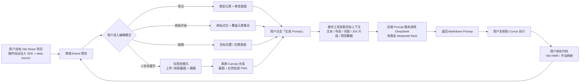

# vibe-app 项目简报

> 最后更新：2026-11-02（阶段四：L3 后端 + React 画布联调）

## 1. 项目名称与目标

- **名称**：vibe-app
- **一句话定位**：面向 Vibe Coding 的**可视化交互辅助层**——在真实前端预览上圈画、旁注、拖拽，把空间操作转成极度精准的 Markdown Prompt，交给 Cursor 等外部 AI 执行。
- **核心痛点**：用 AI 写代码时，纯文字描述界面问题缺乏空间感，修改 UI 需要反复对话。
- **核心目标**：提供无限画布 + 用户真实前端预览；用户像画图一样标注；系统调用 DeepSeek 生成可直接复制到 Cursor 的修改指令。

**明确边界**：系统不修改代码，不生成 Diff，不编译，不回滚，不控制用户的 dev server，也不介入刷新。

## 2. 最终决策

### 2.1 用户与交互模型

| 编号 | 决策项 | 最终结论 |
|---|---|---|
| U | 首要用户 | 独立开发者 / AI 编程用户 |
| P3 | 编辑交互模型 | 独立编辑模式；用户主动保存提交后才触发 Prompt 生成；拖拽仅采集意图，不直接改真实 DOM |

### 2.2 Q1–Q18 最终决策

| 编号 | 决策项 | 最终结论 |
|---|---|---|
| Q1 | Agent 边界 | 只读分析并生成指令；本地/后端服务绝对不修改用户代码；不涉及代码修改、回滚和编译 |
| Q2 | DeepSeek 输出契约 | 模型输出 Markdown 自然语言 Prompt；后端接收标注 JSON + 选中目标上下文（含精简 JSX 片段）+ 固定系统提示词；不生成 Diff，不做复杂业务模板 |
| Q3 | 预览方式 | 用户自己启动 Vite（如 5173）；画布工具作为独立 Web 应用，通过跨域 iframe 加载用户 URL；用户项目由插件自动注入 SDK，通过 `postMessage` 传递富 DOM 索引与坐标 |
| Q4 | 源码标记 | Vite 插件在开发环境给所有第一方 JSX 节点注入 `data-source="src/components/Button.tsx:12[:列]"`，并生成源码片段注册表 |
| Q5 | 刷新方式 | 用户复制 Prompt 到 Cursor 执行；Cursor 改完代码后用户保存；Vite HMR 或手动刷新 iframe；系统完全不介入刷新逻辑 |
| Q6 | 部署形态 | **纯本地化部署**：画布、Prompt 服务、用户 Vite 项目都在本机，只监听回环地址；不做云端 / 托管 |
| Q7 | SDK 分发 | 由 **Vite 插件自动注入 SDK**，用户不手写 `<script>` 标签 |
| Q8 | 注入范围 | **所有第一方 JSX 节点（含自定义组件）**注入 `data-source`；自定义组件用组件根宿主节点兜底 |
| Q9 | 无标记目标 | 源码模式**坚决拒绝**：只有检测到 `data-source` 才能标注、提交、生成 Prompt；不做模糊匹配或伪造。无 SDK 时自动降级为仅视觉模式，改为上传截图 + `visual-draw` |
| Q10 | 历史持久化 | MVP **不需要数据库**；最多用 `localStorage` 保存本地操作历史，无服务端历史、无同步 |
| Q11 | 视觉输入 | 支持手绘轨迹；**不做自动截屏**，用户通过工具栏“上传截图 / 粘贴截图”补充视觉信息，1 MB 上限 |
| Q12 | 框架支持 | MVP **只支持 Vite + React**，不支持 Vue 或其他构建工具 |
| Q13 | 公网与鉴权 | 纯本地模式不适用公网账号 / 鉴权；未来公网部署单独评审 |
| Q14 | 代码片段 | 源码标注的 Prompt **必须包含选中目标的精简 JSX 片段**；片段由插件注册表按需提供，后端硬校验。`visual-draw` 不适用 |
| Q15 | 快照范围 | 富索引：文本预览、标签、布局白名单、邻居标识、实例；**不是完整 DOM** |
| Q16 | 手绘点位 | 前端本地最多记录 **5000 个原始点**，不做平滑；提交后端前降采样到 **50–100 个关键点**，或只传包围盒；模型只收 bbox / 空间摘要 |
| Q17 | 截图触发 | 画布工具栏提供 **“上传截图”按钮**，支持上传或粘贴；仅手动上传，1 MB，不做自动截屏 |
| Q18 | 快照上限 | 过滤 `display:none` 后最多 **200 个 DOM 节点**，超过则截断并标记 |

### 2.3 第一轮决策的覆盖关系

第一轮 P1–P7 中，以下条目已被 Q1–Q18 覆盖，仅作为历史记录保留：

| 原决策 | 原内容 | 当前状态 |
|---|---|---|
| P1 | 独立 Web 应用 + 本地 Agent，读写用户本地代码 | 覆盖为：独立 Web 应用 + 后端 Prompt 服务 + 用户项目 SDK；不读源码、不写代码 |
| P2 | 系统启动 dev server，同源 iframe | 覆盖为：用户自己启动 Vite；跨域 iframe + SDK；纯本地部署 |
| P4 | 生成指令 / Prompt，外部工具执行 | 保留，并明确：只输出 Markdown Prompt，不输出 Diff |
| P5 | 工具内新建的 React 单页项目 | 覆盖为：用户自有 Vite React 项目 |
| P6 | 只支持自有创建的项目，可自由注入源码标记 | 覆盖为：接入 Vite 插件 + SDK 的 React 项目；插件自动注入 SDK 与 `data-source` |
| P7 | AI 完成后整体刷新，3–10 秒 | 覆盖为：系统不控制刷新；HMR / 手动刷新由用户环境完成 |

## 3. 目标用户与核心价值

### 3.1 首要用户

独立开发者 / AI 编程重度用户：使用 Claude Code、Cursor 等工具生成 React 页面，需要通过可视化方式指出界面偏差，而不是反复用文字描述“按钮往左一点、卡片间距大一些”。

### 3.2 核心价值

1. **空间意图结构化**：圈画、旁注、拖拽 → 明确的目标元素、源码路径与修改意图。
2. **Prompt 更精准**：Prompt 直接引用 `文件:行号`、目标文本 / 布局 / 邻居与精简 JSX 片段。
3. **缩短反馈环**：从“描述 → 生成 → 肉眼比对 → 再描述”压缩为“指认 → 生成 Prompt → 粘贴执行”。
4. **边界清晰**：系统只做可视化辅助层，不承担代码修改、构建和回滚风险。
5. **可追溯**：每条标注保留目标源码位置、意图、空间数据与生成的 Prompt。

## 4. 端到端核心流程

> **边界说明**：系统不写代码、不生成 Diff、不控制 dev server、不触发刷新。HMR 后画布工具只被动接收新的 SDK 快照并重定位标注；找不到目标时标记失效。

## 5. MVP 范围

### 5.1 本期包含

- 用户自有 Vite + React 项目接入：Vite 插件给所有第一方 JSX 注入 `data-source`，并自动注入 SDK。
- 跨域 iframe 预览 + `postMessage` 桥接；严格校验 origin、source、会话 token、协议版本。
- 富 DOM 快照：文本预览、标签、布局白名单、邻居、实例；过滤 `display:none` 后最多 200 个节点，超出截断并标记。
- 独立编辑模式：交互 / 抓手 / 旁注 / 圈画 / 拖拽。
- 标注数据：目标元素、源码路径 / 行号 / `sourceKind`、组件名、实例、意图、矩形 / 原始笔迹 / 位移。
- 源码模式无 `data-source` 或片段缺失时硬阻断；仅视觉模式无截图时硬阻断，均不生成 Prompt。
- 点击「生成 Prompt」后，后端把标注 JSON + 目标上下文 + JSX 片段 + 可选图片发给 DeepSeek，返回 Markdown Prompt。
- 3 秒内未完成 SDK 握手时自动降级为仅视觉模式：工具栏上传 / 粘贴截图，截图作为画布底图继续圈画；
  提交前用离屏 Canvas 合成「截图 + 红笔轨迹」PNG，顶层 `image_base64` 随标注提交。
- 携带图片时后端路由到 `deepseek-flash`，系统提示词要求结合红色轨迹和文字旁注生成修改指令；无 Key 返回 `MODEL_UNAVAILABLE`。
- 前端手绘保留原始点位（≤5000），不做平滑；提交前降采样到 50–100 关键点或 bbox；截图最长边 1600 px、合成后 ≤1 MB。
- Prompt 展示、复制、下载；不执行、不生成 Diff。
- 标注清单、单条删除、撤销、清空、示例数据；`localStorage` 本地历史。
- HMR / 手动刷新后被动更新 SDK 快照，按 `source + instance` 重定位标注，失效标记。

### 5.2 本期不做

- 直接修改用户代码、生成 Diff / patch、编译、lint、测试、回滚。
- 启动 / 停止 / 重启用户 dev server；控制 iframe 刷新。
- 自动调用 Cursor 或判断 Prompt 是否执行成功。
- 工具内创建项目、仓库导入向导（只支持手动接入用户自有的 Vite 项目）。
- Vue、其他构建工具、多页面 / 多路由、移动端预览。
- 多用户、登录、协作、分享、计费、云端部署。
- 自动截屏、跨域 iframe 像素读取、后台抓屏。
- 数据库持久化、服务端历史、MinIO / 对象存储落盘。
- 手绘轨迹的平滑 / 降噪 / 曲线拟合。
- 数据库表结构；L3 API 契约见 `03.API接口设计.md`，后端已实现。

## 6. 技术栈与基础设施

| 层 | 技术 | 状态 |
|---|---|---|
| 后端 | Python 3.14 + FastAPI + Uvicorn + Pydantic 2 | L3 Prompt API 已实现，Mock Provider 默认 |
| ORM / 数据库 | SQLAlchemy 2.0 + MySQL 8.0 | 已有骨架；MVP 不作为依赖 |
| 缓存 | Redis | 已有 Docker；MVP 不依赖 |
| 对象存储 | MinIO | 已有 Docker；MVP 不落盘图片 |
| 画布工具 | Vite 8 + React 19 + TypeScript + TailwindCSS 4 | `canvas-ui/` 已实现画布、标注、L3 联调 |
| 用户项目 | Vite + React + 自动注入 SDK + Vite 插件 | `vibe-plugin/` 已实现；`examples/vite-demo/` 可验证 |
| 预览桥接 | 跨域 iframe + `postMessage` | 已接真实 Vite 项目；动态 Origin + SDK 握手 |
| 大模型 | DeepSeek API | 可选接入；当前 Mock Markdown |
| 配置 | pydantic-settings + `.env` | 已就绪 |

> 中间件复用 `~/Workspace/infra` 中的常驻 Docker 实例；MVP 不要求启动 MySQL / Redis / MinIO。

## 7. 预期核心模块

详细职责与交互关系见 `docs/design/01.功能模块梳理.md`，整体架构见 `docs/design/02.整体架构设计.md`。

1. **接入层**：项目配置、Vite 插件（全 JSX 注入 + 自动注入 SDK + 片段注册表）、预览连接、SDK 桥接与富 DOM 索引。
2. **画布交互层**：无限画布、模式与手势、标注采集、标注管理、`localStorage` 历史。
3. **意图与源码层**：标注归一化、源码目标解析、片段校验、失效标记。
4. **Prompt 服务层**：后端 DeepSeek 编排、Markdown Prompt 展示与复制。
5. **支撑层**：会话状态、错误反馈、本地安全、脱敏日志、视觉标注与手动截图。

## 8. 关键约束

- 用户项目必须接入 Vite 插件；SDK 由插件自动注入，不提供手写 `<script>` 接入。
- 跨域 iframe 不能直接读取 DOM，所有目标信息必须经 SDK `postMessage` 获取。
- 所有第一方 JSX 都注入 `data-source`；第三方或动态 DOM 无 `data-source` 祖先时直接阻断，不伪造。
- 后端不接触源码文件；只接收选中目标的精简 JSX 片段、文本预览、布局、邻居与视觉数据。
- 富快照只留在浏览器内存；最多 200 个节点，超出截断并标记。
- 系统输出 Markdown Prompt，不输出 Diff、补丁或完整文件重写。
- 系统不控制刷新；HMR / 手动刷新由用户完成，系统只被动更新快照。
- 系统不能声称“修改已应用”，只能显示“Prompt 已生成 / 已复制”。
- 手绘在前端保留原始点位（≤5000），提交前降采样到 50–100 关键点或 bbox；不做平滑。
- 截图只允许用户手动上传 / 粘贴，不自动截屏；多模态不是硬依赖。
- MVP 只支持 Vite + React，纯本地部署。
- MVP 不依赖数据库；历史只写 `localStorage`，可被用户清空。

## 9. 风险与待确认事项

### 9.1 主要风险

| 编号 | 风险 | 影响 |
|---|---|---|
| R1 | 自定义组件吞掉未知 props，`data-source` 不落到 DOM | 该节点不可定位，或只能定位到组件根；无锚点则阻断 |
| R2 | 本地 HTTP 与未来 HTTPS 部署的混合内容限制 | 当前纯本地回环部署已规避，未来公网需重新评审 |
| R3 | SDK 快照与真实 DOM 不同步 | 标注矩形偏移、命中错误；需快照版本与查询兜底 |
| R4 | 后端看不到源码，Prompt 可能泛泛而谈 | 依赖 JSX 片段与上下文；要求 Cursor 先读文件 |
| R5 | 标注文本 / JSX 提示注入 | 模型输出被污染；需数据与指令分隔、输出形态校验 |
| R6 | 没有“已应用”反馈 | 产品只能承诺“生成 / 复制” |
| R7 | SDK / 插件 / 画布协议版本漂移 | 连接失败或字段不兼容 |
| R8 | HMR 后行号漂移 | Prompt 指向旧行；只能标记风险 |
| R9 | 200 节点截断 | 大型页面目标可能不在快照内 |
| R10 | 片段注册表缺失或过期 | 无法满足 Q14；`SNIPPET_REQUIRED` 阻断 |
| R11 | 原始轨迹点位过多 | 请求体过大、渲染卡顿；前端限 5000，提交前降采样到 ≤100 或 bbox |
| R12 | 用户上传图片过大或含敏感信息 | 请求失败或隐私风险；需大小限制与明示 |

### 9.2 仍需在 API 设计中定稿的工程细节

| 编号 | 事项 | 影响 |
|---|---|---|
| A1 | 手绘本地 5000 点、提交 ≤100 关键点或 bbox、请求体 8 MB | 已定稿；影响请求模型与错误码 |
| A2 | JSX 片段 40 行 / 4 KB 的截断字段与标记 | 影响片段契约 |
| A3 | 快照截断后目标补查协议 | 影响命中 / 片段接口 |
| A4 | 图片压缩参数与 DeepSeek 多模态支持 | 影响视觉输入契约 |
| A5 | `localStorage` 历史结构与上限 | 影响前端状态与隐私 |

## 10. 当前进度

- [x] 阶段一：需求探索与第一轮决策确认（2026-11-02）
- [x] 阶段二：可交互原型 `docs/prototypes/stage-2-canvas.html`（2026-11-02）
- [x] 阶段三：Q1–Q18 最终决策确认（2026-11-02）
- [x] 阶段三：`docs/design/01.功能模块梳理.md` v3（2026-11-02）
- [x] 阶段三：`docs/design/02.整体架构设计.md` v2.2（2026-11-02）
- [x] 阶段三：`docs/design/03.API接口设计.md` v1（2026-11-02）
- [x] 阶段三：01 / 02 / 03 设计评审与接口决策（2026-11-02）
- [x] 阶段四：L3 Prompt 后端服务、硬校验、Mock / DeepSeek Provider、pytest（2026-11-02）
- [x] 阶段四：React 画布 `canvas-ui/`、无限画布、旁注 / 圈画 / 拖拽（2026-11-02）
- [x] 阶段四：前端 → `/api/v1/prompts/generate` 联调、Markdown 渲染、复制（2026-11-02）
- [x] 阶段五：真实 Vite 插件、`data-source` 注入、SDK 协议接入（2026-11-02）
- [x] 阶段五：滚轮反向/中键平移/工作区锁定/可折叠工作台/真实项目加载（2026-11-02）
- [x] 阶段六：3 秒源码模式自动探测、仅视觉降级、视觉圈画与生成硬拦截（2026-11-02）
- [x] 阶段七：仅视觉模式截图上传 / 粘贴、Canvas 红笔合成、`image_base64` 多模态路由（2026-11-02）
- [x] 阶段四：真实 DeepSeek 多模态联调（`deepseek-flash` 识别红圈搜索框，2026-11-02）
- [ ] 阶段四：更多页面类型的 Prompt 质量评估
- [ ] 阶段四：`localStorage` 历史、失效标注重定位

> 当前业务代码包含 `app/`（FastAPI L3）、`canvas-ui/`（React 画布）、`vibe-plugin/`（Vite 插件 + SDK）与 `examples/vite-demo/`（验证项目）。画布加载项目后 3 秒内探测 SDK：成功为源码模式，失败自动降级为仅视觉模式；源码模式支持旁注/圈画/拖拽与 L3 联调；仅视觉模式需上传 / 粘贴截图，前端把截图与红色手绘轨迹合成 PNG 后以 `image_base64` 提交，后端切换到 `deepseek-flash`。交互模式下的 iframe 内输入事件仍由用户页面接管，这是浏览器跨域 iframe 的固有限制。

## 11. 约定

- 敏感信息只写入 `.env`，`.env.example` 保持占位符。
- 业务表必须通过 SQLAlchemy ORM 定义，禁止手拼原生 SQL（若后续引入数据库）。
- 文档统一放在 `docs/`，架构与流程使用 Mermaid。
- 每次完成独立任务后运行 `black .` 与 `pytest`（仅涉及 Python 代码时），并提交 Git。
- 不自动 push；推送由负责人确认。
